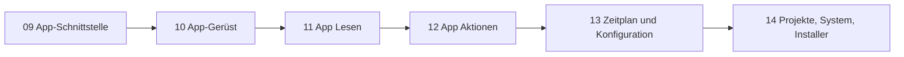

# IPA Assistant Desktop-App – Spezifikation (Version 1)

Stand: 25. November 2026 · App-Spezifikationsversion 1.0 · Grundlage: `docs/app/design-brief.md`, das Design (Claude-Design-Artefakt `https://claude.ai/artifact/QvG2hZpxCHjPtFLEqevgCq`, Version `1795614797-b2b5`, 72 Artboards in Hell und 72 in Dunkel) und die CLI-Verträge aus `docs/implementation/spec.md` (Pakete 01 bis 09)

Diese Datei ist für die Pakete 10 bis 14 unter `docs/implementation/packages/` verbindlich. Die Paketspezifikationen verweisen auf ihre Abschnitte (Schreibweise `app/spec.md §8.3`) und pflegen keine eigenen Kopien. Die Verträge des CLI (Befehle, Exit-Codes, Dateiformate, `--json`) stehen weiterhin nur in `docs/implementation/spec.md`; diese Datei verweist darauf (`spec.md §…`) und wiederholt sie nicht, ausser wo die App sie in Anzeige übersetzt. Wo das Design oder der Design-Brief dem Code widerspricht, gilt der Code, und der Widerspruch steht in §13.

Schlüsselwörter: **MUSS** und **DARF NICHT** sind verbindlich. **SOLL** ist eine starke Empfehlung, von der nur mit Begründung abgewichen wird.

Alle Texte der App sind Deutsch in Schweizer Rechtschreibung (`ss`, kein `ß`). Kommentare im Code sind Englisch und stehen nur dort, wo sie nötig sind.

---

## 1. Ziel und Abgrenzung

### 1.1 Ziel

Die App ist die grafische Oberfläche für das bestehende CLI `ipa` unter Windows 11. Sie ersetzt die Konsole für den Alltag und zeigt zusätzlich, was gesammelt wurde:

1. **Lesen:** Was an einem Tag passiert ist (Snapshots, Work-Logs, Notizen, Journal-Entwürfe, Läufe, Lücken), schnell und ohne Konsole.
2. **Auslösen:** Jede Aktion des CLI (erfassen, Journal erzeugen, Analyse erneut versuchen oder überspringen, Ausgangspunkt setzen, prüfen, Zeitplan verwalten, Konfiguration ändern, Projekt einrichten) per Oberfläche.
3. **Erfassen:** Notizen in unter einer Minute.

Das CLI bleibt der Motor. Die App enthält keine Fachlogik der Erfassung, der Analyse oder der Zeitplanung, ausser der **Anzeigelogik**, die aus gelesenen Dateien Ansichten ableitet (§5).

### 1.2 Prinzipien

Sie übernehmen Design-Brief §2 und das Prinzip „sicher und sparsam“ des CLI:

1. **Lesen vor Schreiben.** Die Tagesansicht ist der Kern, Aktionen sind Beiwerk.
2. **Die App schreibt nie selbst in einen Arbeitsbereich.** Jede Änderung geht durch einen Befehl des CLI (AD-05). Notizen entstehen mit `ipa note --json`, die Konfiguration mit `ipa config set`, der Zeitplan mit `ipa schedule …`. Die App öffnet Dateien nur lesend und gibt sie dem Betriebssystem zum Öffnen (`shell.openPath`).
3. **Fakten und KI trennen.** Alles, was Claude formuliert hat, trägt das Etikett `KI-Entwurf`; Inhalte ohne KI `ohne KI`; vom Tool berechnete Werte `vom Tool`; eigene Notizen `Notiz` (§11.4). Ein leerer Abschnitt heisst „nicht erfasst“, nie „nichts passiert“ (I-13).
4. **Sicher und sparsam als Standard.** Nichts startet Claude von selbst (§12.1). Jeder Button, der Claude aufrufen kann, trägt die KI-Markierung (§12.2). Es gibt keine globalen Standardwerte (§12.4).
5. **Keine Gesamtsumme der Arbeitszeit.** Gemessene und geschätzte Zeit, Verzögerung und Planung stehen getrennt und werden nie addiert (I-07, §15 der CLI-Spezifikation).
6. **Fehler erklären, nicht anzeigen.** Jeder Exit-Code und jeder Status wird in Klartext mit dem nächsten Schritt angezeigt (§9).
7. **Nüchtern und ruhig.** Wenig auf einmal, wenige Rahmen, Farbe heisst Aufmerksamkeit (§10, Design-Brief §3).

### 1.3 Im Umfang

Die elf Screens des Design-Briefs (§6.1 bis §6.11) mit allen Zuständen aus dem Design in Hell und Dunkel:

| Nr. | Screen (Brief) | Abschnitt hier | Paket |
| --- | --- | --- | --- |
| 1 | Tagesansicht (6.1) | §8.3 | 11 |
| 2 | Notiz-Dialog (6.2) | §8.8 | 12 |
| 3 | Journal (6.3) | §8.5 | 11 (Lesen), 12 (Erzeugen) |
| 4 | Work-Logs (6.4) | §8.4 | 11 (Lesen), 12 (Aktionen) |
| 5 | Projektübersicht (6.5) | §8.2 | 11 |
| 6 | Läufe starten und Laufanzeige (6.6) | §8.7 | 12 |
| 7 | Dialoge: Ausgangspunkt, Überspringen, Erneut versuchen (6.7) | §8.9 | 12 |
| 8 | Projekt hinzufügen (6.8) | §8.12 | 14 |
| 9 | Zeitplan (6.9) | §8.10 | 13 |
| 10 | Konfiguration (6.10) | §8.11 | 13 |
| 11 | System (6.11) | §8.13 | 14 |

Dazu: Gerüst, Seitenleiste, Kopfzeile, Navigation (§8.1), die Notizenliste (Tab im Tag, §8.6) und der Installer (§6.4).

### 1.4 Nicht im Umfang

Siehe §14 (Nicht-Ziele für V1). Die App ändert das CLI nicht. Wo ein CLI-Wunsch bleibt, steht er in §4.4 und in §18.

### 1.5 Verhältnis zur bestehenden Planung

- `docs/implementation/README.md` bezeichnete die App bisher als „nicht Teil der Planung“. Mit dieser Datei und den Paketen 10 bis 14 ist sie Teil der Planung, aber **nicht Teil der Abnahme von Version 1 des CLI** (Konzept §17).
- Die Invarianten I-01 bis I-15 des CLI gelten unverändert. Die App verletzt sie nicht und ergänzt eigene Regeln (§12).
- Die Pakete 10 bis 14 hängen von Paket 09 ab. Offen aus Paket 09 bleibt für den Benutzer die manuelle Prüfung der echten Aufgabenplanung (AK-09-17, zusammen mit AK-08-07). Die App darf auf `ipa schedule` aufbauen, die Zeitplan-Seite gilt aber erst als abgenommen, wenn AK-09-17 erledigt ist (AK-10-80).

---

## 2. Entscheidungen

| ID | Entscheidung | Begründung |
| --- | --- | --- |
| AD-01 | **Electron mit TypeScript (strikt) und React.** Bestätigt, nicht korrigiert. | Das Design ist eine Windows-Desktop-Oberfläche mit vielen zustandsreichen Komponenten (Dialoge, Tabs, Formulare, Markdown). Electron liefert Chromium für das gerenderte Markdown und die Barrierefreiheit, `shell.openPath` zum Öffnen von Dateien und `nativeTheme` für Hell und Dunkel. Tauri wäre kleiner, brächte aber eine zweite Toolchain (Rust) und hätte trotzdem eine Node-Laufzeit für das CLI zu liefern, das Node 24 verlangt. React hat die breiteste Testunterstützung für Komponenten. |
| AD-02 | **Getrennte Pakete, keine npm-Workspaces.** Das CLI bleibt im Wurzelordner, die App liegt in `app/` mit eigenem `package.json` und eigenem `package-lock.json` (§6). | `npm ci` und `npm install --global .` im Wurzelordner müssen ohne Electron (einige hundert MB) und ohne Änderung der Abhängigkeitsauflösung des CLI laufen. Das CLI nutzt TypeScript 7, die Werkzeugkette der App kann eine andere Version brauchen. Workspaces würden beides koppeln. |
| AD-03 | **Der Main-Prozess startet das CLI, der Renderer nie.** Der Renderer läuft in einer Sandbox ohne Node und spricht nur über eine schmale Preload-Schnittstelle (§3.2, §3.9). | Electron-Sicherheitsempfehlungen 2, 3, 4, 13, 14, 17 und 20 (Quelle in §3.2). Der Renderer zeigt Inhalte aus Code, Notizen und KI-Antworten an und gilt als nicht vertrauenswürdig. |
| AD-04 | **Die App liefert eine eigene `node.exe` (Node 24 LTS) mit und startet das CLI damit, nicht mit Electron als Node (`ELECTRON_RUN_AS_NODE`).** | Siehe §3.3. Kurz: `ipa schedule install` schreibt `process.execPath` in die Windows-Aufgabe (`src/cli/commands/schedule-task.ts`). Mit Electron als Node würde die Aufgabe die App-Exe ohne `ELECTRON_RUN_AS_NODE` starten, also die Oberfläche statt `capture`. |
| AD-05 | **Aktionen immer über `ipa … --json`; Lesen direkt aus den Dateien des Arbeitsbereichs; Zustand der Projekte über `ipa status --json`.** | Hülle und Schemas sind stabile Verträge (`spec.md §6.6`, `§6.7`). Ein einziger Schreiber (das CLI) erzwingt Validierung, Lock, Secret-Prüfung und IDs. Lesen ist schnell und braucht keine Prozesse. |
| AD-06 | **Fortschritt eines Laufs wird aus Dateiereignissen im Arbeitsbereich abgeleitet.** | Das CLI gibt sein Ergebnis erst am Ende aus (`print()` nach dem Lauf, `src/cli/action.ts`) und meldet während des Laufs höchstens vereinzelte Warnungen auf stderr (`onWarning`, `src/cli/commands/capture.ts`); es gibt keine Fortschrittsmeldungen. Die Live-Ausgabe des Designs ist deshalb nur aus Dateien möglich (§3.5). |
| AD-07 | **Zwei reine Funktionen des gebauten CLI werden im Main-Prozess wiederverwendet:** `createPathFilter` (Pfad testen) und `createSecretScanner` (Vorprüfung von Gründen und Notiztexten), über genau eine Adapterdatei (§3.8). | Eine Kopie der Regeln in der App würde auseinanderlaufen. Das CLI liefert beides sonst nur als Seiteneffekt eines Befehls. Alternative und Kosten siehe AO-05. |
| AD-08 | **Die App speichert nur Anzeigezustand** (Fensterposition, zuletzt gewähltes Projekt und Bereich) unter `%APPDATA%\IPA Assistant\app-state.json`. Die Projektliste ist `registry.json` des CLI. | Keine globalen Standardwerte (Design-Brief §2, Prinzip 3); eine Quelle für Projekte. |
| AD-09 | **Die Live-Vorschau des Zeitplans nutzt `ipa config set schedule=… --dry-run --json`.** Die App rechnet den Läufeplan nicht selbst. | `planSchedule` ist die einzige Quelle (AK-09-11). `--dry-run` liefert `schedulePlan` und Befunde, ohne zu schreiben. Eine Verzögerung von einem Prozessstart wird mit Entprellung (300 ms) hingenommen. |
| AD-10 | **Markdown mit `react-markdown` und `remark-gfm`, ohne `rehype-raw`.** | Rendert in React-Elemente, nie in `innerHTML`. Rohes HTML im Inhalt wird nicht ausgeführt und nicht angezeigt (Design-Brief §9). |
| AD-11 | **Alle Tagesangaben der App gelten in der Zeitzone des Projekts** (`config.json › timezone`), nie in der Systemzeitzone. | `spec.md §8.3`. Die Notiz-Standardtag („heute“) und der Kalender folgen dem Projekt. |
| AD-12 | **Keine Windows-Benachrichtigungen, kein Tray-Symbol in V1.** Halt und Fehler zeigen Banner beim Öffnen, Warnpunkte in der Seitenleiste und am Kalendertag. | Design-Brief §7 und §11. |
| AD-13 | **Electron-Version: die jeweils neueste stabile Hauptversion zum Start von Paket 10, mindestens 44.** Stand 25.11.2026: Electron 45 (45.5.0, Node 24.22.3, Chromium 156). Die Version wird exakt festgelegt (kein `^`). | Das Electron-Team unterstützt die neuesten drei stabilen Hauptversionen, mit acht Wochen Abstand (Quelle in §3.1). Electron 40 und neuer bringen Node 24 mit. |
| AD-14 | **Kein Auto-Update in V1.** Aktualisiert wird durch einen neuen Installer. | Ohne Code-Signierung (AO-01) ist ein Auto-Update nicht sinnvoll absicherbar. |
| AD-15 | **Eingebaute Zustandsgalerie** (`app/src/renderer/gallery/`, nur in Entwicklungs- und Testbuilds) zeigt jede Komponente in jedem Zustand des Designs in beiden Themes. | Grundlage für Komponententests, Kontrastprüfung und die manuelle Sichtprüfung gegen die Artboards (AK-10-12, AK-10-80). |

---

## 3. Technik und Architektur

### 3.1 Technologie und Versionen

| Bereich | Wahl | Beleg |
| --- | --- | --- |
| Laufzeit der App | Electron 45 (Stand 25.11.2026: 45.5.0, Node 24.22.3, Chromium 156.0.8078.109) | `https://releases.electronjs.org/releases.json`, abgerufen am 25.11.2026: Hauptversionen 43, 44 und 45 sind die neuesten drei; alle bringen Node 24.x mit (40.0.0: 24.11.1 bis 45.5.0: 24.22.3). |
| Support-Regel | Neueste drei stabile Hauptversionen, acht Wochen Abstand | `https://www.electronjs.org/docs/latest/tutorial/electron-timelines`, abgerufen am 25.11.2026 („The latest three stable major versions are supported“, „cadence … 8 weeks“). Electron 46 ist nach diesem Takt Mitte Dezember 2026 zu erwarten, danach fällt 43 aus dem Support. |
| Sprache | TypeScript strikt, ESM, eigener `tsconfig` je Prozess (Main/Preload mit `node`-Typen, Renderer mit DOM) | Wie D-01 des CLI. Die TypeScript-Version der App ist eigenständig (AO-04). |
| Oberfläche | React 19, eigener kleiner Store (`useSyncExternalStore`), kein Router (vier Bereiche per Zustand), keine UI-Bibliothek | Das Design hat ein eigenes, kleines Bausatzsystem (§10). Weniger Abhängigkeiten, weniger Angriffsfläche. |
| Bau | `electron-vite` (Vite) für Main, Preload und Renderer | Eine Konfiguration für drei Ziele. Alternativen sind in Paket 10 nur bei einem Kompatibilitätsproblem mit TypeScript 7 erlaubt (AO-04). |
| Markdown | `react-markdown`, `remark-gfm`, eigenes Remark-Plugin für Referenz-Chips | AD-10 |
| Validierung | `ajv` (draft-07, `strict`, `allErrors`, `allowUnionTypes`) mit den Schemas des CLI (§4.2) | Wie `spec.md §8.4`. |
| Tests | `vitest` (Main, Reader, Komponenten mit `@testing-library/react`), `playwright` (`_electron`) für Ende-zu-Ende | Wie das CLI (Vitest). Playwright startet die echte App. |
| Installer | `electron-builder` (Stand 25.11.2026: 26.18.0) mit NSIS | npm-Registry, abgerufen am 25.11.2026. Die Konfigurationsschlüssel (`extraResources`, `nsis`) sind in Paket 10 gegen die Dokumentation der gewählten Version zu prüfen; die Seiten `electron.build/configuration/*` waren bei der Recherche für diese Spezifikation nicht abrufbar (AO-07). |
| Dateibeobachtung | `fs.watch` (rekursiv, unter Windows nativ) mit Entprellung und Abgleich durch Abfrage alle 10 Sekunden | Keine zusätzliche Abhängigkeit; die Abfrage fängt verlorene Ereignisse ab (AK-10-34). |

Neue Abhängigkeiten ausser den genannten brauchen eine Begründung in `app/README.md`.

### 3.2 Prozessmodell und Sicherheitseinstellungen

```text
┌────────────────────────── Main-Prozess (Node, Electron) ──────────────────────────┐
│ cli/        Laufzeit auflösen, Befehle starten, Ergebnisse validieren              │
│ run/        Sperren, Warteschlange, Abbruch, Fortschritt aus Dateiereignissen       │
│ reader/     Dateien des Arbeitsbereichs lesen, validieren, in Ansichten umrechnen   │
│ watch/      Dateibeobachtung, Entprellung                                           │
│ cli-lib.ts  einziger Zugang zu createPathFilter und createSecretScanner (AD-07)     │
│ shell.ts    Dateien und Ordner öffnen (Allowlist), Zwischenablage                   │
│ ipc/        Kanäle gemäss §3.9, Prüfung von Absender und Eingaben                   │
└───────────────────────────────────▲─────────────────────────────────────────────────┘
                                     │ contextBridge (typisierte, schmale API)
┌───────────────────────────────────┴───────────── Preload ──────────────────────────┐
│ window.ipa: nur die Methoden aus §3.9, keine rohen ipcRenderer-Funktionen            │
└───────────────────────────────────▲─────────────────────────────────────────────────┘
┌───────────────────────────────────┴──────── Renderer (Chromium, Sandbox) ──────────┐
│ React, Zustand der Oberfläche, Markdown, Dialoge. Kein Node, kein Dateizugriff.      │
└────────────────────────────────────────────────────────────────────────────────────┘
```

Einstellungen des Hauptfensters (Test AK-10-03):

- `contextIsolation: true`, `sandbox: true`, `nodeIntegration: false`, `webSecurity: true`, `allowRunningInsecureContent: false`, keine experimentellen Funktionen.
- Der Renderer wird aus dem Paket geladen (eigenes Protokoll `app://`, nicht `file://`). Es wird nie fremder Inhalt geladen.
- Content-Security-Policy per Antwortkopf des eigenen Protokolls: `default-src 'none'; script-src 'self'; style-src 'self'; img-src 'self' data:; font-src 'self'; connect-src 'none'; base-uri 'none'; form-action 'none'; frame-ancestors 'none'`.
- Navigation und neue Fenster werden verweigert (`will-navigate`, `setWindowOpenHandler` liefern `deny`). Externe Links aus Markdown öffnen nur nach Bestätigung (§11.1).
- Berechtigungsanfragen (Kamera, Mikrofon, Benachrichtigungen usw.) werden in allen Sitzungen abgelehnt.
- Jede IPC-Nachricht prüft `event.senderFrame` (nur das Hauptfenster, nur das eigene Protokoll) und validiert die Eingabe gegen ein Schema.
- Electron-Fuses: `RunAsNode` aus, `EnableNodeCliInspectArguments` aus, `EnableNodeOptionsEnvironmentVariable` aus, `OnlyLoadAppFromAsar` ein.
- Nur eine Instanz (`app.requestSingleInstanceLock`). Ein zweiter Start bringt das vorhandene Fenster nach vorn.

Quelle: Electron-Sicherheitsempfehlungen (`https://www.electronjs.org/docs/latest/tutorial/security`, abgerufen am 25.11.2026), Punkte 2, 3, 4, 5, 7, 13, 14, 15, 17, 18, 19 und 20. Dass `ELECTRON_RUN_AS_NODE` bei abgeschaltetem Fuse `runAsNode` ignoriert wird, steht in `https://www.electronjs.org/docs/latest/api/environment-variables`; das ist ein weiterer Grund für AD-04.

### 3.3 Laufzeit des CLI und das Risiko der Node-Version

**Befund:**

1. Das CLI verlangt `node >=24` (`package.json › engines`) und wurde mit Node.js 24.19.0 geprüft (Paketcheckliste 09).
2. Electron bringt ab Version 40 Node 24 mit (Tabelle §3.1). Die Anforderung an die Version wäre also mit Electron als Node erfüllbar.
3. `ipa schedule install` trägt `process.execPath` des laufenden CLI als Programm der Windows-Aufgabe ein (`src/cli/commands/schedule-task.ts`, Zeile 89: `options.nodePath ?? process.execPath`) und `<TOOL_ROOT>/dist/cli.js` als erstes Argument (`CLI_ENTRY`). Die Aufgabe läuft ohne die App und ohne zusätzliche Umgebungsvariablen (`schtasks` kennt in der Vorlage keine, `src/schedule/templates.ts`).

**Folgerung:** Würde die App das CLI mit `ELECTRON_RUN_AS_NODE=1` und der App-Exe starten, stünde die App-Exe als Programm in der Aufgabe. Die Aufgabe würde ohne diese Variable die Oberfläche öffnen statt `capture --scheduled`. Das CLI bietet keine Option, den Node-Pfad zu überschreiben (nur die interne Abhängigkeit `deps`, `src/cli/deps.ts`). Ein zweiter Grund: Mit dem empfohlenen Abschalten des Fuses `RunAsNode` (§3.2) ginge `ELECTRON_RUN_AS_NODE` nicht mehr.

**Entscheidung (AD-04):**

- Der Installer liefert die offizielle `node.exe` (Windows x64) von Node 24 unter `resources/node/node.exe` mit. Die Version ist in `app/node-runtime.json` festgelegt: `{ "version": "24.22.3", "sha256": "e612af99f626ab415ea225af6bce5c971feb448cb5cae250bb1c3fa50c5f7d9f" }` (Prüfsumme von `node-v24.22.3-win-x64.zip` aus `https://nodejs.org/dist/latest-v24.x/SHASUMS256.txt`, abgerufen am 25.11.2026; v24.22.3 vom 10.11.2026, LTS „Krypton“). Das Bauskript lädt die Datei, prüft die Prüfsumme und bricht bei Abweichung ab.
- Die App startet das CLI immer als `resources/node/node.exe resources/cli/dist/cli.js …`. Damit zeigt eine von der App eingerichtete Aufgabe auf diese beiden Pfade, die von der App unabhängig lauffähig sind.
- Die Version von `node.exe` gleicht der Node-Version in Electron, muss es aber nicht. Massgebend ist, dass die Test-Suite des CLI mit **genau dieser** `node.exe` grün ist (AK-10-76).
- Im Entwicklungsbetrieb nutzt die App das `node` aus dem PATH (Version ≥ 24 geprüft) und das gebaute `dist/cli.js` im Wurzelordner. Eine dabei eingerichtete Aufgabe zeigt auf den Entwicklungsbaum; die App warnt im Entwicklungsbetrieb vor `schedule install` (AK-10-05).

**Nicht gewählt:**

| Alternative | Grund |
| --- | --- |
| `ELECTRON_RUN_AS_NODE` mit der App-Exe | Aufgabe startet die Oberfläche (siehe oben); Fuse `RunAsNode` müsste an bleiben. |
| `utilityProcess.fork` | Gleicher Node-Pfad wie Electron; `process.execPath` bliebe die App-Exe. |
| Node des Benutzers (PATH) | Keine Garantie für Version 24, abweichend zwischen Rechnern. |
| CLI mit einem Bündelwerkzeug zu einer einzigen Exe verpacken | Ändert das CLI, bricht `TOOL_ROOT`-basierte Pfade für Schemas und Prompts. |
| CLI-Option `--node-path` | Wäre sauber, ändert aber das CLI; als Wunsch in §4.4 (W-03) vermerkt. |

**Offen** (siehe §18): Zuwachs der Installergrösse durch `node.exe` ist in Paket 14 zu messen (AO-02); Wartung der gepinnten Node-Version (AO-03).

### 3.4 Aufruf des CLI

Der Main-Prozess ist der einzige Starter. Jeder Aufruf:

- `spawn(nodeExe, [cliJs, …globaleOptionen, befehl, …argumente], { shell: false, windowsHide: true, cwd: <Ordner ausserhalb jedes Repositorys>, env })`. Kein Argument wird zu einem Shell-Text zusammengesetzt (I-01 des CLI bleibt gewahrt, kein Repository als `cwd`). `cwd` ist `app.getPath('userData')`.
- Globale Optionen: immer `--repo <repoPath aus registry.json>`. `--data-dir` wird in V1 nie gesetzt: Die App und die Konsole verwenden dieselbe Datenwurzel nach `spec.md §5.2` (Umgebungsvariable `IPA_ASSISTANT_HOME`, sonst `%LOCALAPPDATA%\ipa-assistant`). Nur Tests setzen `IPA_ASSISTANT_HOME`.
- Aktionsbefehle (`init`, `capture`, `journal`, `note`, `skip`, `baseline`, `doctor`, `config`, `schedule install|status|pause|resume|remove|run`) immer mit `--json`. `status` mit `--json` (ohne Hülle, `spec.md §6.6`).
- Umgebung: die der App, unverändert. Die App setzt und entfernt keine Variablen für Claude (Kostenschutz, `spec.md §13.1`). Sie setzt `NODE_OPTIONS` nicht.
- Kodierung: stdout und stderr als UTF-8. Pfade mit Leerzeichen und Umlauten sind Pflicht-Testfälle.
- **Ergebnis:** stdout wird vollständig gesammelt, als JSON gelesen und gegen `schemas/cli-<befehl>.schema.json` validiert (Hülle und Ergebnis). stderr wird gesammelt und als „Ausgabe des Befehls“ im Ergebnis angezeigt. Der Exit-Code kommt vom Prozess und wird mit `exitCode` der Hülle abgeglichen.
- **Fehlerklassen der App** (nicht Exit-Codes des CLI):

| Code der App | Auslöser | Anzeige |
| --- | --- | --- |
| `runtime_missing` | `node.exe` oder `cli.js` fehlt, oder `node --version` < 24 | Fehlerbanner „Die mitgelieferte CLI-Laufzeit fehlt oder ist beschädigt. Installiere die App neu.“ |
| `spawn_failed` | Prozess startet nicht | Fehlerbanner mit Systemmeldung |
| `cli_output_invalid` | stdout ist kein einzelnes JSON-Objekt oder verletzt das Schema | Fehlerbanner „Das CLI hat eine unerwartete Antwort geliefert“ (App- und CLI-Version in den Details), Ausgabe einblendbar |
| `cli_version_mismatch` | `ipa --version` ≠ erwartete Version der App | Fehlerbanner; verhindert, dass App und CLI auseinanderlaufen (AK-10-06) |
| `commander_error` | Exit-Code 2 ohne JSON auf stdout (zum Beispiel unbekannte Option) | als Bedienungsfehler (Exit-Code 2), Ausgabe einblendbar |

- **Keine Zeitüberschreitung** für Befehle mit Claude: Läufe dauern bis zu 30 Minuten (`limits.maxRunSeconds`, Design-Brief §6.6). Die Grenzen setzt das CLI.

### 3.5 Fortschritt und Laufanzeige

Das CLI druckt während eines Laufs keinen Fortschritt: Die Ergebniszeilen und Hinweise erscheinen erst nach dem Lauf, nur einzelne Warnungen gehen sofort auf stderr (`src/cli/action.ts`: `report.print()` nach dem Körper, `out.warn` sofort; `src/cli/commands/capture.ts`: `reportQueue`) (`src/cli/action.ts`: `report.print()` nach dem Körper; `src/cli/commands/capture.ts`: `reportQueue`). Die Live-Ausgabe der Laufanzeige (Design: Artboards `Lauf-LaeuftLive`) stammt deshalb aus Dateien des Arbeitsbereichs, die der Main-Prozess beobachtet, solange der Lauf läuft:

| Ereignis (Datei) | Zeile der Live-Ausgabe (Beispiel) |
| --- | --- |
| `lock` erscheint (Inhalt `command`, `runId`, `startedAt`) | „Lauf gestartet (capture)“ |
| `snapshots/.tmp-<id>-*` erscheint | „Arbeitsstand prüfen“ |
| `snapshots/<id>/manifest.json` erscheint | „Snapshot S000006 gespeichert, 4 Dateizustände“ und, aus `filterDecisions`, „Geheimnisprüfung: keine Verdachtsfälle“ oder „Geheimnisprüfung: n Einheit(en) zurückgehalten“ |
| `analyses/<id>/attempt-<n>/` erscheint | „Analyse S000006: Claude-Aufruf k von N gestartet“ (k = wievielter Versuchsordner seit Laufbeginn, N = `claude.maxAnalysesPerRun`) |
| `attempt-<n>/response.json` erscheint | „Analyse S000006: Antwort von Claude erhalten“ |
| `attempt-<n>/outcome.json` erscheint | „Analyse S000006: Versuch n abgeschlossen“ oder „Versuch n nicht abgeschlossen (Fehlerklasse)“ |
| `analyses/<id>/complete.json` erscheint | „Analyse S000006: abgeschlossen“ |
| `journal/runs/<runId>/` und `journal/drafts/*.md` erscheinen | „Journal: Eingabe gebaut“, „Entwurf geschrieben“ |
| Zeile in `ai-usage.jsonl` | „Claude-Aufruf beendet (Dauer, Ergebnis)“ |
| kein Ereignis seit 15 s, Versuchsordner ohne `response.json` | „Analyse S000006: wartet auf Antwort von Claude …“ (gedämpft) |
| Prozessende | „Lauf beendet, Exit-Code n“ |

Regeln:

- Jede Zeile trägt die Uhrzeit des Ereignisses (Systemzeit des Dateiereignisses, angezeigt in der Zeitzone des Projekts).
- Die Zeilen sind Text der App aus Dateinamen und Zählern. Sie enthalten nie Dateiinhalte, Notiztexte, Gründe oder Antworttexte (I-12).
- Nach dem Ende hängt die App die tatsächliche Ausgabe des CLI an (stderr-Zeilen, Hinweise), eingeklappt unter „Ausgabe des Befehls“.
- Die Laufanzeige selbst (Titel, Laufzeit, Chip) benötigt keine Dateien: Titel und Beginn kennt die App aus dem Start, die Laufzeit zählt sie selbst.
- Fehlen Ereignisse (zum Beispiel weil die Beobachtung ausfällt), bleibt die Anzeige korrekt: Titel, Laufzeit und Ende stammen aus dem Prozess. Die Live-Ausgabe ist eine Zugabe.

### 3.6 Abbruch eines Laufs

- Der Button **Abbrechen** fragt zuerst nach (Design: „Lauf wirklich abbrechen? …“). Der Text nennt zusätzlich, dass ein abgebrochener Claude-Aufruf als gescheiterter Versuch zählt (Versuche zählen alle Ausgänge ausser `success` und `input_too_large`, `src/analysis/status.ts`).
- Beim Bestätigen beendet der Main-Prozess den **ganzen Prozessbaum** des Befehls: `taskkill /PID <pid> /T /F` (`execFile`, ohne Shell). Das CLI behandelt keine Signale (`grep` in `src/` findet keinen Signal-Handler ausser dem Timeout des Claude-Prozesses), und Claude läuft als Kindprozess des CLI. Ein einfaches `child.kill()` liesse Claude weiterlaufen.
- Danach zeigt die Laufanzeige „Lauf abgebrochen“ (ohne Exit-Code, Chip neutral). Das CLI räumt nichts auf, die Daten bleiben konsistent: Der nächste Lauf erkennt den toten Lock auf demselben Rechner und übernimmt Unfertiges (`lockBroken`, `recovered`; `spec.md §8.5` und `§11.6`).
- Ein Abbruch kann jeden Befehl treffen, der einen Lock nimmt (`capture`, `baseline`, `skip`) und `journal` (kein Lock). Nicht abbrechbar sind kurze Befehle (`note`, `config`, `schedule`); ihre Buttons sind während des Laufs gesperrt.
- Beim Schliessen der App während eines Laufs fragt die App nach und bietet an, den Lauf abzubrechen oder weiterlaufen zu lassen. Ein Lauf überlebt das Schliessen des Fensters nicht, wenn die App beendet wird: Beim Beenden bricht sie ihn ab (gleicher Ablauf).

### 3.7 Sperren gegen Doppelstarts

Der Main-Prozess führt pro Projekt ein Verzeichnis der laufenden Befehle und prüft vor jedem Start:

| Befehl | Klasse | Verhalten |
| --- | --- | --- |
| `capture`, `baseline`, `skip`, `capture --retry` | **Schreib-Lauf** (CLI nimmt Lock) | Höchstens einer pro Projekt. Zweiter Start wird abgelehnt, ohne Prozess. |
| `journal` (ohne und mit `--no-ai`) | **Journal-Lauf** (CLI nimmt **keinen** Lock, D-16) | Höchstens einer pro Projekt, die App erzwingt es allein. Zwei Klicks würden sonst zwei Claude-Aufrufe auslösen. |
| `doctor` (ohne `--live`) | Kurzbefehl | Mit sich selbst gesperrt, sonst frei. |
| `doctor --live` | **KI-Lauf** | Gesperrt wie ein Schreib-Lauf (verbraucht Kontingent). |
| `note`, `config`, `schedule` ausser `run` | Kurzbefehl | Immer erlaubt, auch während eines Schreib-Laufs (`note` nimmt keinen Lock, D-16). Parallele `config set` sind durch `config_changed` abgesichert. |
| `schedule run` | **KI-Lauf** (startet die Aufgabe) | Gesperrt, solange ein Schreib-Lauf läuft. |

- **KI-Buttons** (`capture` mit Analyse, `journal` ohne `--no-ai`, `capture --retry`, `doctor --live`, `schedule run`) sind gesperrt, solange im Projekt ein Schreib-Lauf oder ein Journal-Lauf läuft (Design-Brief §6.6). Der Tooltip nennt den Grund („Ein Lauf ist aktiv. Jetzt erfassen ist gesperrt, bis er endet.“, Design).
- **Läuft ein fremder Lauf** (geplanter Lauf oder Konsole), erkennt die App ihn an der Datei `lock` (Pfad `<Arbeitsbereich>/lock`, Inhalt `{ pid, hostname, command, runId, startedAt }`, `spec.md §8.5`) und behandelt ihn wie einen eigenen Lauf: Buttons gesperrt, Anzeige „Ein anderer Lauf ist aktiv, aktiv seit …“. Die Datei gilt nur als gehalten, wenn der Prozess `pid` auf diesem Rechner lebt. Ein toter Lock sperrt nicht.
- Startet die App trotzdem einen Befehl und das CLI meldet Exit-Code 3 (Wettlauf), zeigt die App das als **Hinweis**, nicht als Fehler (Design: `Lauf-Gesperrt`), „Dieser Start wurde nicht ausgeführt, es wurde nichts verändert“.
- Die Sperre ist in der App **pro Projekt**; verschiedene Projekte laufen parallel.

### 3.8 Dateien lesen

Die App liest, was das CLI schreibt, direkt aus dem Arbeitsbereich (`spec.md §8.1`). Regeln:

- **Nur lesen.** Der Reader öffnet Dateien mit Lesezugriff und hält keine Handles offen (Windows sperrt sonst das Umbenennen des CLI, `writeFileAtomic` wiederholt nur 5 Mal).
- **Validieren.** Jede gelesene JSON-Datei und jede JSONL-Zeile wird gegen das Schema des CLI geprüft (`schemas/<art>.schema.json`). Eine ungültige Einzeldatei oder Zeile wird nie zum Absturz: Die Ansicht zeigt die Datei als „nicht lesbar“ mit Pfad, ungültige JSONL-Zeilen werden gezählt und im Panel „Hinweise und Lücken“ gemeldet (wie `readJsonl`, `spec.md §8.5`).
- **Unbekannte `schemaVersion`** (D-18) ergibt den Zustand „Datei stammt aus einer neueren Version“ für diese Datei, nicht für die ganze Ansicht.
- **Beobachten.** Der Main-Prozess beobachtet pro geöffnetem Projekt den Arbeitsbereich rekursiv (`fs.watch`), entprellt Ereignisse auf 300 ms und meldet dem Renderer, welche Ansichten neu zu laden sind. Zusätzlich gleicht eine Abfrage alle 10 Sekunden die Änderungszeiten wichtiger Dateien ab (`state.json`, `runs.jsonl`, `lock`, `notes/<heute>.jsonl`), falls Ereignisse verloren gehen. Ändern Konsole, Zeitplan oder App die Dateien, erscheint das innerhalb von 2 Sekunden (AK-10-34).
- **Adapter zum CLI-Code** (`app/src/main/cli-lib.ts`, AD-07): lädt zur Laufzeit `createPathFilter` aus `<cli>/dist/filter/path-filter.js` und `createSecretScanner` mit `BUILTIN_DETECTORS` aus `<cli>/dist/filter/secret-scanner.js` (ES-Modul-Import per Datei-URL). Mehr nicht. Die Adapterdatei prüft beim Start, dass beide Funktionen existieren, sonst `cli_version_mismatch`. Ein Test importiert beide aus dem Wurzel-`dist/` und fällt, wenn sich die Signatur ändert (AK-10-44, AK-10-61).
- **Dateien öffnen** (`shell.openPath`) nur für Pfade, die unter einem registrierten Arbeitsbereich oder der Datenwurzel liegen und nach `realpath` ausserhalb des Repositorys und innerhalb des erlaubten Wurzelordners bleiben. Der Renderer übergibt nie einen rohen Pfad, sondern eine Art und ID (zum Beispiel `{ kind: 'workLog', snapshotId }`, `{ kind: 'journalDraft', file }`); der Main-Prozess setzt den Pfad zusammen.
- **Journal-Endfassung:** Der Ordner `journal/final/` darf mit „Ordner öffnen“ geöffnet werden. Die App legt dort nie eine Datei an und liest sie nie (I-09).

### 3.9 IPC-Schnittstelle (Preload)

Der Renderer kennt nur `window.ipa` mit folgenden Methoden. Jede Antwort ist ein Objekt `{ ok: true, value } | { ok: false, error: { code, message } }`. Eingaben werden im Main-Prozess gegen ein Schema geprüft.

| Gruppe | Methoden | Zweck |
| --- | --- | --- |
| `projects` | `list()`, `status(repositoryId)`, `onChanged(cb)` | Registry und `status --json`, Änderungsmeldungen |
| `day` | `load(repositoryId, day)` | Ansichtsmodell eines Tages (§5.2) |
| `snapshot` | `workLog(repositoryId, snapshotId)`, `evidenceList(repositoryId)` | Work-Log-Text und Belegliste |
| `notes` | `listAll(repositoryId)` (Index für Referenzen) | Notiz suchen per ID |
| `journal` | `drafts(repositoryId, day)`, `read(repositoryId, file)` | Entwurfsliste und -text |
| `runs` | `recent(repositoryId, filter)`, `usage(range)` | `runs.jsonl`, `ai-usage.jsonl` |
| `run` | `start(request)`, `cancel(runKey)`, `onEvent(cb)` | Aktionsbefehle (§4.1), Zustand und Live-Zeilen |
| `config` | `read(repositoryId)`, `check(…)`, `preview(…)`, `set(…)`, `testPath(…)`, `checkPattern(…)`, `scanText(…)` | Konfiguration (Paket 13) |
| `schedule` | `status(repositoryId)`, `plan(…)` | Zeitplan (Paket 13) |
| `system` | `claude()`, `git()`, `dataRoot()`, `versions()` | Projektübergreifende Angaben |
| `shell` | `open(ref)`, `reveal(ref)`, `copy(text)`, `openExternal(url)` | Betriebssystem |
| `app` | `getState()`, `setState(patch)` | Anzeigezustand (AD-08) |

Der Renderer erhält nie Dateipfade zum Öffnen, nie `child_process` und nie Zugang zu `process.env`.

---

## 4. Vertrag mit dem CLI

### 4.1 Aktion und Befehl

Jede Aktion der Oberfläche ruft genau einen Befehl auf (§3.4). Freie Texte (Gründe, Notiztexte, Alternativen) werden in der Form `--option=wert` übergeben, der Notiztext hinter `--` (Beginnt ein Wert mit `-`, bliebe er sonst eine Option, Paket 09 §4.1). Die Felder der Ergebnisse stehen in `spec.md §6.7`.

| Aktion der Oberfläche | Befehl | Genutzte Felder des Ergebnisses | Exit-Codes, die die App gesondert behandelt |
| --- | --- | --- | --- |
| Projekt hinzufügen (Assistent) | `init --json [--timezone=<iana>] [--workspace=<pfad>]` | `repositoryId`, `workspacePath`, `workspaceMode`, `timezone`, `baselineSnapshotId`, `claude` (`ok`, `cliVersion`, `problems`) | 2 (Meldung am Feld), 1 |
| Jetzt erfassen | `capture --json` | `snapshot`, `analysis`, `analyses`, `halt` | 0, 3, 4, 5, 6, 1, 2 |
| Nur aufnehmen | `capture --no-analysis --json` | `snapshot` | 0, 3, 4, 5, 1, 2 |
| Erneut versuchen | `capture --retry=<snapshotId> --json` | `retry`, `snapshot`, `analysis` | 0, 2 (Snapshot nicht `exhausted`), 3, 4, 5, 6 |
| Überspringen | `skip <snapshotId> --reason=<text> --json` | `snapshotId`, `previousStatus`, `cursor` | 0, 2 (Grund fehlt oder Secret-Verdacht, falscher Status), 3 |
| Neuen Ausgangspunkt setzen | `baseline --reason=<text> [--force] --json` | `snapshotId`, `endedHalt`, `forced` | 0, 2, 3 |
| Journal erzeugen | `journal [--day=<YYYY-MM-DD>] [--no-ai] --json` | `day`, `mode`, `draftPath`, `failure`, `openItems` | 0, 6 (Angebot „Ohne KI erzeugen“), 2 |
| Notiz speichern | `note [--type=…] [--day=…] [--minutes=… \| --start=… --end=…] [--measured \| --estimated] [--delay=…] [--reason=…] [--alternative=…]… [--cause=…] [--solution=…] [--ref=…]… --json -- <text>` | `noteId`, `type`, `activityDay`, `time`, `delay`, `secretFindings` | 0, 2 (Feld) |
| Prüfen | `doctor --json` | `ok`, `claude`, `git`, `billing`, `findings` | 0, 7 |
| Live-Test | `doctor --live --json` | `liveCheck`, `ok` | 0, 7 |
| Zustand der Projekte | `status --json` (ohne Hülle) | Felder `spec.md §6.6` | 0, 2 |
| Zeitplan lesen | `schedule status --json` | `state`, `enabled`, `differences`, `nextRun`, `lastRun`, `lastResult`, `running`, `plan` | 0 (auch Zustand `error`) |
| Zeitplan einrichten, aktualisieren | `schedule install [--update] --json` | `state`, `changed` | 0, 2 (`schedule_exists`, `schedule_cli_missing`, `schedule_no_workdays`, `schedule_temp_in_repository`), 1 (`schtasks_failed`) |
| Zeitplan pausieren, fortsetzen, löschen | `schedule pause`, `resume`, `remove` mit `--json` | `state`, `changed` | 0, 2 (`schedule_not_installed`), 1 |
| Zeitplan jetzt auslösen | `schedule run --json` | `changed`, `running`, `insideWindow` | 0, 2 (`schedule_not_installed`, `schedule_paused`), 1 |
| Konfiguration speichern | `config set <pfad=wert>… [--confirm-paid-usage] --json` | `valid`, `findings`, `changes`, `written` | 0, 2 (`config_immutable`, `paid_usage_confirmation_required`, `config_changed`, Befunde) |
| Konfiguration prüfen und Vorschau | `config set <pfad=wert>… --dry-run --json`, `config check --json` | `valid`, `findings`, `schedulePlan` | 0, 2 |

Regeln:

- **Aktionen verändern die Zustandsansicht nie selbst.** Nach jedem Befehl lädt die App die betroffenen Ansichten neu (Beobachtung, §3.8) und zeigt das Ergebnis der Hülle.
- `ok` der Hülle ist `exitCode === 0`. Die App zeigt Meldungen aus `errors[].message` (deutsch, ohne Inhalte aus dem Repository, I-12) und `warnings`. Sie ergänzt eigene Texte nur dort, wo §9 es vorgibt.
- Die App ruft **nie** einen Befehl auf, den die Tabelle nicht nennt. Insbesondere nie `capture`, `journal` ohne Benutzeraktion (§12.1).
- `schedule --os …` und `config get` braucht die App nicht (die Datei `config.json` liest sie direkt).

### 4.2 Direkt gelesene Dateien

Pfade relativ zum Arbeitsbereich (`registry.json › workspacePath`). Schemas aus `schemas/` (im Installer unter `resources/cli/schemas/`). Alle Dateien sind nur lesend.

| Datei | Schema | Verwendung |
| --- | --- | --- |
| `<Datenwurzel>/registry.json` | `registry` | Projektliste (§8.1) |
| `config.json` | `config` | Zeitzone, Zeitplan, Limits, Filter, Modell, Formulare der Konfiguration (§8.11) |
| `state.json` | `state` | Halt, Cursor, Branch (§8.2) |
| `snapshots/<id>/manifest.json` | `manifest` | Snapshots, Belege, Lücken, Filterentscheidungen, Zeiträume |
| `analyses/<id>/attempt-<n>/outcome.json`, `retry-<n>.json`, `complete.json`, `skip.json`, `analysis.json` | `attempt-outcome`, `retry`, `complete`, `skip`, `analysis-record` | Analyse-Status (§5.3), Versuche, Fehlerklasse, Art des Work-Logs (KI oder deterministisch, `analysis: null`) |
| `logs/<id>.md` | – (Markdown) | Work-Log (§8.4) |
| `notes/<YYYY-MM-DD>.jsonl` | `note` (je Zeile) | Notizen (§8.6) |
| `journal/drafts/<tag>-<runId>.md` und `.json` | `journal-record` | Journal-Entwurf, Modus, Quellen (§8.5) |
| `runs.jsonl` | `run-record` (je Zeile) | Läufe (§8.3, §8.10) |
| `ai-usage.jsonl` | `ai-usage` (je Zeile) | Verbrauch (§8.13) |
| `doctor.json` | `doctor` | Claude-Status (Version, Anmeldeart, Bereitschaft, Zeitpunkt) |
| `lock` | – (flüchtig, ohne Schema, `spec.md §8.5`) | Erkennung fremder Läufe (§3.7) |
| `snapshots/<id>/content/…`, `analyses/<id>/attempt-*/input.json`, `prompt.md`, `response.json`, `stderr.txt`, `journal/runs/…` | – | **Nie gelesen.** Inhalte von Belegen und Aufrufen liest die App nicht; sie öffnet höchstens den Beleg als Datei (Beleg-Aktion, §8.4). |

`state.json`, `registry.json` und `doctor.json` werden atomar ersetzt (`writeFileAtomic`); die App liest sie vollständig oder gar nicht. JSONL-Dateien werden nur angehängt; ein unvollständiges Zeilenende gilt als ungültige Zeile (`readJsonl`, `spec.md §8.5`) und verschwindet beim nächsten Lesen, sobald die Zeile vollständig ist.

### 4.3 Was die App schreibt

Ausserhalb von Arbeitsbereichen und Repository genau diese Dateien: `%APPDATA%\IPA Assistant\app-state.json` (Fensterposition und -grösse, zuletzt gewähltes Projekt und Bereich), das Protokoll der App (§12.5) und, nur in Schritt 1 des Assistenten, eine Schreibprobe in der Datenwurzel (eine Datei mit zufälligem Namen, sofort gelöscht; bei fehlender Datenwurzel im nächsten vorhandenen übergeordneten Ordner). Alles andere schreibt das CLI (I-01, I-09, D-16).

### 4.4 Wünsche an das CLI (keine Voraussetzung für V1)

Die App kommt ohne Änderung am CLI aus. Folgendes würde sie vereinfachen und ist als spätere Pakete zu prüfen:

| ID | Wunsch | Wirkung |
| --- | --- | --- |
| W-01 | Fortschrittsereignisse (`--progress`, JSON-Zeilen auf stderr) für `capture` und `journal` | Ersetzt die Ableitung aus Dateien (AD-06) und zeigt echte Schritte, zum Beispiel die Geheimnisprüfung. |
| W-02 | `ipa doctor` ohne Repository, oder ein Befehl für die Voraussetzungen vor `init` | Der Assistent (Schritt 1) und die Seite System könnten Claude ohne vorhandenes Projekt prüfen (AO-08). |
| W-03 | Option oder Umgebungsvariable für den Node-Pfad der Aufgabe (`schedule install --node-path`) | Würde Electron als Node erlauben (AD-04). |
| W-04 | Befehl `config test-path` und `config check-text` | Ersetzt die Wiederverwendung von `createPathFilter` und `createSecretScanner` (AD-07, AO-05). |
| W-05 | `ipa status --json` mit Liste der Snapshots und ihrem Analyse-Status | Ersetzt die App-eigene Ableitung (§5.3). |
| W-06 | Behandlung von `SIGBREAK` im CLI mit geordnetem Ende | Ersetzt das harte Beenden des Prozessbaums (§3.6). |

---

## 5. Datenmodell der App und Lesepfade

Die Ansichtsmodelle entstehen im Main-Prozess (`app/src/main/reader/`) und gehen als reine Daten an den Renderer. Sie enthalten nie Dateiinhalte von Belegen, nie Gründe und nie erkannte Secret-Werte.

### 5.1 Projekt und Statuspunkt

`Project = { repositoryId, repoPath, workspacePath, workspaceMode, timezone, status, hint }` mit `status` ∈ `ok` · `warning` · `error` · `halt` (Design-Brief §5, Seitenleiste). Quelle: `registry.json` und `status --json`.

| Status | Regel (die erste zutreffende) | Kurzhinweis |
| --- | --- | --- |
| `halt` | `status.halt` ist nicht `null` | „Halt“ |
| `error` | `status --json` endet mit Exit-Code ≠ 0 (Repository oder Arbeitsbereich fehlt, `config.json` ungültig) oder `lastRun.outcome` ist `error` | „Fehler“ mit Kurzgrund |
| `warning` | `analyses.pending + failed + blocked + exhausted > 0`, oder `withheld.units + withheld.notes > 0`, oder `claude.ok === false`, oder `lastRun.outcome` ist `analysis_failed`, `unstable` oder `usage_error` | „n offene Analysen“, sonst „Zurückgehaltene Inhalte“, sonst „Claude nicht bereit“ |
| `ok` | sonst | leer |

Darstellung: Punkt in `--err` (halt, error), `--warn` (warning) oder `--mut` (ok), immer mit Text für Hilfsprogramme (`aria-label`) und der Kurzzeile (nie nur Farbe, Design-Brief §3). Ein Halt zeigt zusätzlich den roten Banner (AK-10-32).

### 5.2 Tagesansicht (`DayView`)

Ein Tag ist `YYYY-MM-DD` in der Zeitzone des Projekts (AD-11, `spec.md §8.3`). `day.load(repositoryId, day)` liefert:

- `day`, `weekday`, `timezone`, `isFuture`, `isToday`
- `snapshots[]`: je `{ id, kind, capturedAt, observedPeriod, branch, commits, evidence, analysisStatus, aiMode, runId, dayAttribution }` für alle Snapshots, deren `observedPeriod` den Tag berührt, und den Ausgangs-Snapshot, dessen `capturedAt` auf den Tag fällt. `dayAttribution` ist `day` oder `unclear` (§5.4). `aiMode` ist `ai` (`analysis.json › analysis` ist nicht `null`), `deterministic` (`analysis: null`) oder `none` (noch keine Analyse).
- `notes[]`: gültige Notizen mit `activityDay` gleich dem Tag, je mit Markierung `withheld` (§5.5).
- `runs[]`: Läufe aus `runs.jsonl`, deren `startedAt` auf den Tag fällt, mit Ergebnis (`outcome`), Exit-Code, Dauer.
- `drafts[]`: Journal-Entwürfe mit `day` gleich dem Tag.
- `summary`: `snapshotCount`, `noteCount`, `time` (§5.6).
- `attention[]`: Hinweise und Lücken (§5.7).
- `invalid`: Zähler ungültiger Zeilen (Notizen des Tages, `runs.jsonl`) und nicht lesbarer Dateien.

**Zähler an den Tabs** (Design: „Work-Logs 5, Notizen 6, Journal 2“): `snapshots.length`, `notes.length`, `drafts.length`. Der Wert in der Tageszusammenfassung „Snapshots“ ist `snapshots.length`.

**Sortierung im Zeitstrahl:** aufsteigend nach Uhrzeit des Tages in der Projektzeitzone. Zeitpunkt eines Eintrags: Snapshot `observedPeriod.to` (liegt er nicht auf dem Tag, `observedPeriod.from`); Lauf `startedAt`; Notiz `recordedAt`, wenn `recordedAt` auf den Tätigkeitstag fällt, sonst `time.start`, sonst ohne Uhrzeit am Ende des Tages (Anzeige „–“). Bei gleicher Zeit: Snapshot vor Notiz vor Lauf, dann nach ID.

### 5.3 Analyse-Status eines Snapshots

Die App leitet den Status aus Dateien nach `spec.md §12.1` ab, in dieser Reihenfolge:

1. `complete.json` gültig vorhanden: `complete`
2. `skip.json` vorhanden: `skipped`
3. `manifest.analysisRequired === false`: `not_required` (noch ohne Abschluss: „ohne KI ausstehend“, wie `status` in Text)
4. letzter Versuch `input_too_large`: `blocked`
5. Zahl der Versuche mit `outcome ∉ {success, input_too_large}` seit der letzten `retry-<n>.json` (Nummer grösser als das grösste `<n>`) ist mindestens `claude.maxAttemptsPerSnapshot`: `exhausted`
6. mindestens ein fehlgeschlagener Versuch: `failed`
7. sonst `pending`

Ein Versuchsordner ohne `outcome.json` zählt als `interrupted` und damit als fehlgeschlagen (Abbruch durch die App, §3.6). **Prüfung:** Die Zähler dieser Ableitung stimmen für jeden Testarbeitsbereich mit `analyses` aus `ipa status --json` überein (AK-10-18). Weicht die Ableitung ab, gilt `status --json`, und die App meldet den Widerspruch als Hinweis „Analyse-Stand uneinheitlich“.

### 5.4 Tageszuordnung

Nach `spec.md §15`: Ein Snapshot gehört zum Tag D (`dayAttribution: day`), wenn `observedPeriod.from` und `observedPeriod.to` beide auf D liegen. Überspannt er mehrere Tage, ist er auf jedem berührten Tag `unclear`: Er steht im Zeitstrahl mit dem Zusatz „Tageszuordnung unklar“, im Panel „Hinweise und Lücken“ als „Zur Kenntnis“, und er zählt nie als ausgeführte Arbeit. Ein Ausgangs-Snapshot ist `baseline` und zählt nie als Arbeit; `observedPeriod.from` ist dort `null`, und der Snapshot gehört zum Tag seines `capturedAt`.

### 5.5 Notizen und zurückgehaltene Notizen

Die App liest Notizen aus `notes/<tag>.jsonl`. Eine Notiz ist **zurückgehalten**, wenn der Secret-Scanner des CLI (`createSecretScanner`, mit `secrets.extraPatterns` und `secrets.disabledDetectors` der Konfiguration, AD-07) in `text`, `reason`, `alternatives`, `cause` oder `solution` einen Treffer findet (`src/analysis/note-secrets.ts`, D-23). Zurückgehaltene Notizen bleiben in der Liste sichtbar (Etikett „zurückgehalten“, Detektorname, nie der Wert) und zählen mit ihrer Zeit; ihr Text geht nie an Claude. Die Anzahl stimmt mit `status --json › withheld.notes` überein (AK-10-18).

### 5.6 Zeitwerte

Die App berechnet die Tageszeiten deterministisch aus den Notizen des Tages, nach der Zeitübersicht des CLI (`spec.md §15`, I-07):

- `measured` und `estimated`: Summe der `time.minutes` aller Notizen mit `time`, **ohne** Notizen vom Typ `plan`, getrennt nach `basis`. **Keine Gesamtsumme** wird gebildet, berechnet oder angezeigt (AK-10-21).
- `planned`: Summe der `time.minutes` der Notizen vom Typ `plan`, getrennt nach `basis` („Geplant: 60 min, geschätzt. Nicht in der Zeit enthalten.“).
- `delays`: Summe der `delay.minutes`, getrennt nach `basis`, nie zur Zeit addiert.
- `withoutTime`: Zahl der Notizen ohne `time` („3 Notizen ohne Zeitangabe“). In den Beispieldaten des Designs sind das das Problem (nur Verzögerung), die Erkenntnis und die allgemeine Notiz.

Der Journal-Entwurf enthält dieselben Werte als Tabelle „Zeitaufwand“ (vom CLI berechnet). Die App zeigt im Tag immer ihre eigene Rechnung; ein Unterschied zum Entwurf desselben Tages ist kein Fehler, wenn nach dem Erzeugen Notizen hinzukamen, und wird mit dem Zeitpunkt des Entwurfs beschriftet.

### 5.7 Hinweise und Lücken

Das Panel „n Dinge brauchen Aufmerksamkeit“ (Design-Brief §6.1) sammelt, nur wenn etwas vorliegt:

| Quelle | Eintrag | Link |
| --- | --- | --- |
| Snapshot mit Status `pending`, `failed`, `blocked`, `exhausted` | Snapshot-ID, Chip mit Status, Grund in Klartext (Detektor bei Secret-Verdacht, „3 von 3 Versuchen“) | „Im Tab Work-Logs öffnen“ |
| Snapshot mit `dayAttribution: unclear` | „Zur Kenntnis“ mit Zeitraum, ohne Zählung als Arbeit | – |
| zurückgehaltene Einheiten (Manifest `filterDecisions[].decision = withheld`) | Anzahl und Detektor, nie der Wert | Work-Log |
| Lauf mit Fehler (`outcome` ∉ `ok`, `unchanged`, `outside_window`) | Uhrzeit, Ergebnis in Klartext | Zeile im Zeitstrahl |
| aktiver Halt | Hinweis auf den Banner | Projekt-Übersicht |
| ungültige Zeile in `notes/<tag>.jsonl` oder `runs.jsonl` | „n beschädigte Zeile(n)“ mit Dateiname | – |
| Lücke im Manifest (`gaps[].type`: `rebaseline`, `halt_detected`, `previous_state_unavailable`) | „Neuer Ausgangspunkt“, „Halt vor neuem Ausgangspunkt“, „Vorgängerstand fehlt“ | Work-Log |
| Tag ohne jeden Snapshot, aber mit Notizen | „Keine Aufnahme an diesem Tag“ | – |

Die Anzahl der Einträge steht in der Titelzeile. „Zur Kenntnis“-Zeilen zählen nicht mit.

### 5.8 Weitere Lesemodelle

- **Beleg-Liste** (`evidenceList`, für den Notiz-Dialog): alle `evidence[]` aller Manifeste, qualifiziert (`S000002:E001`), gruppiert nach Snapshot (Titel „S000002 · Analyse abgeschlossen“ bzw. „S000001 · Ausgangslage“), mit Art und Pfad. Art in Klartext: `commit_message` → „Commit“, `commit_diff` → „Commit-Diff“, `staged_diff` → „Staged-Diff“, `unstaged_diff` → „Unstaged-Diff“, `state_delta` → „Datei-Zustand“, `test_report` → „Testbericht“. Ausgelassene Belege (`omitted`) sind wählbar und tragen den Zusatz „ausgelassen (Grund)“.
- **Referenz-Index:** Notiz-ID → Tätigkeitstag (aus allen `notes/*.jsonl`, einmal aufgebaut, bei Änderung nachgeführt); Snapshot-ID → Tag (§5.2, Sortierzeit). Der Index macht Referenz-Chips klickbar (§11.4).
- **Lauf-Verlauf:** Zeilen aus `runs.jsonl` (`startedAt`, `command`, `outcome`, `durationMs`, `snapshotCreated`, `analysesCompleted`, `analysesFailed`), neueste zuerst.
- **Verbrauch:** Zeilen aus `ai-usage.jsonl` aller Projekte, gruppiert je Tag und Projekt: Zeit, Projekt, Zweck (`analysis`, `journal`, `doctor`), Dauer, Modell, Ergebnis, `costUsd` (Richtwert). Prompt und Antwort stehen in der Datei nie (`spec.md §9.12`).
- **Claude-Status:** `doctor.json` des Projekts; auf der Seite System das neueste `checkedAt` über alle Projekte.

---

## 6. Repository-Struktur und Build

### 6.1 Entscheidung: getrennte Pakete

Das CLI bleibt unverändert im Wurzelordner: `src/`, `schemas/`, `prompts/`, `test/`, `package.json`, `package-lock.json`, `tsconfig*.json`, `vitest*.ts`, `README.md`. Die App liegt in `app/` mit eigenem `package.json` und eigenem `package-lock.json`. **Es gibt keine npm-Workspaces** (AD-02).

| Frage | Entscheidung und Begründung |
| --- | --- |
| Workspaces oder getrennte Pakete | Getrennte Pakete. Mit Workspaces würde `npm ci` im Wurzelordner Electron und die gesamte Werkzeugkette der App installieren, und die gemeinsame Auflösung (Hoisting, `overrides`) könnte die Versionen des CLI verändern (zum Beispiel TypeScript 7, `ajv`). Das CLI bleibt so ohne die App baubar und installierbar. |
| `npm install --global .` | Unverändert. `package.json › files` listet nur `dist`, `schemas`, `prompts`, `README.md`; `app/` gehört nicht dazu (AK-10-01, Prüfung mit `npm pack --dry-run --json`). Die App ist keine Abhängigkeit des CLI. |
| `npm ci` im Wurzelordner | Unverändert, ohne Electron. Die App installiert man mit `npm run app:install` (`npm ci --prefix app`). |
| Build | `npm run build` im Wurzelordner baut nur das CLI (`tsc -p tsconfig.build.json`). Die App baut mit `npm run app:build` (baut zuerst das CLI, dann die App). |
| vitest | Die Konfiguration im Wurzelordner nimmt nur `test/**/*.test.ts` und damit nichts aus `app/`. Die App hat eigene Konfigurationen in `app/` (`vitest.config.ts` für Main, Reader und Komponenten, `playwright.config.ts` für Ende-zu-Ende). `npm test` im Wurzelordner läuft unverändert. |
| tsconfig | Der Wurzel-`tsconfig.json` listet `src/**/*.ts`, `test/**/*.ts`, `test/**/*.mjs` und zwei Konfigurationsdateien und erfasst `app/` nicht. Die App hat eigene `tsconfig`-Dateien (`app/tsconfig.json` mit Verweisen auf `tsconfig.node.json` für Main und Preload und `tsconfig.web.json` für den Renderer), die nichts vom Wurzel erben. |
| `.gitignore` | Ergänzt um `app/out/` (Build der App), `app/stage/` (bereitgestelltes CLI und `node.exe`), `app/release/` (Installer), `app/playwright-report/`, `app/test-results/`. `node_modules/` und `dist/` gelten bereits auf jeder Ebene (`app/node_modules/`, `app/**/dist/`). |
| Skripte im Wurzelordner | Ergänzt (nur Weiterleitungen): `app:install`, `app:dev`, `app:typecheck`, `app:test`, `app:build`, `app:dist`. Ihre Namen und Wirkung stehen in §6.3. Kein bestehendes Skript ändert sich. |
| Fake-CLI für Tests | Die App-Tests verwenden `test/helpers/fake-claude.mjs` und Hilfen des CLI-Repositorys per relativem Pfad (`../test/helpers/…`) als Testdaten, nicht als Abhängigkeit des Installers. |

### 6.2 Wie die App `schemas/` und das gebaute CLI nutzt

| Betrieb | `cliRoot` (enthält `dist/`, `schemas/`, `prompts/`, `package.json`, `node_modules/`) | `node` |
| --- | --- | --- |
| Entwicklung (`npm run app:dev`) | Wurzelordner des Repositorys | `node` aus dem PATH (geprüft: ≥ 24) |
| Test | Wurzelordner, Arbeitsbereich in einer temporären Datenwurzel (`IPA_ASSISTANT_HOME`) | `process.execPath` des Tests |
| Installiert | `<Installationsordner>/resources/cli/` (`process.resourcesPath`) | `<Installationsordner>/resources/node/node.exe` |

`resolveRuntime()` (Main-Prozess) liefert `{ nodeExe, cliJs, cliRoot, schemasDir }` und prüft Existenz und Version. Das CLI ermittelt seine eigenen Pfade selbst (`TOOL_ROOT` aus der Lage von `dist/`, `src/core/tool.ts`); das gebaute Verzeichnis muss deshalb dieselbe Struktur wie eine Installation haben.

### 6.3 Skripte und Stufen des Builds

| Skript (Wurzel) | Wirkung |
| --- | --- |
| `npm run app:install` | `npm ci --prefix app` |
| `npm run app:dev` | CLI bauen, dann `electron-vite dev` in `app/` |
| `npm run app:typecheck` | Typprüfung aller drei Ziele der App |
| `npm run app:test` | Vitest der App (Main, Reader, Komponenten); Playwright getrennt: `npm run test:e2e --prefix app` |
| `npm run app:build` | `npm run build` (CLI), danach `electron-vite build` → `app/out/` |
| `npm run app:dist` | `app:build`, `stage-cli`, `fetch-node`, dann `electron-builder --win nsis` → `app/release/` |

Stufen von `app:dist`:

1. **CLI bauen** (`npm run build` im Wurzelordner).
2. **`app/scripts/stage-cli.mjs`**: `npm pack` im Wurzelordner in einen temporären Ordner, entpacken nach `app/stage/cli/` (genau der Inhalt, den `npm install --global .` bekäme), `package-lock.json` des Wurzels danebenlegen, `npm ci --omit=dev --ignore-scripts` ausführen (bringt `ajv`, `commander`, `picomatch` mit Abhängigkeiten).
3. **`app/scripts/fetch-node.mjs`**: `node.exe` gemäss `app/node-runtime.json` laden, Prüfsumme prüfen, nach `app/stage/node/node.exe` legen.
4. **`electron-vite build`**: Main, Preload, Renderer nach `app/out/`.
5. **`electron-builder`** (`app/electron-builder.yml`): `extraResources: [{ from: stage/cli, to: cli }, { from: stage/node, to: node }]` (Ziel `resources/cli`, `resources/node`, nicht im ASAR-Archiv, damit `node.exe` die Dateien lesen kann), NSIS pro Benutzer.

Die Schlüssel von `electron-builder` sind in Paket 14 gegen die Dokumentation der festgelegten Version zu prüfen (AO-07).

### 6.4 Installer

- **Ziel:** ein NSIS-Installer für Windows 11 x64, Installation **pro Benutzer** ohne Administratorrechte, fester Installationsordner `%LOCALAPPDATA%\Programs\IPA Assistant` (Name vorläufig, AO-06). Der Ordner ist nicht änderbar, damit eine Windows-Aufgabe, die die App eingerichtet hat, nach einem Update dieselben Pfade behält (`resources/node/node.exe`, `resources/cli/dist/cli.js`).
- **Deinstallation:** entfernt die Programmdateien. Die Datenwurzel (`%LOCALAPPDATA%\ipa-assistant`), Arbeitsbereiche und Journale bleiben (das Tool sichert nichts und löscht nichts, Design-Brief §6.11). Windows-Aufgaben bleiben bestehen und laufen dann ins Leere; die Seite Zeitplan zeigt nach einer Neuinstallation `stale` oder `error` (AO-09).
- **Start:** Startmenü-Eintrag, kein Autostart, kein Tray (AD-12).
- **Signierung und Auto-Update:** offen (AO-01, AD-14).

### 6.5 Versionen

- `app/package.json › version` ist die Version der App. Die Seite System zeigt App, CLI (`ipa --version`) und Node der mitgelieferten Laufzeit (`node --version`).
- Beim Start prüft die App `ipa --version` gegen die Version, die das Bauskript aus dem gestagten `package.json` in `app/out/cli-version.json` geschrieben hat. Abweichung: `cli_version_mismatch` (§3.4).

---

## 7. Ordnerstruktur der App

```text
app/
  package.json                    eigenes Paket, eigenes package-lock.json
  tsconfig.json                   Verweise auf tsconfig.node.json und tsconfig.web.json
  electron.vite.config.ts
  electron-builder.yml
  vitest.config.ts   playwright.config.ts
  node-runtime.json               Version und SHA-256 der mitgelieferten node.exe
  README.md                       Aufbau, Befehle, Hinweise zu Sicherheit und Sparsamkeit
  assets/                         icon.ico (Platzhalter bis AO-06), Schriften nur falls nötig
  scripts/                        stage-cli.mjs, fetch-node.mjs, check-artboards.mjs
  src/
    shared/                       Typen der IPC-Schnittstelle, Ansichtsmodelle, Konstanten (Texte der Statuschips)
    main/
      index.ts                    Start, Fenster, Single-Instance, Protokoll app://, Fuses
      cli/                        runtime.ts, runner.ts, commands.ts (typisierte Befehle), envelope.ts (Ajv), errors.ts
      run/                        locks.ts, queue.ts, cancel.ts, progress.ts (Dateiereignisse zu Zeilen)
      reader/                     registry.ts, status.ts, state.ts, snapshots.ts, analysis-status.ts, notes.ts,
                                  runs.ts, journal.ts, usage.ts, day.ts (DayView), time-summary.ts, attention.ts
      watch/                      watcher.ts
      cli-lib.ts                  Adapter zu createPathFilter und createSecretScanner (AD-07)
      shell.ts                    öffnen, anzeigen, kopieren, openExternal mit Bestätigung
      ipc/                        Kanäle je Gruppe, Schemas der Eingaben, Absenderprüfung
      app-state.ts                app-state.json
    preload/index.ts              contextBridge: window.ipa
    renderer/
      main.tsx   App.tsx
      store/                      Projekte, Auswahl, Läufe, Sperren (useSyncExternalStore)
      theme/                      tokens.css (hell, dunkel), typography.css, icons/ (16-px-Linien-Icons)
      components/                 Basis: Button, SplitButton, Chip, StatusChip, RefChip, Label (KI-Etiketten),
                                  Banner, Dialog, ConfirmDialog (zweistufig), Tooltip, Tabs, Table, ChipList, Field, Icon
      markdown/                   MarkdownView.tsx, plugins/ (refChips, sectionLabels), hash.tsx
      layout/                     Sidebar, ProjectHeader, SectionNav, RunPanel
      pages/
        overview/                 OverviewPage, HaltBanner, ClaudeWarning
        day/                      DayPage, DayHeader, DayCalendarPopover, DaySummary, AttentionPanel, DayTimeline,
                                  WorkLogsTab (WorkLogList, WorkLogView), NotesTab (NotesList), JournalTab (JournalView)
        schedule/                 SchedulePage, ScheduleForm, SchedulePreview, ScheduleRunsTable, ScheduleDeleteDialog
        config/                   ConfigPage, SaveBar, ConfigClaude, ConfigCostGuard, CostGuardConfirm, ConfigScheduleRef,
                                  ConfigPathFilter, PathTester, ConfigSecrets, ConfigContext, ConfigLimits, ConfigInfo
        add-project/              AddProjectWizard, TimezonePicker
        system/                   SystemPage, SystemClaude, LiveTestDialog, SystemGit, SystemCostGuard, SystemUsage,
                                  SystemData, SystemVersion
      dialogs/                    NoteDialog (EvidencePicker, TimeFields, NoteSavedPanel), BaselineDialog, SkipDialog,
                                  RetryDialog, ReasonField
      gallery/                    Zustandsgalerie (nur Entwicklung und Test, AD-15)
  test/
    unit/  reader/  components/   Vitest
    e2e/                          Playwright (echte App, gebautes CLI, Fake-Claude)
    fixtures/                     Arbeitsbereiche, die das echte CLI mit der Fake-CLI erzeugt (nicht von Hand geschrieben)
  stage/   out/   release/        gitignoriert
```

Regeln: `src/renderer/` importiert nichts aus `src/main/` (nur aus `src/shared/`). Der Main-Prozess importiert nichts aus dem Renderer. Eine Komponente liest keine Dateien und startet keine Befehle, sie ruft `window.ipa` auf.

---

## 8. Seiten, Dialoge und Komponenten

Jeder Abschnitt nennt die Komponenten mit Datenquelle, die Artboards des Designs (Anhang A listet alle 72 Artboards einzeln in Hell und Dunkel) und die Akzeptanzkriterien (§16). Texte in Anführungszeichen stammen aus dem Design und sind verbindlich, ausser §13 korrigiert sie. Jede Komponente existiert in Hell und Dunkel (§10) und in allen genannten Zuständen in der Zustandsgalerie (AD-15).

### 8.1 Gerüst, Seitenleiste, Kopfzeile, Navigation (Paket 10)

Layout nach Design-Brief §5 und den Artboards `Main`, `Uebersicht` (Rahmen): Seitenleiste 232 px, Inhaltsbereich mit Kopfzeile, Bereichsleiste und Inhalt, unten die Laufanzeige. Mindestgrösse 1100 × 700, frei skalierbar.

| Komponente | Inhalt und Datenquelle | Zustände |
| --- | --- | --- |
| `Sidebar` | „Projekte“; je Projekt Statuspunkt, Name (`repositoryId`, Sans-Schrift, nie Monospace), Kurzhinweis (§5.1); „Projekt hinzufügen“; ganz unten „System“. Quelle: `registry.json`, `status --json` je Projekt. | gewählt, Warnung, Halt, Fehler, ok; keine Projekte (Hinweis „Noch kein Projekt“ mit Hauptaktion Projekt hinzufügen); Registry nicht lesbar (Fehlerbanner) |
| `ProjectHeader` | Name mit Statuspunkt; Hauptaktion **Neue Notiz** (Akzent, `Strg+N`); Nebenaktion **Jetzt erfassen** (Split-Button mit KI-Symbol, §8.7). Bei Halt zusätzlich der rote Banner (§8.2). Bei Claude-Problem eine Warnung im Kopf, sonst nichts (Design-Brief §3). | läuft (Jetzt erfassen gesperrt), Halt, Claude nicht bereit |
| `SectionNav` | Übersicht · Tag · Zeitplan · Konfiguration (Tab-Leiste mit Unterstreichung). Die Projektwahl bleibt beim Wechsel des Bereichs, der gewählte Tag bleibt beim Wechsel des Projekts erhalten, wenn er im neuen Projekt Daten hat, sonst gilt heute. | gewählt (`aria-current`) |
| `RunPanel` (Rahmen) | fest am unteren Rand, einklappbar (§8.7) | siehe dort |

Tastenkürzel (Design-Brief §3): `Strg+N` neue Notiz (überall im Projekt), `←` und `→` Vortag und Folgetag (in der Tagesansicht, wenn kein Eingabefeld den Fokus hat), `Strg+Enter` speichert im Notiz-Dialog und bestätigt in den Dialogen (Design: „Strg+Enter bestätigt“), `Esc` schliesst Dialog und Popover. Alle Elemente sind per Tastatur erreichbar, der Fokus ist sichtbar (2 px `--acctx`, Versatz 2 px).

Datenquellen und Aufrufe: AK-10-09, AK-10-10, AK-10-13, AK-10-14.

### 8.2 Projektübersicht und Halt (Paket 11, Aktion in Paket 12)

Artboards: `Uebersicht`, `Uebersicht-Claude`, `Halt-Branch`, `Halt-Historie`, `Halt-HeadFehlt`.

| Komponente | Inhalt und Datenquelle | Zustände |
| --- | --- | --- |
| `HaltBanner` | Roter Banner „Erfassung angehalten: <Grund>“ mit Klartext, erwartetem Stand (Branch, HEAD) und beobachtetem Stand (Branch, HEAD), „Erkannt von Lauf …“ (Kurz-ID, volle ID im Tooltip) mit Zeit und „Exit-Code 4: Halt wegen Branchwechsel oder Historie“, und der Aktion **Neuen Ausgangspunkt setzen** (öffnet §8.9). Quelle: `state.json › halt` (`reason`, `detectedAt`, `expected`, `observed`). Der Banner steht auch beim Öffnen der App (AD-12) und im Projektkopf. | `branch_changed`, `history_rewritten`, `head_missing` |
| `OverviewPage` | **Letzter Lauf** (Ergebnis-Chip, Zeit, Dauer; `status.lastRun`), **Letzter Snapshot** (ID, Zeit; `status.lastSnapshotId`), **Analyse-Stand** („Bis S000002 analysiert“; `lastAnalysedSnapshotId`), **Analysen nach Status** (Chips mit Zähler, `status.analyses`), **Zurückgehalten** (Einheiten und Notizen, `status.withheld`), **Notizen heute** (`status.notesToday`), **Zeitplan** (Chip aktiv/pausiert/nicht eingerichtet/veraltet und nächster Lauf aus `schedule status`; „Zum Zeitplan“), **Letzte Tage** (Liste mit Warnpunkten, Klick springt in die Tagesansicht). | normal; Halt; Claude nicht bereit; Projekt nicht lesbar |
| `ClaudeWarning` | „Claude ist nicht bereit“ mit Grund (zum Beispiel „Die Anmeldung fehlt. Aufnehmen funktioniert weiter, Analysen und Journal mit KI sind gesperrt.“), Version, letzter Prüfung und Button **Prüfen** (ruft `doctor`, §8.7). Erscheint **nur** bei einem Problem; ist Claude bereit, steht nichts. Quelle: `status.claude`, `doctor.json`. | bereit (nichts), nicht bereit, nie geprüft („Noch nicht geprüft“) |

Halt-Texte (Design, `Uebersicht`):

| Grund | Titel | Text |
| --- | --- | --- |
| `branch_changed` | Der Branch hat gewechselt | Das Repository steht auf einem anderen Branch als bei der letzten Erfassung. Bis ein neuer Ausgangspunkt gesetzt ist, nimmt das Tool nichts mehr auf. |
| `history_rewritten` | Die Historie wurde umgeschrieben | Zum Beispiel durch Rebase, Amend oder Reset. Der zuletzt erfasste Stand gehört nicht mehr zur Historie des Branches. Das Tool nimmt nichts mehr auf, bis ein neuer Ausgangspunkt gesetzt ist. Offene Analysen laufen trotzdem. |
| `head_missing` | HEAD fehlt | Der zuletzt erfasste Stand (HEAD) ist im Repository nicht mehr vorhanden, etwa nach dem Aufräumen oder einem anderen Klon. Das Tool nimmt nichts mehr auf, bis ein neuer Ausgangspunkt gesetzt ist. Offene Analysen laufen trotzdem. |

Bei `head_missing` steht beim beobachteten Stand „nicht gefunden“ (Design). „Offene Analysen laufen trotzdem“ gilt, weil `capture` die Warteschlange nach einem Halt verarbeitet (`spec.md §6.3`).

Kriterien: AK-10-31, AK-10-32, AK-10-33 (Paket 11), AK-10-43, AK-10-49 (Paket 12).

### 8.3 Tagesansicht (Paket 11)

Artboards: `Main` (Zeitstrahl), `Tagesansicht-Kalender`.

| Komponente | Inhalt und Datenquelle | Zustände |
| --- | --- | --- |
| `DayHeader` | `‹` Vortag, Datum mit Wochentag („Mittwoch, 14. Oktober 2026“), `›` Folgetag, Kalender-Schalter, Button **Heute**, rechts „Zeitzone Europe/Zurich“ (Projektzeitzone, AD-11). Pfeile und `←`/`→` wechseln den Tag. | Heute, Vergangenheit, Zukunft |
| `DayCalendarPopover` | Monatsraster Mo bis So, Monatswechsel, gewählter Tag (Akzent), heute (Rahmen), Punkt für „Tag mit Daten“ (`--mut`) und „Tag mit Warnung (offene Analyse, Lauf mit Fehler)“ (`--warn`); Legende. Ein Tag hat Daten, wenn er Snapshots (Berührung), Notizen oder Läufe hat; Quelle: ein Tagesindex über `snapshots/*/manifest.json`, `notes/*.jsonl`, `runs.jsonl`, bei Änderung nachgeführt. | offen, geschlossen; Zukunftstage wählbar (Planungsnotizen) |
| `DaySummary` | Eine ruhige Zeile: „Snapshots n“, „Notizen n“, „Zeit gemessen x min“, „Zeit geschätzt y min“, Info-Symbol mit Tooltip: „Verzögerung: z min, geschätzt. Nie zur Zeit addiert.“, „Geplant: p min, geschätzt. Nicht in der Zeit enthalten.“, „n Notizen ohne Zeitangabe“. Werte nach §5.6. **Keine Summe.** Aufschlüsselungen stehen nicht hier, sondern als Zähler an den Tabs. | normal, leerer Tag |
| `AttentionPanel` | Aufklappbare Meldung „n Dinge brauchen Aufmerksamkeit“ über dem Zeitstrahl, nur wenn Einträge vorliegen (§5.7). Chips mit Status, Klartext, Link „Im Tab Work-Logs öffnen“. Darunter „Zur Kenntnis: …“. | zu, offen, nicht vorhanden |
| `DayTimeline` | Zeile je Eintrag: Uhrzeit, Typ-Icon (16 px, Tooltip), Titel, rechts Kennzahl. Eintragsarten: **Snapshot** („Snapshot S000002“ mit „Commits 2 · Belege 12“; Ausgangs-Snapshot mit Chip „Ausgangslage“; nicht `complete`: dezentes Zeichen bzw. Chip „Analyse ausstehend“, „Versuche erschöpft“ und Zeitraum), **Notiz** (Titel = Notiztext, Kennzahl „60 min geplant“, „45 min gemessen“, „30 min geschätzt“, „Verzögerung 20 min“, bei Zeit-Von–bis „Zeit von 09:10 bis 09:55“, Details beim Aufklappen: „Grund … · Geprüfte Alternative …“, „Ursache … · Lösung …“), **Lauf** („Arbeitsstand unruhig, nichts gespeichert“ mit „Exit-Code 5“, Details „Später erneut versuchen. Lauf …d2e8“). Aufklappen per Klick und Taste. **Alle** Snapshots des Tages stehen im Zeitstrahl, auch `pending`, `failed`, `blocked` und `exhausted`. Ein Snapshot mit `dayAttribution: unclear` trägt den Zusatz „· Tageszuordnung unklar“, den Zeitraum („14.10. 16:00 – 15.10. 09:00“) und den Text „Überspannt mehrere Tage und zählt an keinem Tag als ausgeführte Arbeit.“ Läufe mit Ergebnis `ok`, `unchanged`, `outside_window` sind ausgeblendet; der Link „3 unauffällige Läufe einblenden“ (bzw. „Unauffällige Läufe ausblenden“) zeigt sie als gedämpfte Zeilen („Erfassung ohne Auffälligkeit“, „Keine neue Arbeit“, „Ausserhalb des Zeitfensters“ mit gekürzter Lauf-ID). Läufe mit Fehler erscheinen immer. | alle Eintragsarten, aufgeklappt, Läufe ein- und ausgeblendet |
| `DayTabs` | Zeitstrahl · Work-Logs n · Notizen n · Journal n (Zähler nach §5.2). | gewählt |

Zustände des Tages: **Tag ohne Aufnahme** („Keine Aufnahme an diesem Tag“, wenn Notizen vorliegen, sonst der leere Zustand des Tabs, vgl. `Notizen-Leer`), **Tag in der Zukunft** (nur Planungsnotizen möglich; Hinweis im Notiz-Dialog), **Laden** (Skelett statt Drehrad, nur wenn das Laden 150 ms überschreitet), **Projekt mit Halt** (Banner, Tag liest weiter).

Kriterien: AK-10-17 bis AK-10-24, AK-10-34, AK-10-35.

### 8.4 Work-Logs (Paket 11, Aktionen Paket 12)

Artboards: `WorkLog`, `WorkLog-Blocked`, `WorkLog-Exhausted`.

| Komponente | Inhalt und Datenquelle | Zustände |
| --- | --- | --- |
| `WorkLogList` | Schmale Spalte „Snapshots des Tages“: je Snapshot ID (Monospace), Chip mit Analyse-Status (§9.2), Zeitraum, Branch, Etikett (`KI-Entwurf`, `ohne KI`, `Ausgangslage`). Der erste Snapshot mit offener Analyse ist vorgewählt, sonst der neueste. | gewählt, je Status |
| `WorkLogView` | Kopf: „Work-Log S000002“, Status-Chip, Etikett, **Zeitraum**, **Branch**, **Herkunft** („Lauf“ mit gekürzter Lauf-ID, „Ausgangspunkt gesetzt“ bei `rebaseline`), Aktionen **Datei öffnen**, **Ordner zeigen**. Inhalt: gerendertes Markdown von `logs/<id>.md` (§11). Je nach Status zusätzlich **Erneut versuchen** (`exhausted`, §8.9), **Überspringen** (`pending`, `blocked`, `exhausted`, `failed`, §8.9) und bei `blocked` der Hinweis „Eingabe zu gross. Die Analyse wurde nicht gestartet, weil die Eingabe das Limit überschreitet. Limit in der Konfiguration erhöhen, danach erneut analysieren.“ mit Button **Zur Konfiguration** (Gruppe Limits, `limits.maxAnalysisInputBytes`). | `complete` (KI), `complete` (ohne KI), `pending`, `failed`, `blocked`, `exhausted`, `skipped`, Ausgangslage |
| Ersatzansicht „Nicht erstellt“ | Für Snapshots ohne `logs/<id>.md` (nicht `complete`): dieselben zehn Abschnitte als Gerüst, „Zusammenfassung: Nicht erstellt. Die Analyse ist nicht abgeschlossen.“, die übrigen KI-Abschnitte „nicht erfasst“, Statusänderungen und Erfassungshinweise mit dem Status und dem Hinweis des Snapshots (zum Beispiel „Secret-Verdacht in einer Commit-Nachricht (Detektor assignment). Inhalt zurückgehalten.“, „Analyse nach 3 Versuchen nicht abgeschlossen.“). Die Texte baut die App aus Manifest und Status; sie erfindet nichts (Design-Brief §12). | `pending`, `blocked`, `exhausted`, `failed` |
| Ausgangs-Snapshot | Überschrift „Ausgangslage – keine neu erbrachte Leistung“ (steht im Work-Log, `src/analysis/render.ts › BASELINE_HEADING`) und der Satz „Dieser Snapshot hält den Ausgangszustand des Repositorys fest. Alles ab hier wird gegen ihn verglichen.“ | Ausgangslage |

Der gerenderte Work-Log hat immer diese Abschnitte in dieser Reihenfolge: Zusammenfassung, Umgesetzt, Entscheidungen, Probleme, Tests, Widersprüche, Statusänderungen, Unbekannt/offen, Erfassungshinweise, Belege (`src/analysis/render.ts › SECTION_TITLES`). Etiketten je Abschnitt: §11.3. Die Tabelle „Belege“ wird nach §11.2 dargestellt; unter ihr steht „5 von 12 Belegen. Die Datei liegt im Arbeitsbereich des Tools.“, wenn gekürzt (ab 5 Zeilen mit „Alle anzeigen“). Das Öffnen eines Belegs öffnet die Beleg-Datei im Arbeitsbereich mit dem Standardprogramm; die App zeigt keine Diffs (Nicht-Ziel, §14).

Kriterien: AK-10-25, AK-10-28 bis AK-10-30 (Paket 11), AK-10-41, AK-10-42 (Paket 12).

### 8.5 Journal (Paket 11 Lesen, Paket 12 Erzeugen)

Artboards: `Journal`, `Journal-Leer`, `Journal-Fehler`.

| Komponente | Inhalt und Datenquelle | Zustände |
| --- | --- | --- |
| `JournalDraftPicker` | Ausklappliste „Entwürfe“: je Eintrag Uhrzeit, „Lauf …7f10“ (volle ID im Tooltip), Etikett `KI-Entwurf` oder `ohne KI` (aus `journal-record › mode`). Der neueste ist vorgewählt, frühere bleiben unverändert erreichbar. Quelle: `journal/drafts/<tag>-<runId>.json`. | geschlossen, offen, kein Entwurf („Kein Entwurf vorhanden“) |
| `JournalView` | Kopf „Journal · Mittwoch, 14. Oktober 2026“, „Entwurf von 10:42, Lauf …7f10“; die Hinweisbox am Anfang (Zitatblock des Entwurfs) als abgesetzte Box: „Persönlich prüfen, korrigieren und manuell nach `journal/final/` übernehmen.“; gerendertes Markdown (§11) mit den 13 Abschnitten in der festen Reihenfolge (`src/journal/render.ts › SECTION_TITLES`): Geplante Arbeiten, Ausgeführte Arbeiten, Probleme und Lösungen, Entscheidungen, Tests, Abweichungen von der Planung, Erkenntnisse, Nächste Schritte, Zeitaufwand, Unklare Tageszuordnung, Offene Analysen und Erfassungslücken, Unbekannt/offen, Quellen. Rechts eine mitlaufende **Gliederung** (die 13 Titel, Sprung per Klick). Aktionen: **Datei öffnen**, **Ordner zeigen**, **Text kopieren**, **Pfad kopieren**, Hinweis „Endfassung von Hand nach `journal/final/` übernehmen. Die App schreibt nie dorthin.“ mit Button **Ordner öffnen**. | KI-Entwurf, ohne KI, Entwurf mit Lücken |
| `JournalActions` | **Journal erzeugen** (KI-markiert, §8.7) und **Ohne KI erzeugen** für den angezeigten Tag. Die Datumswahl des Briefs entfällt, der Tagwechsel im Kopf ist die Datumswahl (§13, Punkt 12). | normal, läuft (gesperrt), Fehler |
| `JournalEmpty` | „Noch kein Journal für diesen Tag. Der Entwurf fasst Snapshots, Notizen und Läufe des Tages zusammen. Die Endfassung entsteht von Hand unter `journal/final/`.“ mit den Hauptaktionen **Journal erzeugen** und **Ohne KI erzeugen**. | leer |
| `JournalError` | Nach Exit-Code 6: „KI-Schritt nicht abgeschlossen. Exit-Code 6. Es wurde kein neuer Entwurf geschrieben. Der Entwurf von 09:15 (ohne KI) bleibt unverändert erreichbar.“ mit **Erneut versuchen** (KI-markiert) und **Ohne KI erzeugen**. | Exit-Code 6 |

Journal-Entwürfe werden nie bearbeitet (Nicht-Ziel). Die Kopf-Angaben des Entwurfs (Tag, Zeitzone, Erstellt, Lauf, Modus, Modelle, Prompt-Version, Snapshots, Notizen des Tages) erscheinen als Liste, wie das CLI sie schreibt (`header()` in `src/journal/render.ts`).

Kriterien: AK-10-27, AK-10-29, AK-10-30 (Paket 11), AK-10-40 (Paket 12).

### 8.6 Notizen (Tab im Tag, Paket 11)

Artboards: `Notizen`, `Notizen-Aufgeklappt`, `Notizen-Leer`.

| Komponente | Inhalt und Datenquelle | Zustände |
| --- | --- | --- |
| `NoteFilter` | Chips „Alle n“, Allgemein, Tätigkeit, Problem, Entscheidung, Erkenntnis, Planung, je mit Zähler; gewählter Chip invertiert. | je Typ |
| `NotesList` | Je Notiz: Uhrzeit (§5.2), Typ-Icon mit Tooltip (`Notiz-Typ`), Text, Typ, Zeitangabe („60 min geplant“, „45 min gemessen“, „Verzögerung 20 min“, „ohne Zeit“). Aufklappen zeigt alle Felder: Typ, Tag, Zeit („60 Minuten (Dauer)“, „Von 09:10 bis 09:55, 45 Minuten“, „nicht angegeben“), Basis, Verzögerung („20 Minuten, geschätzt (nie zur Zeit addiert)“), Grund, Geprüfte Alternativen, Ursache, Lösung, **Verweise** (Referenz-Chips), Notiz-ID (Monospace), Etikett „Notiz“. Hinweis oben: „Notizen sind in V1 nicht änderbar.“ Planungsnotizen: „Planung zählt nicht zur Zeit, sie wird getrennt als Geplant gezeigt.“ Zurückgehaltene Notizen tragen das Etikett „zurückgehalten“ mit Detektor (§5.5). **Neue Notiz** öffnet §8.8. | zu, aufgeklappt (Problem, Entscheidung), gefiltert |
| `NotesEmpty` | „Keine Notizen an diesem Tag. Notizen halten Tätigkeiten, Probleme und Entscheidungen fest. Notizen fliessen in die Analyse und das Journal ein. Notizen mit möglichem Zugangsdatum werden zurückgehalten.“ mit Hauptaktion **Neue Notiz**. | leer |

Kriterium: AK-10-26.

### 8.7 Läufe starten und Laufanzeige (Paket 12)

Artboards: `Lauf-Laeuft`, `Lauf-LaeuftLive`, `Lauf-Ergebnis`, `Lauf-Ergebnis6`, `Lauf-Gesperrt`.

**Aktionen** (Design-Brief §6.6, Befehle §4.1):

| Aktion | Variante | KI-Markierung |
| --- | --- | --- |
| **Jetzt erfassen** (Split-Button im Projektkopf) | Hauptaktion: aufnehmen und analysieren (`capture`). Menü: **Nur aufnehmen** (`capture --no-analysis`). | Hauptaktion ja, Nur aufnehmen nein |
| **Journal erzeugen** | Standard mit KI; **Ohne KI erzeugen** daneben | mit KI ja, ohne KI nein |
| **Erneut versuchen** | nur bei `exhausted` | ja |
| **Überspringen**, **Neuen Ausgangspunkt setzen** | mit Pflichtfeld Grund (§8.9) | nein |
| **Prüfen** | `doctor` | nein |
| **Live-Test** | `doctor --live`, mit Bestätigung (§8.13) | ja |
| **Jetzt auslösen** (Zeitplan) | `schedule run`, startet die Aufgabe (§8.10) | ja |

Die KI-Markierung ist ein kleines Funkensymbol am Button mit dem Tooltip „ruft Claude auf“ (Design: vierzackiger Stern, 16 px).

**`RunPanel`** (fest am unteren Rand, einklappbar, `aria-label` „Laufanzeige“):

| Zustand | Inhalt |
| --- | --- |
| Läuft | Symbol, Titel „Lauf läuft“ (oder Klartext des Befehls, zum Beispiel „Erfasse Snapshot und analysiere …“), Chip „Läuft“, „Gestartet 16:20 · Laufzeit 01:32 · Snapshot S000006“ (Snapshot, sobald bekannt), gekürzte Lauf-ID (volle im Tooltip), **Abbrechen**, Schalter „Live-Ausgabe“ (aufklappbar) |
| Live-Ausgabe offen | Zeilen mit Uhrzeit nach §3.5, Monospace, die letzte gedämpft |
| Abbrechen-Rückfrage | „Lauf wirklich abbrechen? Bereits gespeicherte Snapshots bleiben erhalten.“ plus „Ein abgebrochener Claude-Aufruf zählt als gescheiterter Versuch.“; Buttons **Lauf abbrechen**, **Weiterlaufen lassen** |
| Ergebnis Erfolg (Exit-Code 0) | Titel „Lauf beendet“, Chip „Erfolg“, Zusammenfassung aus der Hülle („Snapshot S000006 gespeichert und analysiert. Die Analyse ist abgeschlossen.“ – zusammengesetzt aus `result.snapshot` und `result.analysis`), „Dauer 1 min 49 s · Snapshot S000006“, „Exit-Code 0: Erfolg“, Schalter „Ausgabe“, **Schliessen** |
| Exit-Code 6 | Chip „KI-Schritt nicht abgeschlossen“ (warn), „Snapshot S000006 ist gespeichert. Die Analyse wurde nicht abgeschlossen (Versuch 1 von 3). Sie wird beim nächsten Lauf erneut versucht, oder du startest sie selbst unter Work-Logs.“, Button **Zu den Work-Logs** |
| Exit-Code 3 | Titel „Ein anderer Lauf ist aktiv“, Chip „Nicht gestartet“, „Dieser Start wurde nicht ausgeführt, es wurde nichts verändert. Versuche es erneut, sobald der laufende Lauf beendet ist.“, „Aktiv seit 16:20“ (aus der Lock-Datei), Hinweis statt Fehler |
| Abgebrochen | „Lauf abgebrochen“, Chip neutral, „Der nächste Lauf setzt sauber fort.“ |
| Weitere Exit-Codes | nach §9.1 |

**Ergebnisse in Klartext** (aus der Hülle): „Snapshot S000002 gespeichert, Commits 2, Belege 12, Analyse abgeschlossen“. Bei `capture: unchanged` neutral „Keine neue Arbeit“. Bei `capture --no-analysis` zusätzlich „Analyse nicht ausgeführt (Nur aufnehmen)“. Bei `outsideWindow` (nur Zeitplan) „Ausserhalb des Zeitfensters, nichts aufgenommen“.

**Sperren:** §3.7. Gesperrte KI-Buttons bleiben sichtbar und tragen den Grund im Tooltip.

Kriterien: AK-10-07, AK-10-08, AK-10-15 (Paket 10), AK-10-36 bis AK-10-40, AK-10-50, AK-10-51 (Paket 12).

### 8.8 Notiz-Dialog (Paket 12)

Artboards: `Notiz-Dialog` (Standard), `-Entscheidung`, `-Problem`, `-ZeitOffen`, `-VonBis`, `-Planung`, `-Belege`, `-BelegeLeer`, `-Gespeichert`. Dialog über allem, 600 px, Rundung 16 px, weicher Schatten, Fokus im Textfeld beim Öffnen.

| Komponente | Inhalt, Regeln und Quelle |
| --- | --- |
| `NoteTypeTiles` | Sechs Kacheln mit Icon: Allgemein (Standard), Tätigkeit, Problem, Entscheidung, Erkenntnis, Planung. Gewählt: `--accsoft` mit Akzentrahmen. |
| `NoteTextField` | „Text“, mehrzeilig, **Pflicht**. Ohne Text ist **Speichern** gesperrt. |
| `DayPicker` | „Tag“: Standard heute (Projektzeitzone, AD-11), Anzeige „Mittwoch, 14.10.2026 · heute“, Kalender-Popover; vergangene Tage erlaubt; „Zukunftstage nur bei Planung.“ (Zukunftstage im Raster gesperrt, ausser Typ Planung; Wechsel von Planung zu einem anderen Typ setzt einen Zukunftstag auf heute zurück; Anzeige „in 5 Tagen“). Ein Tag mit Daten trägt einen Punkt. |
| `MoreFieldsToggle` | Button **Mehr Felder** (Standardansicht bewusst klein); klappt auf. |
| Zusatzfelder Entscheidung | **Grund** und **Geprüfte Alternativen** (Liste, „+ Alternative hinzufügen“, Entfernen mit „ד). Nur bei Typ Entscheidung (`--reason`, `--alternative` mehrfach). |
| Zusatzfelder Problem | **Ursache**, **Lösung** (`--cause`, `--solution`). Nur bei Typ Problem. |
| `TimeFields` („Zeit und Verzögerung“, optional, einklappbar, bei allen Typen) | Umschalter **Dauer** (Minuten, ganze Zahl über 0, `--minutes`) oder **Von–bis** (zwei Uhrzeiten `HH:MM` am selben Tag, Ende nach Beginn, `--start`, `--end`; berechnete Minuten werden angezeigt: „= 45 Minuten“; Fehlertexte „Uhrzeit als HH:MM eingeben“, „Ende muss nach dem Beginn liegen“); Hinweis „Eine Tätigkeit über Mitternacht erfasst du als zwei Notizen.“ Dauer und Von–bis gibt es nie gleichzeitig. **Gemessen / Geschätzt**: Pflichtauswahl, sobald Zeit oder Verzögerung angegeben ist, gilt für beide („Pflicht, sobald Zeit oder Verzögerung angegeben ist. Gilt für beide.“); fehlt sie: „Bitte wählen: gemessen oder geschätzt. Ohne Auswahl lässt sich die Notiz nicht speichern.“, Speichern gesperrt (D-13). **Verzögerung** in Minuten (`--delay`), „Minuten. Wird nie zur Zeit addiert.“ Ohne Zeitangabe ist die Basisauswahl nicht sichtbar. |
| `EvidencePicker` („Belege“) | Suchfeld „Belege durchsuchen“, Treffer nach Snapshot gruppiert („S000002 · Analyse abgeschlossen“, „S000001 · Ausgangslage“), je Zeile Kontrollkästchen, ID (Monospace), Art, Pfad; Mehrfachauswahl; Zähler gewählter Belege. Ohne Treffer: „Keine Belege gefunden. Für «docker» gibt es in den gespeicherten Snapshots keinen Beleg.“ mit „Suche zurücksetzen“. Quelle: Beleg-Liste (§5.8). Gewählte Belege gehen als `--ref=<S…:E…>` (mehrfach). |
| Fusszeile | links die Rückmeldung zur Sperre („Speichern gesperrt: Zeit ohne Basis“, sonst „Strg+Enter speichert“), **Abbrechen**, **Speichern** (Akzent). |
| `NoteSavedPanel` | Titel „Notiz gespeichert“ mit Bestätigung aus **Typ, Tag und Zeit**, nie dem Textinhalt („Tätigkeit · Mittwoch, 14.10. · 09:10 bis 09:55 · gemessen“). Gibt `secretFindings` einen Treffer, zeigt das Panel „Mögliches Zugangsdatum erkannt. Detektor: Zuweisung eines Geheimwerts (`assignment`). Der Wert wird nie angezeigt. Die Notiz wurde trotzdem gespeichert. Sie wird zurückgehalten und fliesst nicht in Analyse und Journal ein.“ Aktionen **Im Zeitstrahl ansehen**, **Weitere Notiz**, **Schliessen**. |

**Formularlogik** (Design-Brief §6.2): Ungültige Kombinationen lassen sich gar nicht erst herstellen (Zeit ohne Basis, Minuten und Von–bis gleichzeitig, Zukunft ohne Planung, Entscheidungsfelder bei anderen Typen: beim Wechsel des Typs verschwinden die Zusatzfelder und ihre Werte).

**Speichern** startet `note --json` (§4.1). Der Text geht als Argument hinter `--`; er darf mehrzeilig sein. Texte, die die Befehlszeile von Windows sprengen würden (rund 30 000 Zeichen), lehnt der Dialog vorher ab („Der Text ist zu lang“, Grenze 8 000 Zeichen, AO-10). Fehler des CLI (Exit-Code 2) erscheinen als Meldung am Feld, nie als Absturz.

Kriterien: AK-10-45 bis AK-10-48.

### 8.9 Dialoge: Ausgangspunkt, Überspringen, Erneut versuchen (Paket 12)

Artboards: `Dialoge`, `Dialoge-Abgelehnt`, `Dialoge-Ueberspringen`, `Dialoge-Erneut`. Dialog 600 px, Fusszeile mit **Abbrechen** und der Bestätigung (Akzent, bei Sperre grau).

| Dialog | Inhalt | Befehl |
| --- | --- | --- |
| **Neuen Ausgangspunkt setzen** (`BaselineDialog`) | Untertitel Projektname; „Das Tool nimmt ab dem jetzigen Stand des Repositorys neu auf. Das Repository selbst wird nicht verändert.“ Zwei Karten „Bisheriger Ausgangspunkt“ (Branch, HEAD aus `state.halt.expected`) und „Neuer Ausgangspunkt“ (aus `state.halt.observed`). **Grund** (Pflicht, `ReasonField`). Warnbox „Zwischen den beiden Ständen entsteht eine Lücke. Änderungen ab `a41c9e2` bis zum neuen Ausgangspunkt werden nicht analysiert. Die Lücke bleibt im Journal sichtbar, mit deinem Grund.“ Bestätigung **Ausgangspunkt setzen**. Ohne aktiven Halt ist der Dialog nur über „Trotzdem setzen“ im Bereich **Erweitert** erreichbar (`--force`, Design-Brief §6.7). | `baseline --reason=<text> [--force]` |
| **Analyse überspringen** (`SkipDialog`) | Snapshot, Status und Zeitraum („S000003 · 12:00–14:00 · ohne KI“, „Analyse ausstehend: Secret-Verdacht in einer Commit-Nachricht (Detektor `assignment`). Inhalt zurückgehalten.“). **Grund** (Pflicht). Vorschau „So erscheint es im Journal“: „S000003 übersprungen. Zeitraum 12:00–14:00 ist nicht analysiert. Grund: …“ und „Der Snapshot und seine Belege bleiben unverändert. Die Lücke steht unter «Offene Analysen und Erfassungslücken».“ Bestätigung **Überspringen**. | `skip <id> --reason=<text>` |
| **Analyse erneut versuchen** (`RetryDialog`) | Snapshot, Status (rot „Versuche erschöpft“), drei Balken „Versuche 3 von 3 · alle verbraucht“, letzte Fehlerklasse (aus dem letzten `outcome.json › errorCode`, zum Beispiel „Zeitüberschreitung beim KI-Schritt“, Zuordnung §9.3). Hinweisbox „Das löst einen Claude-Aufruf aus.“ mit dem **korrigierten** Text aus §13 (Punkt 4). Fusszeile „Versuch 4, von Hand ausgelöst“. Bestätigung **Erneut versuchen** mit KI-Symbol. | `capture --retry=<id>` |

`ReasonField`: Mehrzeilig, Pflicht. Ohne Grund gesperrt („Bestätigen gesperrt: Der Grund fehlt.“, Hinweis „Ohne Grund lässt sich dies nicht bestätigen.“). Die App prüft den Grund **vor** dem Absenden mit `createSecretScanner` (§3.8): Bei einem Treffer („Bestätigen gesperrt: Der Grund enthält einen Geheimwert.“, roter Rahmen) steht „Der Grund wurde nicht übernommen: Er enthält die Zuweisung eines Geheimwerts (Detektor `assignment`). Der Wert wird weder angezeigt noch gespeichert. Formuliere den Grund ohne Zugangsdaten.“ Der Detektorname kommt vom Scanner. Das CLI prüft denselben Grund erneut und lehnt ihn mit Exit-Code 2 ab; diese Antwort hat Vorrang. Der Wert erscheint nie im Dialog, im Protokoll, im Zustand der App oder in Fehlermeldungen (I-12).

Kriterien: AK-10-41 bis AK-10-44.

### 8.10 Zeitplan (Paket 13)

Artboards: `Zeitplan` (aktiv), `-Neu`, `-Veraltet`, `-Pausiert`, `-Fehler`, `-Loeschen`, `-Warnungen`, `-ZeitFehler`.

| Komponente | Inhalt und Datenquelle | Zustände |
| --- | --- | --- |
| `ScheduleStatusCard` | Chip mit Zustand und Satz: **Nicht eingerichtet** („Für dieses Projekt läuft keine Windows-Aufgabe. Erfasst wird nur mit Jetzt erfassen.“), **Aktiv** („Die Windows-Aufgabe läuft nach Plan.“), **Pausiert** („Es werden keine Läufe ausgelöst, bis du fortsetzt.“), **Veraltet** („Trigger oder Pfade passen nicht mehr zur Konfiguration.“, Meldung „Zeitplan nicht mehr aktuell: Die Windows-Aufgabe passt nicht mehr zur Konfiguration (<Abweichungen>). Mit Aktualisieren wird sie angepasst. Bis dahin läuft der alte Plan weiter.“), **Fehler** („Die Aufgabe konnte nicht gelesen werden. Details in den Windows-Aufgaben.“, mit `detail` des CLI). Dazu „Nächster Lauf“ und „Letzter Lauf“ (Datum, Wochentag, Zeit; `null` heisst „unbekannt“, Paket 09 §9) mit Chip des Ergebnisses. Die technische Aufgaben-ID `ipa-assistant-<repositoryId>` (zum Beispiel `ipa-assistant-mein-projekt-3fa9c1`) steht klein als Info. Quelle: `schedule status --json`. Die Abweichungen heissen: `node_path` „Pfad zu Node“, `cli_path` „Pfad zu cli.js“, `arguments` „Argumente“, `triggers` „Trigger“, `execution_time_limit` „Zeitlimit“. | `not_installed`, `active`, `paused`, `stale`, `error` |
| `ScheduleForm` | **Arbeitstage** (Chips Mo bis So; leer nicht speicherbar: „Mindestens ein Arbeitstag nötig. Ohne Arbeitstage lässt sich der Zeitplan nicht speichern.“), **Zeitfenster von–bis** (`HH:MM`), **Intervall** in Minuten (ganze Zahl über 0), **Zusätzliche Läufe** (Chip-Liste `HH:MM`, „+ Hinzufügen“, Entfernen). „Alle Uhrzeiten gelten in der Zeitzone des Projekts: Europe/Zurich“. Fehlertexte: „Beginn «8.00» ist keine gültige Uhrzeit. Bitte im Format HH:MM eingeben, zum Beispiel 08:00.“, „Ende «…» ist keine gültige Uhrzeit …“, „Das Ende muss nach dem Beginn liegen.“, „Das Intervall muss eine ganze Zahl über 0 sein (Minuten).“, „Zusatzlauf «25:30» ist keine gültige Uhrzeit. Erlaubt sind 00:00 bis 23:59.“ Felder mit Fehler tragen roten Rahmen. Das Formular entspricht dem Block `schedule` der Konfiguration (§7.1 der CLI-Spezifikation); gespeichert wird mit `config set` (§8.11). | gültig, ungültig (Liste der Fehler), geändert (ungespeichert) |
| `SchedulePreview` | „Vorschau eines Arbeitstags“ (Zeitzone): die Startzeiten als Chips (`runTimes`; Lauf auf `windowEnd` mit Tooltip „Ob die Aufgabenplanung einen Lauf genau am Fensterende auslöst, ist nicht geprüft. Die Vorschau zählt ihn vorsichtig mit.“), „Höchstens N Claude-Aufrufe pro Arbeitstag“ mit „n Läufe × m Analysen pro Lauf“ (`runsPerDay`, `maxAnalysesPerRun`, `maxClaudeCallsPerDay`) und dem Hinweis „Ohne neue Arbeit ruft ein Lauf Claude gar nicht auf.“ **Warnungen** wie im CLI: „Zusatzlauf 19:30 liegt ausserhalb des Zeitfensters 08:00–18:00.“ (`schedule_extra_outside_window`), „Das Intervall (660 Min) ist länger als das Zeitfenster (600 Min). Es gibt nur den Lauf zu Beginn.“ (`schedule_interval_exceeds_window`), „Der Timeout pro Claude-Aufruf beträgt 900 s und damit mehr als 10 Minuten. Ein Lauf kann entsprechend lange dauern.“ (`claude_timeout_exceeds_reserve`). Ohne gültige Angaben: „Keine Startzeiten, solange die Angaben ungültig sind.“ Quelle: `config set schedule=<entwurf> --dry-run --json` (AD-09, `schedulePlan` und `findings`), entprellt auf 300 ms; Eingaben, die offensichtlich keine Uhrzeit sind, prüft die App sofort lokal, ohne Aufruf. | gültig, Warnungen, ungültig |
| `ScheduleActions` | **Einrichten** (`install`, nur bei `not_installed`), **Aktualisieren** (`install --update`, bei `stale`, bei `error` zweitrangig), **Pausieren** (`pause`), **Fortsetzen** (`resume`, bei `paused` und `error`), **Jetzt auslösen** (`run`, KI-markiert, „Startet die Aufgabe sofort und kann Claude aufrufen“), **Löschen** (`remove`, mit Bestätigung). **Jetzt auslösen** ist bei `paused` und `error` gesperrt („Gesperrt: Zeitplan fortsetzen“). Ausserhalb des Zeitfensters zeigt die App vor dem Start den Hinweis des CLI („der Lauf endet ohne Aufnahme (`outside_window`)“, `insideWindow: false`). Einrichten und Aktualisieren sind bei ungültigem Formular gesperrt. Der Zustand nach jedem Befehl stammt aus dem Ergebnis (`state`, `changed`); `changed: false` heisst „Schon so“ (kein Fehler). | je Zustand |
| `ScheduleDeleteDialog` | „Zeitplan löschen? Die Windows-Aufgabe `ipa-assistant-…` wird entfernt. Danach laufen keine geplanten Erfassungen mehr. Konfiguration, Snapshots, Notizen und der Lauf-Verlauf bleiben erhalten. Einrichten ist jederzeit wieder möglich.“ Buttons **Abbrechen**, **Zeitplan löschen**. | – |
| Hinweise | „Die Aufgabe läuft nur bei angemeldetem Benutzer. Verpasste Läufe werden nachgeholt.“ (Belege: `LogonType InteractiveToken`, `StartWhenAvailable true`, `src/schedule/templates.ts`.) „Ein geplanter Lauf erzeugt keine Arbeitszeit. Das Journal bleibt ein manueller Schritt.“ | – |
| `ScheduleRunsTable` | „Lauf-Verlauf“: Zeit, Befehl, Ergebnis (Chip mit Punkt), Dauer, Snapshot, Analysen („1 abgeschlossen · 0 gescheitert“); neueste zuerst, horizontal scrollbar; „Noch keine Läufe. Nach dem Einrichten erscheinen hier die geplanten und die manuellen Läufe.“ Quelle: `runs.jsonl`. | mit Läufen, leer |

Zustandsabhängige Hauptaktion (Akzent): `not_installed` Einrichten; `stale` Aktualisieren; `paused` Fortsetzen; `active` keine.

Kriterien: AK-10-52 bis AK-10-57, AK-10-80.

### 8.11 Konfiguration (Paket 13)

Artboards: `Konfiguration` (Claude, Standard), `-Modell`, `-Fehler`, `-Kosten`, `-KostenBestaetigen`, `-Zeitplan`, `-Filter`, `-Secrets`, `-Kontext`, `-Limits`, `-Info`.

`ConfigPage`: links Navigation der acht Gruppen (Claude, Kostenschutz, Zeitplan, Dateifilter, Secrets, Kontext, Limits mit Marke „erweitert“, Info mit Marke „nur lesen“), rechts die Gruppe, oben **config.json öffnen**. Unten die `SaveBar` („Verwerfen“, „Speichern“, links die Zahl der Fehler oder „Ungespeicherte Änderungen“). Gelesen wird `config.json` direkt (Schema `config`); jede Änderung wird vor dem Speichern mit `config set … --dry-run --json` geprüft, gespeichert mit `config set … --json`. Fehler (`findings`) erscheinen am Feld in Klartext (zum Beispiel „Versuche pro Snapshot: ganze Zahl, mindestens 1. Der Wert 0 ist nicht erlaubt.“). Das Schema `config` ist die gemeinsame Quelle; die App kennt keine eigenen Regeln ausser den Hinweisen unten. **Änderungen gelten ab dem nächsten Lauf.** Läuft gerade einer, sagt die App das („Ein Lauf ist aktiv. Die Änderung gilt erst für den nächsten Lauf.“, `spec.md §6.3`).

| Gruppe | Komponenten und Regeln | Felder und Befehl |
| --- | --- | --- |
| **Claude** (`ConfigClaude`) | Modell als Ausklappliste: „Standard von Claude Code“ (`null`, kein `--model`), Claude Fable 5.2 (`claude-fable-5-2`), Claude Opus 5.5 (`claude-opus-5-5`), Claude Sonnet 5.5 (`claude-sonnet-5-5`), Claude Haiku 5.5 (`claude-haiku-5-5`); die ersten zwei tragen den Hinweis „Grössere Modelle verbrauchen in der Regel mehr Kontingent.“ Darunter „Anderes Modell“ als freies Feld („Modellname für neue Modelle eingeben“). Bei „Standard“: „Ohne eigene Wahl übergibt das Tool kein Modell, Claude Code nutzt seinen eigenen Standard.“ (ohne Namen, §13 Punkt 6). Zahlenfelder mit Einheit und Standard: **Timeout pro Aufruf** (`timeoutSeconds`, s, 600), **Maximale Gesprächsrunden** (`maxTurns`, 5), **Versuche pro Snapshot** (`maxAttemptsPerSnapshot`, 3), **Analysen pro Lauf** (`maxAnalysesPerRun`, 5); je „ganze Zahl, mindestens 1“. Rechts die Prüfung: „bereit · Letzte Prüfung 14.10. 07:52 · Claude Code 2.1.4 · Anmeldung über Abo“ (aus `doctor.json`) mit **Prüfen**. | `claude.model`, `claude.timeoutSeconds`, `claude.maxTurns`, `claude.maxAttemptsPerSnapshot`, `claude.maxAnalysesPerRun` |
| **Kostenschutz** (`ConfigCostGuard`, `CostGuardConfirm`) | „Standard ist aus: Claude wird nur über das Abo genutzt.“ **Gefahrenbereich** mit Schalter „Kostenpflichtige Nutzung erlauben (`allowPaidUsage`) – Aus“. „Erkannte kostenpflichtige Wege (nur Namen, nie Werte)“: Namen aus `doctor --json › billing` (`apiKeySources`, `providerSources`, `unreadableSettings`; Prüfen). **Zweistufige Bestätigung** beim Einschalten: Schritt 1 von 2 („Mit dieser Einstellung darf das Tool Claude auch über kostenpflichtige Wege aufrufen. Jeder Aufruf kann dann Kosten verursachen. Läufe nach Zeitplan zählen dazu.“, **Weiter**); Schritt 2 von 2 (Kontrollkästchen „Ich habe verstanden, dass dadurch Kosten entstehen können, die nicht über das Abo gedeckt sind.“ und Eingabe „Zur Bestätigung «erlauben» eintippen“; **Kostenpflichtige Nutzung erlauben** erst aktiv, wenn beides erfüllt ist). Der Befehl trägt `--confirm-paid-usage` und wird nur in diesem Schritt abgesetzt. Das Ausschalten braucht keine Bestätigung und kein Flag. Die App schaltet den Wert nie von selbst. | `claude.allowPaidUsage` |
| **Zeitplan** (`ConfigScheduleRef`) | Zusammenfassung („Montag bis Freitag, 08:00 bis 18:00 · Europe/Zurich · Alle 120 Minuten, zusätzlich 17:45. Höchstens 35 Claude-Aufrufe pro Arbeitstag.“) und der Satz „Es gibt nur eine Stelle für den Zeitplan: den Bereich Zeitplan. Dort lässt er sich bearbeiten, einrichten und pausieren.“ mit **Zum Zeitplan**. Nach einer Änderung am Zeitplan: Meldung „Zeitplan nicht mehr aktuell: Die Konfiguration wurde geändert, die Windows-Aufgabe läuft noch mit dem alten Plan.“ mit **Aktualisieren**. Gleiches bei Änderung von `limits.maxRunSeconds` oder `claude.timeoutSeconds` (Hinweis des CLI). | `schedule` (nur Anzeige) |
| **Dateifilter** (`ConfigPathFilter`, `PathTester`) | **Einschliessen** (`paths.include`) und **Ausschliessen** (`paths.exclude`) als Chip-Listen für Glob-Muster, „+ Muster“; gesperrte Chips `.git` („Immer ausgeschlossen, nicht änderbar“) und, wenn der Arbeitsbereich im Repository liegt, `.ipa` („Arbeitsbereich im Repository, immer ausgeschlossen“); „Gesperrte Chips lassen sich nicht entfernen.“ **Pfad testen**: Eingabe eines Repository-Pfads zeigt „wird erfasst“ oder „wird nicht erfasst“ mit der Regel (`PathDecision.rule`, zum Beispiel `**/node_modules/**`, `paths.include`, `.git/**`). Berechnung mit `createPathFilter` (AD-07) auf dem **ungespeicherten** Entwurf. | `paths.include`, `paths.exclude` |
| **Secrets** (`ConfigSecrets`) | „Treffer werden zurückgehalten, nie angezeigt und nie an Claude gesendet. Angezeigt wird nur der Name des Detektors.“ Neun Schalter mit Erklärung: `private_key`, `aws_access_key`, `github_token`, `slack_token`, `anthropic_or_openai_key`, `jwt`, `url_credentials`, `assignment`, `custom` (Namen und Bedeutung aus `spec.md §14.4` und dem Design; alle neun stehen im Schema als Wert von `secrets.disabledDetectors`; `custom` schaltet die eigenen Muster ab: „Ohne diesen Detektor greifen sie nicht.“). Beim Abschalten die Warnung „Abgeschaltet: Treffer dieses Detektors werden nicht mehr zurückgehalten und können an Claude gehen.“ **Eigene Muster** (`secrets.extraPatterns`): Liste, „Neues Muster (regulärer Ausdruck)“ mit Gültigkeitsprüfung (`new RegExp(quelle)` ohne Flags, wie `spec.md §7.2`), Testfeld „Testtext“ mit Treffer-Anzeige (nur „Treffer“ oder „kein Treffer“, nie der Testtext in Protokollen). | `secrets.disabledDetectors`, `secrets.extraPatterns` |
| **Kontext** (`ConfigContext`) | **Kontextdateien** (`context.files`, Liste mit „Datei wählen …“ über den Dateidialog des Systems, Entfernen), **Testberichte** (`testReports`: Pfad und Bezeichnung je Zeile, „+ Testbericht hinzufügen“). Pfade relativ zur Repository-Wurzel oder absolut (`spec.md §7.2`). | `context.files`, `testReports` |
| **Limits** (`ConfigLimits`, erweitert) | „Grössen- und Wiederholungsgrenzen. Die Standardwerte sind bewusst konservativ.“ Acht Felder mit Einheit (B, KiB, MiB, s, ms), „· Standard x“ und **Auf Standard zurücksetzen**: `maxFileBytes`, `maxSnapshotBytes`, `maxAnalysisInputBytes`, `maxJournalInputBytes`, `maxContextFileBytes`, `stabilityRetries`, `stabilityDelayMs`, `maxRunSeconds` (Standards `spec.md §7.1`). Anzeige in KiB und MiB, gespeichert in Bytes. | `limits.*` |
| **Info** (`ConfigInfo`, nur lesen) | Repository-ID, Pfad, Arbeitsbereich, Zeitzone mit **Kopieren**. „Die Zeitzone lässt sich nach der Einrichtung nicht mehr ändern. Sie bestimmt, welchem Tag bestehende Daten zugeordnet sind. Das ist eine Entscheidung der App, keine Regel des Tools.“ (Hinweis: das CLI erzwingt es ebenfalls, `config_immutable`, D-27.) | `repositoryId`, `repository.path`, `timezone` |

**Verhalten:** Es gibt keine globalen Standardwerte und kein „Einstellungen übernehmen“ (§12.4). `config.json` kann von Hand geändert werden: Der Beobachter erkennt die Änderung, die Ansicht lädt neu; hat der Benutzer ungespeicherte Änderungen, fragt die App („Die Datei wurde zwischenzeitlich geändert“, **Neu laden**, **Meine Änderungen behalten**). Ergibt `set` den Befund `config_changed`, gilt dasselbe.

Kriterien: AK-10-58 bis AK-10-68.

### 8.12 Projekt hinzufügen (Paket 14)

Artboards: `Hinzufuegen`, `-KeinGit`, `-Bereits`, `-Datenwurzel`, `-Einstellungen`, `-Zeitzone`, `-Repo`, `-Bestaetigen`, `-Ergebnis`, `-ErgebnisWarnung`.

`AddProjectWizard` mit Schrittanzeige „Schritt n von 4: …“ (Ordner wählen · Einstellungen · Bestätigen · Ergebnis) und Fusszeile (Abbrechen, Zurück, Weiter, „Projekt einrichten“, „Zum Projekt“).

| Schritt | Inhalt, Regeln und Quelle |
| --- | --- |
| 1 Ordner wählen | „Wähle den Hauptordner des Git-Repositorys, das du begleiten willst. Das Tool liest nur und verändert das Repository nie.“ Button **Ordner wählen …** (Systemdialog, Pfad angezeigt). **Prüfung** als Liste mit Symbol, Wert und Marke (In Ordnung, Fehler, Offen): *Datenwurzel* („Beschreibbar · `%LOCALAPPDATA%\ipa-assistant`“, `spec.md §5.2`), *Git-Repository* („Ja · Branch main · HEAD 3c7d9a4“), *Schon eingerichtet* (Nein / Ja, als `<repositoryId>`), *Git-Version*, *Claude*. Quellen: Git-Repository und Branch/HEAD per `git rev-parse` lesend (die App ruft Git nur mit den Unterbefehlen `rev-parse` und `--version` und nie mit Schreibzugriff; sie startet es wie das CLI über `shell: false` mit `GIT_OPTIONAL_LOCKS=0`, §12.5); „Schon eingerichtet“ aus `registry.json` mit der Pfadnormalisierung von `spec.md §5.4`; Datenwurzel durch Schreibprobe einer temporären Datei im Datenwurzelordner (nach dem Test gelöscht; vor dem Anlegen des Ordners wird nichts angelegt, ausser er fehlt und lässt sich anlegen); Git-Version aus `git --version`; Claude aus dem neuesten `doctor.json` irgendeines Projekts, sonst „Wird nach dem Einrichten geprüft (init prüft Claude ohne Modellaufruf)“ (AO-08, W-02). **Fehlerzustände** (Weiter gesperrt, „Weiter gesperrt: Die Prüfung ist nicht bestanden.“): kein Git-Repository („Dieser Ordner ist kein Git-Repository“, „Wähle den Hauptordner des Repositorys, also den Ordner, der `.git` enthält.“), bereits eingerichtet („Dieses Repository ist bereits eingerichtet“, „Ein Repository lässt sich nur einmal hinzufügen. Wechsle zum bestehenden Projekt.“, Button „Zu <Projekt> wechseln“), Datenwurzel nicht beschreibbar („Das Tool kann in der Datenwurzel nichts speichern“, „Prüfe die Schreibrechte dieses Ordners und starte die Prüfung danach neu.“, Buttons **Erneut prüfen**, **Ordner öffnen**; Auswege `--data-dir`, `IPA_ASSISTANT_HOME` und `--workspace` nennt das CLI). Teilweise eingerichtetes Projekt mit abweichenden Angaben: Meldung des CLI (Exit-Code 2 von `init`). |
| 2 Einstellungen | **Zeitzone des Projekts** (Standard `Europe/Zurich`, durchsuchbar: „Zeitzone suchen, zum Beispiel Europe oder Zurich“, Liste aller IANA-Namen aus `Intl.supportedValuesOf('timeZone')`, ohne Treffer „Keine Zeitzone gefunden. Versuche einen anderen Suchbegriff.“; Hinweis „Die Zeitzone bestimmt, welchem Tag ein Snapshot zugeordnet wird, und gilt für Zeitfenster und Zeitplan.“). **Arbeitsbereich**: Standard („In der Datenwurzel des Tools, ausserhalb des Repositorys. Das Repository bleibt unberührt.“, empfohlen) oder **Im Repository** (`.ipa`, `--workspace .ipa`, Hinweis „Trage `.ipa/` in `.gitignore` ein. Sonst erscheint der Arbeitsbereich im Repository als Änderung. Das Tool ändert die Datei `.gitignore` nicht selbst.“ mit Kopieren-Button). |
| 3 Bestätigen | Zusammenfassung (Ordner, Branch und HEAD, Zeitzone, Arbeitsbereich mit Pfad, Ausgangs-Snapshot „S000001 · Ausgangslage, zählt nicht als Arbeit“); „Der Ausgangs-Snapshot gilt nie als Arbeit. Beim Einrichten hält das Tool den heutigen Stand als Snapshot S000001 (Ausgangslage) fest. Als Arbeit zählt erst, was sich danach ändert.“ Fusszeile „Das Repository selbst wird nicht verändert.“ Button **Projekt einrichten** startet `init --json`. |
| 4 Ergebnis | „Projekt eingerichtet“, Ergebnis (Repository-ID, Arbeitsbereich, Zeitzone, Ausgangs-Snapshot) aus `result`; **Claude-Prüfung** als Chip (bereit: „Bereit · Claude Code … · Anmeldung über Abo“; Warnung: Text aus `claude.problems`, „Der Arbeitsbereich ist in beiden Fällen vollständig.“, Button **System öffnen**). Danach das Angebot „Zeitplan einrichten? Ein Zeitplan lässt das Tool regelmässig erfassen und analysieren, auch wenn die App geschlossen ist. Du kannst ihn jederzeit unter Zeitplan einrichten.“ mit **Zeitplan einrichten** (führt zur Seite Zeitplan, richtet **nicht** selbst ein) und **Später**. Schaltfläche **Zum Projekt**. |

Kriterien: AK-10-69 bis AK-10-71.

### 8.13 System (Paket 14)

Artboards: `System`, `-ClaudeProblem`, `-LiveTest`, `-Git`, `-KostenOk`, `-KostenBefund`, `-Verbrauch`, `-Daten`, `-Version`. Seite „System – gilt für alle Projekte“ mit Navigation Claude · Git · Kostenschutz · Verbrauch · Daten · Version.

| Bereich | Inhalt und Quelle |
| --- | --- |
| **Claude** (`SystemClaude`) | Chip „bereit“ oder „nicht bereit“, „Letzte Prüfung 14.10. 07:52“, Version („Claude Code …“), Anmeldeart, bei Problem „Claude ist nicht angemeldet. Aufnehmen funktioniert weiter, Analysen und Journal mit KI sind gesperrt. Melde dich in Claude Code an und prüfe danach erneut.“ **Prüfen** („Prüft Version und Anmeldung. Es wird kein Modell aufgerufen und nichts verbraucht.“, `doctor --json`). **Live-Test** (`LiveTestDialog`): „Live-Test starten? Das ruft das Modell auf. Bei einer Anmeldung über Abo wird nichts abgerechnet. Über kostenpflichtige Wege kann ein Aufruf Kosten verursachen. Der Test sendet nur einen kurzen Fixtext, keine Daten aus deinen Projekten.“ – **mit der Korrektur „zwei kurze Testaufrufe“** (§13 Punkt 5); Buttons **Abbrechen**, **Live-Test starten** (KI-markiert); ohne bereites Claude gesperrt („Erst möglich, wenn Claude bereit ist.“). Hinweis, dass nicht prüfbar ist, ob es der zugelassene geschäftliche Zugang ist (Design-Brief §6.11). Quelle: neuestes `doctor.json` über alle Projekte; Prüfen und Live-Test laufen im Kontext des ersten Projekts, das der Benutzer wählt (AO-08). |
| **Git** (`SystemGit`) | „Gefunden“, Version („git 2.47.1“), „Das Tool braucht Git, um Zustandsänderungen und Commit-Nachrichten zu lesen. Es verändert Repositorys nie.“ **Prüfen**. Quelle: `doctor.json › git`. |
| **Kostenschutz** (`SystemCostGuard`) | Nichts erkannt: „Kein kostenpflichtiger Weg erkannt. Claude wird nur über das Abo genutzt. Geprüft werden die Umgebungsvariablen und die Anmeldeart. Werte werden nie angezeigt, nur Namen.“ Befund: „Kostenpflichtiger Weg erkannt. Erkannte Umgebungsvariablen (nur Namen, nie Werte): `ANTHROPIC_API_KEY` …“, „Claude Code kann über diese Variablen pro Aufruf abrechnen. Solange «Kostenpflichtige Nutzung erlauben» ausgeschaltet ist, ruft das Tool Claude nicht auf.“, **Abhilfe**: „Variablen entfernen. Lösche sie in den Windows-Umgebungsvariablen und starte das Tool neu. Danach unter Claude auf «Prüfen» klicken.“ oder „Oder bewusst erlauben. Kostenschutz, mit zweistufiger Bestätigung.“ mit Link „Kostenschutz in der Konfiguration öffnen“. Quelle: `doctor --json › billing` (nur Namen). |
| **Verbrauch** (`SystemUsage`) | „Claude-Aufrufe pro Tag und Projekt. Die Richtwerte in USD sind geschätzt. Bei einer Anmeldung über Abo wird nichts abgerechnet.“ Zeitraum wählbar (7 Tage, 30 Tage, alle). Je Tag ein Kopf mit Summe der Aufrufe und Richtwerte (nicht über Basis oder Projekt gemischt: Summe der Aufrufe ja, Summe der USD je Tag ja, Summe der Dauer nie als Arbeitszeit), Tabelle Zeit, Projekt (gekürzt, volle ID im Tooltip), Zweck (Analyse, Journal, Doctor), Dauer, Modell, Ergebnis (Chip), Richtwert. „Ein Richtwert ist keine Rechnung. Bei einer Anmeldung über Abo wird nichts abgerechnet, der Richtwert zeigt dann nur den Umfang.“ Quelle: `ai-usage.jsonl` aller Projekte (`costUsd` ist `null`, wenn unbekannt: „–“). Prompt und Antwort stehen dort nie. |
| **Daten** (`SystemData`) | „Datenwurzel `%LOCALAPPDATA%\ipa-assistant`“ (tatsächlicher Pfad), **Ordner öffnen**, **Pfad kopieren**, „Hier liegen die Konfiguration, die Arbeitsbereiche, die Snapshots und die Journal-Entwürfe aller Projekte.“ **„Das Tool sichert nichts.** Wenn du die Daten behalten willst, sichere diesen Ordner selbst, zum Beispiel mit deiner üblichen Datensicherung.“ Liegen Arbeitsbereiche im Repository (`.ipa`), nennt die Seite sie ebenfalls. |
| **Version** (`SystemVersion`) | „App IPA Assistant 1.0.0“, „CLI ipa …“, „Node (mitgeliefert) …“, **Kopieren**; „Gib diese Angaben an, wenn du einen Fehler meldest.“ |

Kriterien: AK-10-72 bis AK-10-74.

---

## 9. Zustands- und Fehlerregeln

Jede Meldung nennt, was geschah, und den nächsten Schritt (Prinzip 6, §1.2). Die App zeigt nie nur einen Code. Texte stehen zentral in `app/src/shared/messages.ts` und sind in Tests nach Code und Status vollständig abgedeckt (AK-10-38).

### 9.1 Exit-Codes in Klartext

Quelle: `spec.md §6.4`, Design-Brief §7.

| Code | Bedeutung | Anzeige und nächster Schritt |
| --- | --- | --- |
| 0 | Erfolg, auch „keine neue Arbeit“ und „ausserhalb des Zeitfensters“ | Erfolgsmeldung (Chip „Erfolg“); bei `capture: unchanged` neutral „Keine neue Arbeit“; bei `outsideWindow` „Ausserhalb des Zeitfensters, nichts aufgenommen“. |
| 1 | Unerwarteter interner Fehler | Fehlerbanner „Unerwarteter Fehler“; Details (Code der Hülle, Ausgabe) einblendbar; Hinweis, den Fehler mit den Angaben unter System › Version zu melden. |
| 2 | Bedienungs- oder Konfigurationsfehler | Meldung mit dem betroffenen Feld (`errors[].message`, bei `config` `findings[].path` als Feldname); nie als Absturz. |
| 3 | Ein anderer Lauf hält den Lock | **Hinweis**, kein Fehler: „Ein anderer Lauf ist aktiv. Dieser Start wurde nicht ausgeführt, es wurde nichts verändert. Versuche es erneut, sobald der laufende Lauf beendet ist.“ |
| 4 | Halt wegen Branchwechsel oder Historie | Roter Banner im Projekt mit **Neuen Ausgangspunkt setzen** (§8.2). Nach `capture` mit Halt laufen offene Analysen trotzdem (Exit-Code 4 hat Vorrang vor 6). |
| 5 | Arbeitsstand unruhig, nichts gespeichert | Hinweis „Der Arbeitsstand war während der Aufnahme unruhig, es wurde nichts gespeichert. Später erneut versuchen.“ |
| 6 | KI-Schritt nicht abgeschlossen | Hinweis „Der Snapshot ist gespeichert. Die Analyse wurde nicht abgeschlossen (Versuch n von N).“ mit **Erneut versuchen** oder **Überspringen**, bei Journal **Ohne KI erzeugen** (`journal --no-ai`). Gründe nach Fehlercode (§9.3). |
| 7 | Voraussetzungen nicht erfüllt (`doctor`) | Liste der fehlenden Voraussetzungen mit Abhilfe aus `findings` (zum Beispiel nicht angemeldet, Option fehlt, kostenpflichtiger Weg erkannt). |

Fehlercodes von `errors[].code`, die die App ausserdem erkennt: `lock_held` (wie Exit-Code 3), `paid_usage_blocked` (§12.3), `claude_not_ready`, `analysis_exhausted`, `input_too_large` (Analyse `blocked`), `schedule_*`, `config_*` (§8.10, §8.11). Unbekannte Codes zeigt die App mit der Meldung des CLI und dem Code in den Details; sie rät nie.

### 9.2 Analyse-Status (Chips)

Chip = Farbe + Icon + Kurztext (nie nur Farbe). Farbig sind nur die offenen Status.

| Status | Kurztext | Farbe | Hinweis |
| --- | --- | --- | --- |
| `complete` | Analyse abgeschlossen | neutral | Etikett `KI-Entwurf` oder `ohne KI` |
| `skipped` | Übersprungen | neutral | Grund steht in `skip.json` (die App zeigt ihn nie; er ist im Journal sichtbar) |
| `not_required` | Keine Analyse nötig | neutral | wartet nur noch auf deterministischen Abschluss |
| `pending` | Analyse ausstehend | Warnung | |
| `failed` | Analyse fehlgeschlagen | Warnung | „Der nächste Lauf versucht es erneut.“ |
| `blocked` | Eingabe zu gross | Warnung | „Limit in der Konfiguration erhöhen.“ |
| `exhausted` | Versuche erschöpft | Fehler | „n von N Versuchen.“ Erneut versuchen oder Überspringen. |
| Ausgangslage | Ausgangslage | neutral | Ausgangs-Snapshot |

### 9.3 Fehlerklassen der Versuche

Die letzte Fehlerklasse (`outcome.json › errorCode`) erscheint im Dialog „Erneut versuchen“ und im Work-Log einer erschöpften Analyse: `not_found` „Claude wurde nicht gefunden“; `not_executable` „Claude lässt sich nicht starten“; `timeout` „Zeitüberschreitung beim KI-Schritt“; `nonzero_exit` „Claude wurde mit einem Fehler beendet“; `invalid_envelope`, `missing_structured_output` „Die Antwort von Claude war nicht auswertbar“; `error_result` „Claude meldete einen Fehler“; `schema_invalid`, `evidence_invalid`, `rule_violation` „Die Antwort von Claude hat die Prüfung nicht bestanden“; Ausgang `interrupted` „Der Versuch wurde abgebrochen“. Die Meldung `message` des CLI erscheint einblendbar.

### 9.4 Lauf-Ergebnis (Chips)

`ok` „Erfolgreich“ · `unchanged` „Keine neue Arbeit“ · `halted` „Angehalten“ · `unstable` „Arbeitsstand unruhig“ · `lock_held` „Ein anderer Lauf war aktiv“ · `analysis_failed` „Analyse gescheitert“ · `outside_window` „Ausserhalb des Zeitfensters“ · `usage_error` „Bedienungsfehler“ · `error` „Fehler“. Neutral: `ok`, `unchanged`, `outside_window`, `lock_held`; Warnung: `unstable`, `usage_error`; Fehler: `halted`, `analysis_failed`, `error`.

### 9.5 Halt, Lücken, Zeitplan

- **Halt-Gründe:** §8.2. **Lücken** (Manifest `gaps[].type`): `rebaseline` „Neuer Ausgangspunkt“, `halt_detected` „Halt vor neuem Ausgangspunkt“, `previous_state_unavailable` „Vorgängerstand fehlt“.
- **Zeitplan-Zustände:** `not_installed` „Nicht eingerichtet“, `active` „Aktiv“, `paused` „Pausiert“, `stale` „Veraltet“, `error` „Fehler“ (§8.10). `error` bleibt bei Windows ohne `schtasks`, ohne Rechte und bei unlesbarer Definition; die App zeigt `detail` und nie einen Absturz. Meldet das CLI `schedule_platform_unsupported` (Nicht-Windows), zeigt die Seite „Der Zeitplan wird nur unter Windows verwaltet“.

### 9.6 Fehlerzustände der Ansichten

| Zustand | Anzeige |
| --- | --- |
| Registry fehlt | leer: „Noch kein Projekt“ |
| Registry nicht lesbar oder ungültig | Fehlerbanner mit Pfad und Schemafehler; Seitenleiste zeigt keine Projekte |
| Projekt: Repository oder Arbeitsbereich fehlt | Statuspunkt „Fehler“, Seite „Dieses Projekt ist nicht lesbar“ mit Pfad (Exit-Code 2 des CLI: „kein Git-Repository“, „nicht initialisiert“, fehlender Arbeitsbereich ohne automatische Neuanlage, `spec.md §5.4`) |
| `config.json` ungültig | Seite Konfiguration zeigt die Befunde von `config check` und sperrt Speichern, bis sie behoben sind; die übrigen Seiten lesen weiter, soweit möglich |
| Einzelne Datei ungültig oder neuere Schemaversion | nur diese Ansicht zeigt „Datei nicht lesbar“ (§3.8) |
| Ungültige JSONL-Zeilen | Zähler im Panel „Hinweise und Lücken“ (§5.7) |
| Beobachtung fällt aus | Hinweis „Automatische Aktualisierung unterbrochen“, Abfrage alle 10 s übernimmt |

---

## 10. Design-Tokens, Typografie und Barrierefreiheit

### 10.1 Tokens

Quelle: die Paletten der Artboards (Hell und Dunkel). Die App definiert sie als CSS-Variablen in `renderer/theme/tokens.css`; Komponenten verwenden nie feste Farbwerte. Die Palette gilt für Seiten, die Dialogebene hat eigene Flächenwerte (Spalte „Dialog“).

| Token | Hell | Dunkel | Verwendung |
| --- | --- | --- | --- |
| `--bg` | `#ffffff` | `#121316` | Inhaltsfläche |
| `--side` | `#f5f5f7` | `#17181c` | Seitenleiste |
| `--surface` | `#f7f7f9` | `#1b1c21` | Karten, Hinweisflächen, Laufanzeige |
| `--chip` | `#ececf0` | `#25272e` | neutrale Chips, gewählte Zeilen |
| `--fg` | `#1c1d21` | `#ececf1` | Text |
| `--mut` | `#666a75` (Design: `#6b6f7a`, §13 Punkt 13) | `#9ea3ae` | gedämpfter Text, Icons |
| `--line` | `#e6e6ea` | `#2a2c33` | Linien |
| `--acc` | `#5e6ad2` | `#5e6ad2` | Akzent (Hauptaktion, Auswahl), Text darauf `#ffffff` |
| `--acctx` | `#4f58c4` | `#9aa3ff` | Akzent als Text, Fokusring, Links |
| `--accsoft` | `#eceefc` | `#262b4d` | gewählte Kacheln, Hinweisbox |
| `--warn` | `#946000` (Design: `#9a6700`, §13 Punkt 13) | `#e3b341` | Warnung, `pending`, `failed`, `blocked` |
| `--warnbg` | `#fbf1d6` | `#2e2510` | Fläche der Warnung |
| `--err` | `#cf222e` | `#ff7b72` | Fehler, Halt, `exhausted` |
| `--errbg` | `#fde8e8` | `#3a1719` | Fläche des Fehlers |
| `--scrim` | `rgba(28,29,33,.32)` | `rgba(0,0,0,.55)` | Abdunkelung hinter Dialogen |
| Dialog `--dlg-bg` | `#ffffff` | `#1b1c21` | Dialogfläche |
| Dialog `--dlg-surface` | `#f6f6f8` | `#23252b` | Felder und Karten im Dialog |
| Dialog `--dlg-chip` | `#ececf0` | `#2a2d35` | Chips im Dialog |
| Dialog `--dlg-hair` | `#e0e0e6` | `#33353d` | Linien im Dialog |
| Dialog `--page` | `#eeeef2` | `#0f1013` | Fläche hinter dem Dialog |

Weitere Werte des Designs: Rundung 10 bis 12 px für Karten und Felder, 16 px für Dialoge, 999 px für Chips; weiche Schatten nur bei Dialogen, Popovern und Laufanzeige (`0 24px 60px rgba(0,0,0,.22)`, Popover `0 14px 40px rgba(0,0,0,.2)`, Laufanzeige hell `0 8px 28px rgba(20,20,40,.10)`, dunkel `0 8px 28px rgba(0,0,0,.5)`); Fokusring 2 px `--acctx`, Versatz 2 px.

**Theme:** Die App folgt der Windows-Einstellung (`nativeTheme.shouldUseDarkColors`, Änderungen zur Laufzeit). Ist keine Einstellung ermittelbar, gilt **Hell** (Design-Brief §3). Ein Schalter in der App ist in V1 nicht vorgesehen.

### 10.2 Typografie und Icons

- Schrift der Oberfläche: `'Segoe UI Variable','Segoe UI',system-ui,sans-serif`, 14 px Grundgrösse, Zeilenhöhe 1,5 (Design). Titel Projekt 18 px/600, Datum 22 px/600, Dialogtitel 17 px/600, Markdown-Fliesstext 14,5 px, Zeilenhöhe 1,6.
- Monospace (`ui-monospace, Consolas, "Cascadia Mono", monospace`, 13 px) **nur** für IDs (`S000002`, `N20261014T081500Z-0c1d`, `R…`), Pfade, Befehle, Hashes und Code. Projektnamen sind Sans-Schrift.
- Icons: 16-Pixel-Linien-Icons (`viewBox 0 0 16 16`, Strichstärke 1,5, `stroke-linecap/linejoin: round`, `currentColor`), mit Tooltip, wenn die Bedeutung nicht aus dem Text folgt. Satz aus dem Design: Lesezeichen (Snapshot), Kalender (Planung, Datumswahl), Uhr (Tätigkeit), Warndreieck (Problem), Verzweigung (Entscheidung), Glühbirne bzw. Funke (Erkenntnis), Kreispfeil (Lauf), Funke (KI-Markierung), Kreis mit „i“ (Info), Pfeile, Plus, Kreuz. Alle Icons liegen als SVG-Komponenten in `renderer/theme/icons/` (kein Icon-Font, keine Fremdbibliothek).

### 10.3 Barrierefreiheit

- Kontrast mindestens WCAG AA in beiden Themes für Text (4,5:1) und Bedienelemente (3:1). Die App prüft die Paarungen der Tokens automatisch (AK-10-11). Messung am Design (25.11.2026): alle Paarungen erreichen AA ausser Hell `--warn` auf `--warnbg` (4,32) und Hell `--mut` auf `--chip` (4,26); die Tabelle in §10.1 enthält die Korrekturwerte (4,74 und 4,59). Weiss auf `--acc` hat 4,70.
- Status nie nur über Farbe: Chip = Farbe + Icon + Text; Punkte der Seitenleiste tragen `aria-label` und eine Textzeile.
- Vollständig per Tastatur bedienbar, sichtbarer Fokus, Fokusfalle und Rückgabe des Fokus bei Dialogen, `Esc` schliesst, Tab-Reihenfolge entspricht der Lesereihenfolge. Tabs und Ausklapplisten folgen den ARIA-Mustern (`role="tablist"`, `aria-selected`, `aria-expanded`).
- `prefers-reduced-motion`: Animationen (Drehsymbol, Ausklappen) entfallen.
- Mindestgrösse 1100 × 700; die Oberfläche skaliert frei, Tabellen scrollen horizontal.

---

## 11. Markdown-Darstellung

Work-Logs (`logs/<id>.md`) und Journal-Entwürfe (`journal/drafts/*.md`) werden **wie eine Webseite** dargestellt. Der Text stammt aus Code, Notizen und KI-Antworten und gilt als nicht vertrauenswürdig (Design-Brief §9). Die App zeigt den Inhalt unverändert; sie glättet und ergänzt nichts (Design-Brief §12). Ausnahmen sind ausschliesslich die vier Darstellungsregeln dieses Abschnitts (Etiketten, Referenz-Chips, Hash-Kürzung, Klartext der Art-Spalte).

### 11.1 Sicherheit

- `react-markdown` mit `remark-gfm`, **ohne** `rehype-raw`; `skipHtml` ist an: Rohes HTML im Inhalt (`<script>`, ``, `<iframe>`, Kommentare) erscheint weder als Element noch als ausführbarer Text, sondern wird weggelassen.
- Es wird nie `dangerouslySetInnerHTML` verwendet. Bilder aus Markdown werden nicht geladen (`img-src 'self' data:`; Markdown-Bilder werden als Text mit Alternativtext angezeigt).
- Erlaubte Linkprotokolle: `https:` und `http:`. Alle anderen (`javascript:`, `file:`, `data:`, `vbscript:`) werden als reiner Text dargestellt.
- Links öffnen **nie von selbst** (kein Vorladen, keine Vorschau). Ein Klick fragt: „Link im Browser öffnen? <Adresse>“, **Öffnen** oder **Abbrechen**; erst dann `shell.openExternal`.

### 11.2 Elemente

Überschriften bis Ebene 3 (Ebene 1 = Titel 20 px, 2 = 15 px, 3 = 14 px), Fliesstext, Listen und verschachtelte Listen, **Fettschrift**, `Code` inline (Monospace, `--chip`), Zitatblöcke (Hinweise; links 3 px `--line`), horizontale Linien, Codeblöcke. **Tabellen** (GFM: Zeitaufwand, Belege, Quellen) mit Kopfzeile, feinen Linien (`--line`), `min-width 820 px`, horizontal scrollbar. Lesebreite des Fliesstexts auf etwa 80 Zeichen begrenzt (660 px, Design `.prose`), Tabellen dürfen breiter sein.

- **Lange Hashes:** Eine Tabellenzelle, die genau einem SHA-256 (64 Hexzeichen) entspricht, erscheint gekürzt („9e859f…b561“, Monospace) als Knopf; ein Klick kopiert den vollständigen Wert, Tooltip „Klicken, um den vollständigen Hash zu kopieren: …“.
- **Spalte „Art“:** Bekannte Werte von `kind` (`commit_message`, `commit_diff`, `staged_diff`, `unstaged_diff`, `state_delta`, `test_report`, `note`, `context`) erscheinen in Klartext nach §5.8 (`note` „Notiz“, `context` „Kontext“); der Rohwert steht im Tooltip. Unbekannte Werte bleiben unverändert.
- Beide Themes mit gleichwertiger Typografie (Tokens, §10.1).

### 11.3 KI-Etiketten per Abschnittsname

Das Etikett steht klein und gedämpft hinter der Überschrift der Ebene 2 (Design: `.lab`, 12 px, `--mut`). Es richtet sich **nur** nach dem Wortlaut der Überschrift und der Art des Dokuments; die App rät bei unbekannten Überschriften nie (kein Etikett).

**Work-Log** (Art aus `analysis.json`: `analysis` nicht `null` = KI, `null` = deterministisch; Ausgangs-Snapshot ist immer deterministisch):

| Überschrift | KI-Work-Log | deterministischer Work-Log |
| --- | --- | --- |
| Zusammenfassung, Umgesetzt, Entscheidungen, Probleme, Tests, Widersprüche, Unbekannt/offen | `KI-Entwurf` | `ohne KI` |
| Statusänderungen, Erfassungshinweise, Belege | `vom Tool` | `vom Tool` |

Der Kopf des Work-Logs zeigt zusätzlich das Etikett der Art (`KI-Entwurf`, `ohne KI`) und bei Ausgangs-Snapshots `Ausgangslage`.

**Journal-Entwurf** (Art aus `journal-record › mode`: `ai` oder `no_ai`):

| Überschrift | `ai` | `no_ai` |
| --- | --- | --- |
| Geplante Arbeiten, Ausgeführte Arbeiten, Probleme und Lösungen, Entscheidungen, Tests, Abweichungen von der Planung, Erkenntnisse, Nächste Schritte, Unbekannt/offen | `KI-Entwurf` | `ohne KI` |
| Zeitaufwand, Unklare Tageszuordnung, Offene Analysen und Erfassungslücken, Quellen | `vom Tool` | `vom Tool` |

Zusätzlich gilt für **einzelne Listenzeilen**, am Wortlaut erkannt: Eine Zeile mit „aus Work-Log übernommen“ (`FROM_WORK_LOG`) trägt das Etikett `KI-Entwurf (Work-Log)`, weil die Aussage aus einer Claude-Analyse stammt, auch in einem Entwurf `ohne KI`. Eine Zeile mit „– Notiz (Tätigkeit)“, „– Notiz (Problem)“ usw. (`NOTE_LABELS`) trägt das Etikett `Notiz`. Notizen im Tab Notizen tragen `Notiz` (Design: „Etikett: Notiz“).

### 11.4 Referenz-Chips

- Referenzen in eckigen Klammern (`[N20261014T081500Z-0003]`, `[S000002:E003]`, `[E001, E002]`, `[C01]`, auch mit Kommas getrennte Listen) und Zellen, die genau eine Referenz enthalten (Spalten „Notiz“, „Referenz“, „ID“), werden zu **Referenz-Chips** (Monospace, `--chip`, 999 px Rundung, klickbar). Erkannt wird nach den Mustern von `spec.md §8.2`: `^[RN][0-9]{8}T[0-9]{6}Z-[0-9a-f]{4}$` (nur `N`), `^S[0-9]{6}:E[0-9]{3,}$`, `^C[0-9]{2,}$` und `^E[0-9]{3,}$` (nur im Work-Log, dort gilt die Referenz für den Snapshot des Work-Logs: `E001` wird zu `S000002:E001`). Klammern verschwinden im Chip, die Kommas bleiben als Trenner.
- **Notiz-Referenz** springt zur Notiz: Tab Notizen des Tätigkeitstags (Referenz-Index, §5.8), Notiz aufgeklappt und hervorgehoben. Ist die Notiz nicht auffindbar: Chip gedämpft, Tooltip „Notiz nicht gefunden“.
- **Beleg-Referenz** (`S000002:E003`) springt zum Work-Log des Snapshots (Tag des Snapshots nach §5.2, Tab Work-Logs, Snapshot gewählt, Zeile in der Tabelle „Belege“ hervorgehoben). In V1 führt sie nicht zu einem Diff (Nicht-Ziel).
- **Kontext-Referenz** (`C01`) ist ein Chip ohne Sprung; Tooltip nennt den Pfad aus `sources`.
- Ein Muster innerhalb von Code (`` `…` ``) oder eines Codeblocks wird nie zum Chip.

---

## 12. Sicherheit und Sparsamkeit

### 12.1 Nichts startet Claude von selbst

- Die App ruft Claude **nie** selbst auf. Sie startet ein CLI-Kommando, das Claude aufrufen kann, **nur** auf eine ausdrückliche Handlung des Benutzers (Klick auf einen KI-markierten Button, Bestätigung im Dialog). Kein Timer, keine Dateiänderung, kein Start der App, kein Wechsel der Ansicht und kein Wiederholen nach einem Fehler löst so einen Befehl aus.
- **Erlaubte automatische Aufrufe** (nie ein Modellaufruf): `status --json`, `schedule status --json`, `config check --json`, `config set … --dry-run --json` (nur auf Änderung des Formulars), `doctor --json` (nur auf Klick **Prüfen**; `doctor` ohne `--live` ruft kein Modell auf, `spec.md §6.3`). Dazu lesendes Git im Assistenten (§8.12).
- **Nur auf ausdrücklichen Klick:** `capture` (mit Analyse), `capture --retry`, `journal` ohne `--no-ai`, `doctor --live`, `schedule run`. `capture --no-analysis` und `journal --no-ai` rufen Claude nicht auf.
- Die Zeitplan-Aufgabe läuft ohne die App; die App richtet sie nur auf **Einrichten** oder **Aktualisieren** ein und nie automatisch (D-28, Paket 09 §2).
- Prüfung: Alle Aufrufe des CLI laufen über eine Stelle (`run/queue.ts`), die jeden Aufruf mit Befehl, Auslöser (`user` oder `auto`) und Klasse protokolliert. Ein Test startet die App, navigiert durch alle Seiten, ändert Dateien im Arbeitsbereich und prüft mit dem Protokoll der Fake-CLI (`FAKE_CLAUDE_LOG`), dass nie ein Modellaufruf erfolgt (AK-10-15).

### 12.2 KI-Markierung

Jeder Button, der Claude aufrufen kann, trägt das Funkensymbol mit dem Tooltip „ruft Claude auf“ (und das Wort „Claude“ im zugänglichen Namen): **Jetzt erfassen** (Hauptaktion), **Journal erzeugen**, **Erneut versuchen** (Dialog und Button), **Live-Test starten**, **Jetzt auslösen**. Buttons ohne Claude tragen sie nicht: Nur aufnehmen, Ohne KI erzeugen, Überspringen, Ausgangspunkt setzen, Prüfen. Die Variante ohne KI steht gleichwertig daneben (Design-Brief §2, Prinzip 3). Der Test zählt die Markierungen gegen die Liste in dieser Datei (AK-10-50).

### 12.3 Kostenschutz sichtbar

- Die Konfiguration zeigt den Schalter `allowPaidUsage` im Gefahrenbereich, Standard „Aus“ (§8.11); die Seite System zeigt den Befund der Prüfung (§8.13).
- Meldet ein Lauf `paid_usage_blocked` (Exit-Code 6 oder 7), zeigt die App „Ein kostenpflichtiger Weg wurde erkannt. Das Tool hat Claude nicht aufgerufen.“ mit den Namen aus `doctor --json › billing` und Links zu System › Kostenschutz und Konfiguration › Kostenschutz. Werte erscheinen nie.
- Die App setzt `allowPaidUsage` nie von selbst, auch nicht beim Einrichten (D-25, AK-09-10). Der Wechsel auf `true` geschieht nur nach der zweistufigen Bestätigung mit `--confirm-paid-usage` (§8.11).

### 12.4 Kein globaler Standard

Es gibt keine app-weiten Standardwerte für Projekte und kein „Einstellungen von einem Projekt übernehmen“. Ein neues Projekt startet mit den festen Standards des CLI (`init`, `spec.md §7.1`); der Assistent fragt nur Zeitzone und Arbeitsbereich ab. `app-state.json` enthält nie Konfigurationswerte eines Projekts (AD-08, AK-10-14).

### 12.5 Dateien, Git, Netz und Protokoll der App

- **Netz:** Die App stellt keine Netzwerkverbindungen her (`connect-src 'none'`), sendet keine Telemetrie und prüft nicht auf Updates (AD-14). Das CLI und Claude Code verbinden sich nach ihren eigenen Regeln.
- **Git:** Die App ruft Git ausschliesslich im Assistenten (Schritt 1) lesend auf: `git rev-parse --show-toplevel`, `git rev-parse --abbrev-ref HEAD`, `git rev-parse --short HEAD` und `git --version`, mit `shell: false`, `GIT_OPTIONAL_LOCKS=0`, `GIT_TERMINAL_PROMPT=0` und ohne `GIT_DIR`, `GIT_WORK_TREE`, `GIT_INDEX_FILE`, `GIT_OBJECT_DIRECTORY` (wie `spec.md §14.2`). Das Repository wird nie verändert (I-01).
- **Schreibzugriffe:** nur `app-state.json` (§4.3), das Protokoll der App und die Schreibprobe der Datenwurzel im Assistenten (§8.12; eine Datei, sofort gelöscht). Nie ein Arbeitsbereich, nie das Repository, nie `journal/final/` (I-09).
- **Protokoll der App** (`%APPDATA%\IPA Assistant\logs\app.log`, höchstens 1 MiB, rotiert): Zeitpunkt, Ereignisart, Befehlsname, `runId`, Exit-Code, Fehlercode. Es enthält nie Argumentwerte mit Freitext (Gründe, Notiztexte, Alternativen), nie stdout oder stderr des CLI, nie Dateiinhalte und nie Pfade ausserhalb der Projektliste (I-12). Ein Test führt einen Lauf mit künstlichem Secret im Notiztext und im Grund aus und sucht es in Protokoll, Zustand und Ausgabe (AK-10-44).
- **Dateien öffnen:** nach §3.8 nur über Art und ID; Pfade, die ausserhalb eines Arbeitsbereichs oder der Datenwurzel liegen, öffnet die App nie.

### 12.6 Vertraulichkeit der Anzeige

- Secret-Werte, Gründe und Notiztexte erscheinen in keiner Meldung der App ausser dort, wo sie der Benutzer selbst sieht (Notiz in der Notizenliste). Der Bestätigungsdialog nach dem Speichern zeigt nie den Text (§8.8).
- Der Grund eines Überspringens oder Ausgangspunkts wird nach dem Absenden in der App nicht mehr angezeigt (er steht in `skip.json` und im Manifest; im Journal nennt ihn das CLI).
- Zurückgehaltene Inhalte werden nur als Anzahl und Detektorname gezeigt.

### 12.7 Was an Claude übermittelt wird (Text in der App)

Nach `spec.md §14.6`, `§9.6` und `§9.10`; die App formuliert es in den Dialogen genau so (Korrektur des Designs: §13 Punkt 4):

- **Analyse** (Jetzt erfassen, Erneut versuchen): die **Zustandsänderungen** des Snapshots (Patch zwischen zwei Ständen, `state_delta`), die Commit-Nachrichten, Testberichte, deine Notizen aus dem Beobachtungszeitraum und die Kontextdateien. **Nie** gesendet werden Commit-, Staged- und Unstaged-Diffs, ausgeschlossene oder zurückgehaltene Inhalte (Secret-Verdacht), Pfade ausgeschlossener Dateien, E-Mail-Adressen und frühere Journal-Entwürfe.
- **Journal** (ohne `--no-ai`): Beschreibungen der Belege, die aus den Work-Logs abgeleiteten Aussagen, Commit-Nachrichten, die Notizen des Tages (ohne Secret-Verdacht), Kontextdateien, die Zeitübersicht und die offenen Punkte. Keine Beleg-Dateien, keine früheren Entwürfe.

---

## 13. Abweichungen zwischen Design, Brief und Code

Wo das Design oder der Brief dem Code (oder sich selbst) widerspricht, gilt der Code. Die App folgt dem Design in Layout, Zuständen und Wortlaut, ausser in diesen Punkten. Die Punkte sind an das Design zurückzugeben (AO-16).

| Nr. | Befund | Entscheidung der App |
| --- | --- | --- |
| 1 | Zeitplan-Artboards nennen die Aufgaben-ID `ipa-assistant-3fa9c1`. Das CLI vergibt `ipa-assistant-<repositoryId>` (Paket 09 §1), im Beispiel `ipa-assistant-mein-projekt-3fa9c1`. | Die App zeigt die ID aus `schedule status › taskName`. |
| 2 | System › Daten nennt `%LOCALAPPDATA%\ipa`. Die Datenwurzel heisst `%LOCALAPPDATA%\ipa-assistant` (`spec.md §5.2`). | Die App zeigt den tatsächlich aufgelösten Pfad. |
| 3 | Work-Log › Belege: Das Design zeigt qualifizierte IDs, Art in Klartext und Dateien `belege/S000002/E001.txt`. Das CLI schreibt Spalten ID \| Art \| Pfad \| Datei mit lokalen IDs (`E001`), `kind`-Werten (`state_delta`) und `snapshots/S000002/content/E001.patch` (`src/analysis/render.ts`). | Die App rendert die Datei unverändert und ergänzt nur die Darstellungsregeln §11.2 und §11.4 (qualifizierte Chips, Klartext der Art mit Rohwert im Tooltip). |
| 4 | Dialog „Erneut versuchen“: „Diffs werden nie gesendet.“ Das CLI sendet den Patch der Zustandsänderung (`state_delta`, D-06); nicht gesendet werden Commit-, Staged- und Unstaged-Diffs. | Text nach §12.7. |
| 5 | Dialog „Live-Test“ nennt „einen kurzen Testaufruf“. `doctor --live` macht zwei Modellaufrufe mit künstlicher Eingabe (`spec.md §13.4`). | „Zwei kurze Testaufrufe“. Der Rest des Wortlauts bleibt. |
| 6 | Konfiguration › Claude: „Das ist derzeit Claude Sonnet 5.5“ nennt einen Standardwert, den weder CLI noch App kennen. | Text ohne Modellnamen (§8.11). |
| 7 | Laufanzeige › Live-Ausgabe zeigt Zeilen wie „Geheimnisprüfung: keine Verdachtsfälle“, die das CLI nie ausgibt. | Zeilen werden aus Dateiereignissen abgeleitet (§3.5, AD-06); jede Zeile des Designs hat eine Quelle oder entfällt. |
| 8 | Brief 6.3: „Journal erzeugen mit Datumswahl“. Das Design zeigt nur die zwei Buttons für den angezeigten Tag. | Keine eigene Datumswahl; der Tagwechsel im Kopf ist die Datumswahl (§8.5). |
| 9 | Brief 6.10: Zeitplan-Gruppe der Konfiguration „dasselbe Formular wie 6.9“. Das Design verweist auf die Seite Zeitplan („es gibt nur eine Stelle“). | Verweis, wie im Design (§8.11). |
| 10 | Brief 6.1: Unklare Snapshots „nur“ im Panel. Das Design zeigt sie zusätzlich im Zeitstrahl mit dem Zusatz „Tageszuordnung unklar“. | Beides, wie im Design (§5.4); sie zählen nie als Arbeit. |
| 11 | Brief 6.6: Laufanzeige-Beispiele „Erfasse Snapshot und analysiere …“ gegen Design „Lauf läuft“. | Titel „Lauf läuft“ mit Befehl im Untertitel; der Klartext-Titel des Briefs ist erlaubt, solange beide Zustände im Design erreichbar sind. |
| 12 | Brief 6.9: Die Aufgabe erzeugt keine Arbeitszeit. Das Design nennt es im Zeitplan-Hinweis. | Übernommen (§8.10). |
| 13 | Kontrast: Hell `--warn` `#9a6700` auf `--warnbg` ergibt 4,32:1 und Hell `--mut` `#6b6f7a` auf `--chip` 4,26:1, beides unter AA 4,5:1 (Berechnung nach WCAG 2.x am 25.11.2026). | `--warn` Hell `#946000` (4,74:1) und `--mut` Hell `#666a75` (4,59:1). Alle anderen Paarungen des Designs erreichen AA. |
| 14 | Der Abbruch-Text des Designs nennt nur „Bereits gespeicherte Snapshots bleiben erhalten.“ Ein abgebrochener Claude-Aufruf zählt als gescheiterter Versuch (`src/analysis/status.ts`). | Zusatz in der Rückfrage (§3.6, §8.7). |
| 15 | Beispieldaten des Designs (Claude Code 2.1.4, Git 2.47.1, `S000004` um 16:00 im Zeitstrahl) sind Beispiele, keine Vorgaben. | Die App zeigt Werte aus den Dateien. Sortierzeit nach §5.2. |

---

## 14. Nicht-Ziele für Version 1

- **Notizen bearbeiten oder löschen** (später als Korrektur-Notiz, die eine alte ersetzt). Notizen sind nicht änderbar.
- **Journal bearbeiten** oder die Endfassung speichern. Die Endfassung entsteht von Hand in `journal/final/`; die App schreibt nie dorthin.
- **Diff-Ansicht** für Belege (Phase 2). Beleg-Referenzen führen zum Work-Log.
- **Windows-Benachrichtigungen** und Tray-Symbol (AD-12).
- **Globale Standardwerte** für neue Projekte, Einstellungen von einem Projekt übernehmen.
- **Auto-Update** (AD-14) und **Telemetrie**.
- **Linux, macOS, cron.** Windows 11 ist die einzige geprüfte Plattform; Windows 10 ist nicht geprüft.
- **Mehrere Benutzer, Zusammenarbeit, Konten, Cloud-Sync.**
- **Änderungen am CLI** (§4.4), ausser einem Fehler, der die App blockiert und dann als eigenes Paket geführt wird.
- **Neue Auswertungen** (Wochen- oder IPA-Gesamtzeitraum, Brief §13) und **Journal-Format-Vorgaben** der Schule (O-04).
- **Ein Befehl in der App für Dinge, die das CLI nicht kennt** (zum Beispiel Snapshots löschen, Arbeitsbereich verschieben): Ein verschobenes Repository muss neu initialisiert werden (`spec.md §5.4`).
- **Ändern der Zeitzone nach `init`** (D-27).

---

## 15. Pakete und Etappen

Die Pakete bauen ohne Lücke aufeinander auf; jedes endet mit einer lauffähigen, getesteten App.

| Paket | Name | Ergebnis (nach dem Paket) | Hängt ab von |
| --- | --- | --- | --- |
| 10 | App-Gerüst | `app/` baut und startet. Sichere Fenster, Laufzeit des CLI, CLI-Runner mit Sperren und Abbruch, Projektliste aus der Registry mit Statuspunkten, Layout, Navigation, Tokens in Hell und Dunkel, Basiskomponenten, Zustandsgalerie. Zeigt noch keine Tagesdaten. | 09 |
| 11 | App Lesen | Alle Leseansichten: Tagesansicht mit Zeitstrahl und Kalender, Work-Logs, Notizenliste, Journal lesen, Projektübersicht mit Halt-Banner, Markdown-Darstellung mit Chips und Etiketten, Live-Aktualisierung. Noch keine Aktionen. | 10 |
| 12 | App Aktionen | Laufanzeige, Jetzt erfassen, Journal erzeugen, Erneut versuchen, Überspringen, Ausgangspunkt, Prüfen, Notiz-Dialog. Sperren, Abbruch, Exit-Codes in Klartext, KI-Markierung. | 11 |
| 13 | App Zeitplan und Konfiguration | Seite Zeitplan mit Vorschau und Verwaltung, Seite Konfiguration mit allen Gruppen, Kostenschutz, Pfad testen. | 12 |
| 14 | App Projekte, System, Installer | Assistent Projekt hinzufügen, Seite System mit Live-Test, Installer mit CLI und `node.exe`, Ende-zu-Ende-Abnahme, Dokumentation. | 13 |



Reihenfolge begründet: Lesen (11) vor Schreiben (12), weil jede Aktion eine Ansicht braucht, die ihr Ergebnis zeigt. Zeitplan und Konfiguration (13) nach den Aktionen, weil sie die Laufanzeige, Sperren und Bestätigungsdialoge wiederverwenden. Der Assistent (14) steht zuletzt, weil er `init`, den Zeitplan und die Systemprüfung nutzt; bis dahin richtet man Projekte in der Konsole mit `ipa init` ein, und die App liest sie aus der Registry. Der Installer steht zuletzt, damit er die fertige App ausliefert.

Zuordnung der Akzeptanzkriterien: Paket 10: AK-10-01 bis 16; Paket 11: AK-10-17 bis 35; Paket 12: AK-10-36 bis 51; Paket 13: AK-10-52 bis 68; Paket 14: AK-10-69 bis 81.

---

## 16. Akzeptanzkriterien

Jedes Kriterium braucht mindestens einen benannten Test oder eine dokumentierte manuelle Prüfung. „In beiden Themes“ heisst: Der Zustand ist in der Zustandsgalerie in Hell und Dunkel ohne Fehler gerendert, besteht die Kontrastprüfung und stimmt mit dem Artboard überein (Sichtprüfung, AK-10-80).

### Paket 10 – Gerüst

| ID | Kriterium |
| --- | --- |
| AK-10-01 | Das CLI bleibt unberührt: `npm ci`, `npm run build`, `npm run typecheck`, `npm test` und `npm install --global .` im Wurzelordner funktionieren ohne `app/node_modules` und ohne Electron-Download. `npm pack --dry-run --json` listet keine Datei unter `app/`. Wurzel-`vitest` und Wurzel-`tsc` erfassen `app/` nicht. |
| AK-10-02 | `app/` hat eigenes `package.json` und `package-lock.json`, keine Workspaces. Die Skripte `app:install`, `app:dev`, `app:typecheck`, `app:test`, `app:build` und `app:dist` im Wurzelordner leiten an `app/` weiter. `.gitignore` enthält `app/out/`, `app/stage/`, `app/release/`, `app/playwright-report/`, `app/test-results/`. |
| AK-10-03 | Das Hauptfenster hat `contextIsolation`, `sandbox`, kein `nodeIntegration`, `webSecurity`, die CSP aus §3.2, verweigert Navigation und neue Fenster, lehnt Berechtigungsanfragen ab, erlaubt nur eine Instanz und setzt die Fuses aus §3.2. Ein Test liest die Optionen und Antwortköpfe. |
| AK-10-04 | Der Renderer erreicht nur die Methoden aus §3.9. Der Main-Prozess prüft Absender und Eingabeschema jeder Nachricht; ungültige Eingaben und Nachrichten fremder Quellen werden abgelehnt. Kein Kanal liefert Pfade zum Öffnen oder Zugang zu `process.env`. |
| AK-10-05 | `resolveRuntime` findet im Entwicklungsbetrieb `node` im PATH (Version ≥ 24 geprüft) und das Wurzel-`dist/cli.js`, im installierten Betrieb `resources/node/node.exe` und `resources/cli/dist/cli.js`. Fehlt etwas oder ist Node < 24, entsteht `runtime_missing` mit klarer Meldung. Im Entwicklungsbetrieb warnt die App vor `schedule install` (die Aufgabe zeigt auf den Entwicklungsbaum). |
| AK-10-06 | Der CLI-Runner startet ohne Shell mit Argument-Array, `--repo` stets, `--json` bei Aktionsbefehlen, `cwd` ausserhalb jedes Repositorys, UTF-8 (Test mit Leerzeichen und Umlauten in Pfaden). Er validiert die Hülle gegen `schemas/cli-<befehl>.schema.json`, meldet `cli_output_invalid` und `commander_error` und gleicht die CLI-Version ab (`cli_version_mismatch`). Tests mit dem echten CLI und der Fake-CLI. |
| AK-10-07 | Sperren (§3.7): Pro Projekt höchstens ein Schreib-Lauf und ein Journal-Lauf, `note` und `config` bleiben parallel möglich, verschiedene Projekte laufen parallel. Ein zweiter Start wird ohne Prozess abgelehnt. Ein fremder Lauf wird an der Lock-Datei (lebender Prozess) erkannt; ein toter Lock sperrt nicht. Exit-Code 3 wird als Hinweis geführt. |
| AK-10-08 | Abbruch beendet den ganzen Prozessbaum (kein Claude- oder Node-Rest, Test mit hängendem Fake-Claude). Danach erzeugt ein neuer `capture` keine doppelten Snapshots oder Work-Logs und übernimmt Unfertiges (Test mit echtem CLI, Fake-Claude, Prüfung wie AK-06-06). |
| AK-10-09 | Die Projektliste stammt aus `registry.json` (Schema `registry`). Fehlt sie, ist die Liste leer („Noch kein Projekt“). Ist sie ungültig, zeigt die App den Fehler und bleibt bedienbar. Ein Eintrag mit fehlendem Repository oder Arbeitsbereich erscheint mit Fehlerpunkt. |
| AK-10-10 | Layout und Navigation nach §8.1: Seitenleiste, Kopfzeile, vier Bereiche, Projektwahl und Tag bleiben beim Wechsel erhalten, Mindestgrösse 1100 × 700, Tastenkürzel `Strg+N`, `←`, `→`, `Esc`. |
| AK-10-11 | Tokens und Theme: Hell und Dunkel gemäss §10.1, Wechsel mit der Windows-Einstellung zur Laufzeit, Standard Hell ohne Einstellung. Eine automatische Prüfung berechnet die Kontrastwerte aller Text- und Flächenpaarungen und besteht nur bei WCAG AA in beiden Themes. Fokusring sichtbar. |
| AK-10-12 | Die Basiskomponenten (Button, Split-Button, Chip, Status-Chip, Referenz-Chip, Etikett, Banner in drei Stufen, Dialog mit Fokusfalle, zweistufiger Bestätigungsdialog, Tooltip, Tabs, Tabelle, Chip-Liste, Feld, Icon) existieren und stehen mit allen Zuständen in der Zustandsgalerie in beiden Themes. Komponententests prüfen Tastatur, Rollen und Namen. |
| AK-10-13 | Lade-, Leer- und Fehlerzustände: ein Skelett nur bei Laden über 150 ms, leere Zustände mit einer Hauptaktion und einem Satz, ein Fehlerbanner mit einblendbaren Details, ein Fehlerrand um jede Seite (ein Fehler in einer Komponente reisst nicht die App mit). |
| AK-10-14 | `app-state.json` enthält nur Fensterzustand und letzte Auswahl, nie Projektkonfiguration; ein fehlendes oder defektes File wird ohne Fehler ersetzt. |
| AK-10-15 | Nichts startet Claude von selbst (§12.1): Start der App, Navigation durch alle Seiten, Änderungen im Arbeitsbereich und Aktualisierungen führen zu keinem Befehl ausser den erlaubten (`status`, `schedule status`, `config check`, `config set --dry-run`). Das Aufrufprotokoll der App und `FAKE_CLAUDE_LOG` belegen es. |
| AK-10-16 | `app/README.md` beschreibt Aufbau, Befehle, Laufzeit des CLI, Sicherheitseinstellungen, und der Wurzel-`README.md` verweist auf die App, ohne ungeprüfte Zusagen. |

### Paket 11 – Lesen

| ID | Kriterium |
| --- | --- |
| AK-10-17 | Reader: jede Datei wird gegen ihr Schema geprüft; ungültige Einzeldateien erscheinen als „nicht lesbar“, ungültige JSONL-Zeilen werden gezählt und gemeldet, eine unbekannte `schemaVersion` betrifft nur diese Datei. Nichts führt zum Absturz. Der Reader hält keine Handles offen (das CLI kann gleichzeitig schreiben und umbenennen). |
| AK-10-18 | Die Ableitung des Analyse-Status (§5.3) und der Zähler zurückgehaltener Notizen stimmen für Arbeitsbereiche, die das echte CLI mit der Fake-CLI in allen Status erzeugt (`pending`, `failed`, `blocked`, `exhausted`, `complete`, `skipped`, `not_required`), mit `status --json › analyses` und `withheld` überein. |
| AK-10-19 | Tage und Zuordnung in der Projektzeitzone (auch Sommer- und Winterzeit, Mitternacht, abweichende Systemzeitzone): `dayAttribution` nach §5.4, Notiz-Tag, Sortierung nach §5.2. |
| AK-10-20 | Tageskopf und Kalender: Tageswechsel (Pfeile und `←`/`→`), „Heute“, Zeitzone-Anzeige, Kalender-Popover mit Markierung „Tag mit Daten“ und „Tag mit Warnung“, Zukunft, in beiden Themes (Artboards `Main`, `Tagesansicht-Kalender`). |
| AK-10-21 | Tageszusammenfassung: Snapshots, Notizen, Zeit gemessen und Zeit geschätzt getrennt, Tooltip mit Verzögerung, Geplant und „n Notizen ohne Zeitangabe“; **nirgends eine Gesamtsumme** (Test über alle Ansichten und Fixtures, I-07). Planungsnotizen zählen nicht in die Zeit. |
| AK-10-22 | Zeitstrahl: alle Eintragsarten, Aufklappen per Maus und Tastatur, **alle** Snapshots (auch offene Status und Ausgangslage), unklare Tageszuordnung mit Zusatz und ohne Arbeit, Läufe `ok`/`unchanged`/`outside_window` ausgeblendet und einblendbar, Läufe mit Fehler immer sichtbar. |
| AK-10-23 | Panel „Hinweise und Lücken“ nach §5.7 mit allen Quellen, Zähler, Links, nur sichtbar bei Inhalt; zurückgehaltene Inhalte nur als Anzahl und Detektor. |
| AK-10-24 | Tabs mit Zählern (Zeitstrahl, Work-Logs n, Notizen n, Journal n) und die Tageszustände: Tag ohne Aufnahme, Zukunft, Laden, Projekt mit Halt. |
| AK-10-25 | Work-Logs: Liste mit Chips (alle Status aus §9.2), Anzeige des Markdown, Ersatzansicht „Nicht erstellt“, Ausgangslage, Hinweis bei `blocked` mit Sprung zur Konfiguration, Aktionen Datei öffnen und Ordner zeigen (öffnen über Art und ID, §3.8). |
| AK-10-26 | Notizen-Tab: Liste, Filter mit Zählern, Aufklappen mit allen Feldern (Zeit, Basis, Verzögerung, Grund, Alternativen, Ursache, Lösung, Verweise, ID, Etikett), zurückgehaltene Notizen gekennzeichnet ohne Wert, Leerzustand, Hinweis „nicht änderbar“, beschädigte Zeilen gemeldet. |
| AK-10-27 | Journal lesen: Entwurfsliste (neuester vorgewählt, frühere erreichbar, Etikett), Hinweisbox, Gliederung, die 13 Abschnitte in fester Reihenfolge, Aktionen Datei öffnen, Ordner zeigen, Text und Pfad kopieren, Ordner `journal/final/` öffnen; leerer Zustand; die App schreibt nie in `journal/final/`. |
| AK-10-28 | Markdown ist sicher (§11.1): Ein Testdokument mit `<script>`, ``, `<iframe>`, HTML-Kommentar, `javascript:`- und `file:`-Links, `data:`-Bildern führt nichts aus und zeigt kein rohes HTML; Links öffnen nur nach Bestätigung und nur `http(s)`. |
| AK-10-29 | Markdown-Darstellung (§11.2): Überschriften, Listen, Zitatblöcke, Code, GFM-Tabellen mit horizontalem Scrollen, Lesebreite, Hash-Kürzung mit Kopieren, Klartext der Spalte „Art“, in beiden Themes. Die Ausgabe von `renderWorkLog` und `renderJournal` (reale Dateien aus dem CLI) wird ohne Verlust von Text dargestellt (Test vergleicht den sichtbaren Text mit dem Quelltext). |
| AK-10-30 | Referenz-Chips (§11.4) und KI-Etiketten per Abschnittsname (§11.3): reale Work-Logs und Journale (KI und ohne KI) tragen je Abschnitt das richtige Etikett, Zeilen mit „aus Work-Log übernommen“ und Notizzeilen die Zeilenetiketten, unbekannte Überschriften keines; Chips springen zu Notiz und Work-Log und sind in Code nie Chips. |
| AK-10-31 | Projektübersicht: alle Kennzahlen aus §8.2, Letzte Tage mit Warnpunkten und Sprung in die Tagesansicht, Claude-Warnung nur bei Problem (bereit zeigt nichts), Zeitplan-Kurzstatus. |
| AK-10-32 | Halt: roter Banner mit allen drei Gründen (`branch_changed`, `history_rewritten`, `head_missing`), erwartetem und beobachtetem Stand, Lauf und Zeit, der Aktion „Neuen Ausgangspunkt setzen“; Banner beim Öffnen der App, Warnpunkt in der Seitenleiste und am Kalendertag. |
| AK-10-33 | Statuspunkt und Kurzhinweis je Projekt nach §5.1 (ok, Warnung, Fehler, Halt), immer mit Text für Hilfsprogramme. |
| AK-10-34 | Live-Aktualisierung: Eine Änderung durch die Konsole, den Zeitplan oder die App (zum Beispiel neue Notiz, neuer Snapshot) erscheint innerhalb von 2 Sekunden ohne Neustart; fällt `fs.watch` aus, genügt die Abfrage alle 10 Sekunden. |
| AK-10-35 | Lesen verändert nichts: Der Fingerprint des Arbeitsbereichs und des Repositorys ist nach dem Öffnen und Navigieren aller Leseansichten unverändert. |

### Paket 12 – Aktionen

| ID | Kriterium |
| --- | --- |
| AK-10-36 | Laufanzeige: Zustände läuft, Live-Ausgabe offen, Ergebnis Erfolg, Exit-Code 6, Exit-Code 3, abgebrochen, in beiden Themes; fest am unteren Rand, einklappbar, mit Laufzeit, gekürzter Lauf-ID, Schliessen und „Zu den Work-Logs“. |
| AK-10-37 | Live-Ausgabe aus Dateiereignissen (§3.5): Mit einer langsamen Fake-CLI erscheinen die Zeilen in der Reihenfolge der Ereignisse mit Uhrzeit, ohne Dateiinhalte, Notiztexte oder Gründe; fehlen Ereignisse, bleibt die Anzeige korrekt. Nach dem Lauf folgt die Ausgabe des CLI. |
| AK-10-38 | Jetzt erfassen (Split-Button mit KI-Symbol, Menü „Nur aufnehmen“) und Ergebnistexte aus der Hülle; **jeder** Exit-Code 0 bis 7 hat einen Klartext mit nächstem Schritt (§9.1), jeder Lauf-Ergebnis-Chip und jede Fehlerklasse einen Text (§9.3, §9.4); unbekannte Codes werden nicht geraten. |
| AK-10-39 | Sperren in der Oberfläche: KI-Buttons gesperrt mit Tooltip, solange ein Lauf aktiv ist (eigener oder fremder, auch geplanter); der Journal-Button ist ausserdem durch die App allein gesperrt; Exit-Code 3 erscheint als Hinweis. |
| AK-10-40 | Journal erzeugen (KI und „Ohne KI“) für den angezeigten Tag; nach Erfolg ist der neue Entwurf vorgewählt; bei Exit-Code 6 der Zustand „KI-Schritt nicht abgeschlossen“ mit „Erneut versuchen“ und „Ohne KI erzeugen“, der frühere Entwurf bleibt unverändert erreichbar. |
| AK-10-41 | Dialog „Erneut versuchen“ nur bei `exhausted`: Versuche, letzte Fehlerklasse, korrigierter Hinweis auf den Claude-Aufruf (§12.7), „Versuch n+1, von Hand ausgelöst“; startet `capture --retry`. |
| AK-10-42 | Dialog „Überspringen“: Snapshot, Status, Pflichtgrund, Vorschau, Hinweis auf die sichtbare Lücke; startet `skip`; nur bei `pending`, `failed`, `blocked`, `exhausted`. |
| AK-10-43 | Dialog „Neuen Ausgangspunkt setzen“: bisheriger und neuer Stand, Pflichtgrund, Hinweis auf die Lücke; startet `baseline`; ohne aktiven Halt nur über „Trotzdem setzen“ im Bereich Erweitert (`--force`). |
| AK-10-44 | Gründe: Vorprüfung mit dem `SecretScanner` des CLI (Detektorname, nie der Wert), Absenden gesperrt; das CLI lehnt einen Grund mit Treffer ebenfalls ab (Exit-Code 2) und hat Vorrang. Ein künstliches Secret erscheint nicht im Dialog nach dem Absenden, im Zustand, im Protokoll der App und in keiner Meldung. |
| AK-10-45 | Notiz-Dialog Standard: sechs Typkacheln, Text als Pflicht und Fokus, Tag (heute in der Projektzeitzone, vergangene Tage erlaubt, Zukunft nur bei Planung), `Strg+N` öffnet, `Strg+Enter` speichert, `Esc` bricht ab. |
| AK-10-46 | Mehr Felder: Zusatzfelder je Typ (Entscheidung, Problem), Zeit als Dauer oder Von–bis (berechnete Minuten, Mitternacht-Hinweis), Pflicht „gemessen oder geschätzt“, Verzögerung getrennt; ungültige Kombinationen lassen sich nicht herstellen; Speichern gesperrt mit Grund. |
| AK-10-47 | Belege-Auswahl aus den Manifesten (durchsuchbar, gruppiert, Mehrfachauswahl, keine Treffer) und Übergabe als `--ref`. |
| AK-10-48 | Speichern über `note --json`: Text als Argument (mehrzeilig, mit führendem `-`, Umlauten, Anführungszeichen), Bestätigung zeigt Typ, Tag, Zeit und nie den Text, Secret-Treffer nennt nur den Detektor und „nie an Claude“, Fehler des CLI erscheinen am Feld, die Notiz erscheint im Tag. |
| AK-10-49 | Prüfen (`doctor`) in Übersicht und im Kopf: Ergebnis mit Version, Anmeldeart und, bei Exit-Code 7, Liste der Voraussetzungen mit Abhilfe; kein Modellaufruf. |
| AK-10-50 | KI-Markierung: genau die Buttons aus §12.2 tragen sie, mit Tooltip und zugänglichem Namen; die Variante ohne KI steht gleichwertig daneben. |
| AK-10-51 | Abbrechen-Fluss: Rückfrage mit Text aus §8.7, Beenden des Prozessbaums, Zustand „abgebrochen“, Fortsetzen durch den nächsten Lauf; beim Schliessen der App während eines Laufs Rückfrage. |

### Paket 13 – Zeitplan und Konfiguration

| ID | Kriterium |
| --- | --- |
| AK-10-52 | Zeitplan-Karte mit den fünf Zuständen und Texten (§8.10), nächstem und letztem Lauf (`null` als „unbekannt“), Aufgaben-ID klein, Abweichungen bei `stale` in Klartext; hauptaktion je Zustand; in beiden Themes. |
| AK-10-53 | Zeitplan-Formular: Arbeitstage, Zeitfenster, Intervall, Zusatzläufe; leere Arbeitstage nicht speicherbar; Fehlermeldungen für ungültige Uhrzeiten, Reihenfolge und Intervall in Klartext am Feld. |
| AK-10-54 | Vorschau aus `config set … --dry-run --json`: Startzeiten, „Höchstens N Claude-Aufrufe pro Arbeitstag“ (Standardwerte 7 Läufe und 35 Aufrufe), vorsichtige Zählung des Laufs auf `windowEnd` mit Hinweis, die drei Warnungen, „Keine Startzeiten“ bei ungültigen Angaben; die App rechnet selbst nichts; entprellt; die Datei bleibt unverändert. |
| AK-10-55 | Aktionen Einrichten, Aktualisieren, Pausieren, Fortsetzen, Jetzt auslösen (KI-markiert, gesperrt bei `paused` und `error`, Hinweis ausserhalb des Fensters), Löschen mit Bestätigung; `changed: false` als „Schon so“; Fehler `schtasks_failed` mit Meldung; die Befehle und Zustände stammen aus dem Ergebnis. Alle Tests mit Ersatz-Runner, kein Test berührt die echte Aufgabenplanung. |
| AK-10-56 | Zusammenspiel: Nach dem Speichern einer Änderung an `schedule`, `limits.maxRunSeconds` oder `claude.timeoutSeconds` zeigt die App „Zeitplan nicht mehr aktuell“ (`stale`) mit **Aktualisieren**; eine pausierte Aufgabe bleibt nach Aktualisieren pausiert. |
| AK-10-57 | Lauf-Verlauf aus `runs.jsonl`: Spalten, Chips, Dauer, Snapshot, Analysen, neueste zuerst, horizontal scrollbar, Leerzustand. |
| AK-10-58 | Konfiguration: Navigation der acht Gruppen, Speichern-Leiste mit Verwerfen und Fehlerzahl, Prüfung vor dem Speichern mit `config set --dry-run`, Fehler am Feld in Klartext (Schema `config` als Quelle), „Änderungen gelten ab dem nächsten Lauf“ (und Hinweis bei laufendem Lauf), „config.json öffnen“. |
| AK-10-59 | Gruppe Claude: Modellliste mit „Standard von Claude Code“ (kein `--model`), bekannten Modellen, freiem Feld und Hinweis bei grösseren Modellen; die vier Zahlenfelder mit Mindestwert 1; Prüfstatus aus `doctor.json`; Text ohne Modellnamen für den Standard. |
| AK-10-60 | Kostenschutz: Gefahrenbereich, Standard Aus, zweistufige Bestätigung (Weiter, Kontrollkästchen und Eingabe «erlauben»), `--confirm-paid-usage` nur im zweiten Schritt, Abschalten ohne Bestätigung, erkannte Wege nur mit Namen; ohne Bestätigung kein Schreiben. |
| AK-10-61 | Dateifilter: Chip-Listen für include und exclude, gesperrte Chips (`.git`, Arbeitsbereich im Repository), „Pfad testen“ mit Ergebnis und Regel über `createPathFilter` auf dem ungespeicherten Entwurf; ein Test vergleicht es mit dem Verhalten des CLI (`ipa`-Erfassung eines Testrepositorys). |
| AK-10-62 | Secrets: neun Detektoren als Schalter mit Erklärung und Warnung beim Abschalten, eigene Muster mit Gültigkeitsprüfung und Testfeld; ungültige Muster blockieren das Speichern. |
| AK-10-63 | Kontext: Kontextdateien über Dateidialog, Testberichte mit Pfad und Bezeichnung. |
| AK-10-64 | Limits: acht Felder mit Einheiten (B, KiB, MiB, s, ms), „Auf Standard zurücksetzen“, Umrechnung ohne Rundungsfehler, Mindestwerte aus dem Schema. |
| AK-10-65 | Info: nur lesen, Kopieren, Hinweis zur Zeitzone; die Felder `repositoryId`, `repository.path`, `timezone` und `schemaVersion` lassen sich in der App nicht ändern; `config_immutable` des CLI wird abgefangen. |
| AK-10-66 | Konfiguration › Zeitplan verweist auf die Seite Zeitplan (nur eine Stelle) mit Zusammenfassung, Aktualisieren bei Abweichung. |
| AK-10-67 | Konkurrierende Änderungen: Eine von Hand geänderte `config.json` wird erkannt (Neu laden oder eigene Änderungen behalten); `config_changed` führt zum selben Dialog. |
| AK-10-68 | Eine Änderung der Konfiguration verändert `config.json` byte-genau nur in den geänderten Pfaden (übrige Felder bleiben wie von Hand geschrieben); die App schreibt die Datei nie selbst (Test mit Dateivergleich). |

### Paket 14 – Projekte, System, Installer

| ID | Kriterium |
| --- | --- |
| AK-10-69 | Assistent Schritt 1: Ordnerwahl, Prüfliste (Datenwurzel, Git-Repository, schon eingerichtet, Git-Version, Claude) und die drei Fehlerzustände (kein Git-Repository, bereits eingerichtet mit Wechsel zum Projekt, Datenwurzel nicht beschreibbar mit „Erneut prüfen“); Weiter bei Fehler gesperrt; die Git-Aufrufe sind lesend (§12.5). |
| AK-10-70 | Schritt 2: Zeitzone (Standard `Europe/Zurich`, durchsuchbar, nur gültige IANA-Namen), Arbeitsbereich Standard oder im Repository mit `.gitignore`-Hinweis und Kopieren. |
| AK-10-71 | Schritte 3 und 4: Zusammenfassung, `init --json` mit Zeitzone und Arbeitsbereich, Ergebnis aus der Hülle, Claude-Prüfung bereit oder Warnung (Arbeitsbereich in beiden Fällen vollständig), Angebot Zeitplan **ohne** automatische Einrichtung; ein bereits teilweise eingerichtetes Projekt mit Abweichungen zeigt die Meldung des CLI; das Projekt erscheint in der Seitenleiste. |
| AK-10-72 | System › Claude: Zustand, Version, Anmeldeart, Prüfen ohne Modellaufruf, Live-Test mit zweistufiger Bestätigung und korrigiertem Text („zwei kurze Testaufrufe“), gesperrt ohne bereites Claude; nicht-bereit-Zustand mit Abhilfe. |
| AK-10-73 | System › Git, Kostenschutz (nichts erkannt, Befund mit Abhilfe, nur Namen), Daten (Pfad, Öffnen, Kopieren, Hinweis „sichert nichts“), Version (App, CLI, Node, Kopieren). |
| AK-10-74 | System › Verbrauch aus `ai-usage.jsonl` aller Projekte: Zeitraum wählbar, je Tag und Projekt Aufrufe, Zweck, Dauer, Modell, Ergebnis, Richtwert in USD mit dem Hinweis „keine Rechnung“, `null` als „–“, nie Prompt oder Antwort. |
| AK-10-75 | Installer: NSIS pro Benutzer ohne Administratorrechte, fester Installationsordner, Startmenü-Eintrag, kein Autostart; `extraResources` liefern `resources/cli` (mit `dist`, `schemas`, `prompts`, `package.json` und `node_modules` der Produktionsabhängigkeiten, gleicher Inhalt wie `npm pack`) und `resources/node/node.exe` (Prüfsumme gegen `app/node-runtime.json`). Deinstallation lässt Datenwurzel und Arbeitsbereiche. |
| AK-10-76 | `npm test` des CLI ist mit genau der mitgelieferten `node.exe` grün (Version in `app/node-runtime.json`); ein Test startet das gestagte CLI mit `resources/node/node.exe` und führt `init`, `note`, `capture --no-analysis` aus. |
| AK-10-77 | Zeitplan mit mitgelieferter Laufzeit: `schedule install` aus der installierten App trägt `resources/node/node.exe` und `resources/cli/dist/cli.js` ein (Prüfung mit Ersatz-Runner an der erzeugten Vorlage); Pfadwechsel nach Neuinstallation erscheint als `stale` mit `node_path` oder `cli_path` und **Aktualisieren**. |
| AK-10-78 | Versionsabgleich: App, CLI und Node zeigen konsistente Versionen; ein CLI anderer Version als erwartet blockiert Aktionen mit klarer Meldung (`cli_version_mismatch`). |
| AK-10-79 | Ende-zu-Ende (Playwright, echte App, gestagtes CLI, Fake-Claude, temporäre Datenwurzel): Projekt hinzufügen, Notiz erfassen, Jetzt erfassen mit Analyse, Journal erzeugen (KI und ohne KI), Work-Log und Journal lesen, Zeitplan-Vorschau, Konfiguration ändern, Abbruch eines Laufs; das untersuchte Repository bleibt unverändert (Fingerprint). |
| AK-10-80 | **Manuell, vom Benutzer:** (a) Die Zeitplan-Verwaltung an der echten Windows-Aufgabenplanung ist geprüft (AK-09-17 zusammen mit AK-08-07) und die Seite Zeitplan mit der echten Aufgabe getestet (einrichten, pausieren, fortsetzen, auslösen, löschen); (b) Sichtprüfung aller 72 Artboards in Hell und Dunkel gegen die App (Anhang A, Abweichungen nur wie §13); (c) Bedienung allein per Tastatur; (d) Installer auf einem sauberen Windows 11 ohne installiertes Node. Ergebnis im Abnahmeprotokoll `docs/abnahme/app-abnahmeprotokoll.md`. |
| AK-10-81 | Dokumentation: `app/README.md` und Wurzel-`README.md` beschreiben Installation, Bau, Laufzeit, Grenzen, Kostenschutz, den Zusammenhang zwischen Aufgabe und App und nennen keine ungeprüfte Plattform. `docs/implementation/README.md` und `checklist.md` führen die Pakete 10 bis 14. |

---

## 17. Tests

- **Werkzeuge:** Vitest für Main (CLI-Runner, Sperren, Reader, Ansichtsmodelle, IPC) und Komponenten (`@testing-library/react`); Playwright (`_electron`) für Ende-zu-Ende.
- **Daten aus dem echten CLI:** Testarbeitsbereiche entstehen mit dem echten CLI und der Fake-CLI (`test/helpers/fake-claude.mjs`, Modi `analysis`, `journal`, `invalid-json`, `hang`), in temporären Datenwurzeln (`IPA_ASSISTANT_HOME`). Von Hand geschriebene Fixtures dürfen Reader-Randfälle abdecken (ungültige Zeilen, neuere Schemaversion), nie normale Daten.
- **Keine echten Claude-Aufrufe** in den automatischen Tests. Kein automatischer Test fasst die echte Aufgabenplanung an (`schtasks` immer über Ersatz-Runner, wie AK-09-16).
- **Zustandsgalerie** (AD-15): Jede Komponente in jedem Zustand und Theme; automatische Prüfungen: rendert ohne Fehler, Kontrast, Rollen, Namen. Die Sichtprüfung gegen die Artboards (Anhang A) ist manuell (AK-10-80).
- **Repository-Fingerprint:** Jeder Test, der Befehle startet, prüft, dass das untersuchte Repository unverändert bleibt (`test/helpers/repo-fingerprint.ts`).
- **Isolation:** Tests schreiben nie in die echte Datenwurzel oder in `%APPDATA%`; der Start der App im Test setzt `IPA_ASSISTANT_HOME` und `userData` auf temporäre Ordner.
- **Befehle:** `npm run app:typecheck`, `npm run app:test`, `npm run test:e2e --prefix app` und `npm run app:build` sind vor jedem Paketabschluss grün; `npm run app:dist` ab Paket 14.
- **Live-Prüfungen** (echtes Claude) bereitet das Paket vor, der Benutzer führt sie aus; die App-Pakete brauchen keine ausser dem manuellen Live-Test in System (AK-10-72), der Quota verbraucht.

---

## 18. Offene Punkte

Diese Punkte sind bewusst nicht entschieden oder nicht geprüft. Keiner blockiert den Start von Paket 10.

| ID | Offener Punkt | Wirkung und Vorschlag |
| --- | --- | --- |
| AO-01 | **Signierung des Installers.** Ohne Code-Signierung zeigt Windows (SmartScreen) eine Warnung. Zertifikat oder Signierdienst, Herausgeber und Kosten sind nicht entschieden. Die Seite `electron.build/code-signing-win` war bei der Recherche nicht abrufbar. | Paket 14 baut unsigniert und dokumentiert die Warnung; Signierung ist eine Entscheidung des Benutzers. |
| AO-02 | **Grösse des Installers** durch `node.exe` ist nicht gemessen. | Paket 14 misst und trägt den Wert in `app/README.md` ein. |
| AO-03 | **Wartung der Versionen.** Electron 45 wird nach dem Takt von acht Wochen bis etwa zur Veröffentlichung von Electron 48 unterstützt (Schätzung: April 2027). Die gepinnte `node.exe` (24.22.3) und die Prüfsumme brauchen Pflege bei Sicherheitsupdates. | Aktualisierungsrhythmus festlegen; `app/node-runtime.json` ist der einzige Ort. |
| AO-04 | **TypeScript-Version der App.** Das CLI nutzt TypeScript 7; ob `electron-vite`, `vitest`, die React-Plugins und Playwright damit laufen, ist ungeprüft. | Paket 10 wählt die höchste lauffähige Version und trägt sie in `app/README.md` ein. |
| AO-05 | **Wiederverwendung interner CLI-Module** (`createPathFilter`, `createSecretScanner`) ist keine dokumentierte Schnittstelle. | AD-07 begrenzt es auf zwei Funktionen mit Test. Alternative: W-04 als CLI-Befehle. |
| AO-06 | **App-Name, Icon, `appId`, Herausgeber.** Bis zur Entscheidung gelten „IPA Assistant“, `icon.ico` als Platzhalter und `appId` `ipa-assistant.app`. | Name und Icon bestimmen Installationsordner und Startmenü; wirkt auf bestehende Aufgaben nur, wenn sich der Installationsordner ändert. |
| AO-07 | **Konfiguration von `electron-builder`** (`extraResources`, `nsis`) ist gegen die Dokumentation der gewählten Version zu prüfen; die Seiten `electron.build/configuration/*` waren bei der Recherche nicht abrufbar (HTTP 404). Die Schlüssel in §6.3 und §6.4 sind aus Kenntnis des Werkzeugs, nicht aus der Seite belegt. | Paket 10 prüft beim Anlegen von `electron-builder.yml`. |
| AO-08 | **Claude-Prüfung ohne Projekt.** `ipa doctor` braucht ein initialisiertes Repository. Schritt 1 des Assistenten und die Seite System können Claude ohne Projekt nicht selbst prüfen. | V1: Anzeige des neuesten `doctor.json`, sonst „Wird nach dem Einrichten geprüft“; Prüfen und Live-Test in System laufen im gewählten Projekt. Besser: W-02. |
| AO-09 | **Aufgabe nach Deinstallation oder Verschieben der App.** Die Windows-Aufgabe zeigt auf `resources/…` und läuft nach der Deinstallation ins Leere. Wer zusätzlich ein global installiertes CLI nutzt und von dort `ipa schedule install` aufruft, wechselt die Pfade und sieht `stale`. | V1 dokumentiert es; die Seite Zeitplan zeigt `stale` und bietet Aktualisieren. Ein Deinstallationsschritt, der Aufgaben entfernt, ist nicht Teil von V1. |
| AO-10 | **Länge des Notiztexts.** Der Text geht als Befehlszeilenargument (`note` liest sonst nur interaktiv). Das Windows-Limit liegt bei rund 32 000 Zeichen; die Grenze 8 000 Zeichen der App ist ein Vorschlag, nicht belegt. | Test in Paket 12; alternativ ein späterer Eingabeweg über stdin im CLI. |
| AO-11 | **Manuelle Prüfung der echten Aufgabenplanung (AK-09-17, mit AK-08-07)** steht aus, ebenso die Live-Abnahme AK-08-08. Bis dahin sind das Format von nächstem und letztem Lauf auf der Systemsprache des Benutzers und das Verhalten eines Laufs genau auf `windowEnd` unbeobachtet. | Die App zeigt `null` als „unbekannt“ und zählt den Lauf auf `windowEnd` vorsichtig mit; AK-10-80 schliesst es. |
| AO-12 | **Zuverlässigkeit von `fs.watch`** auf Windows (verlorene Ereignisse, Arbeitsbereich im Repository, Netzlaufwerke, Virenscanner). | Abfrage alle 10 s als Netz; Messung in Paket 11. |
| AO-13 | **Windows-Benachrichtigungen und Tray** (Halt und Fehler bei geschlossener App). In V1 nur Banner, Warnpunkte und Kalendermarkierung. | Spätere Entscheidung. |
| AO-14 | **Windows 10** ist nicht geprüft; die Electron-Seite nennt keine Mindestversion für neuere Hauptversionen. | V1 gilt für Windows 11. |
| AO-15 | **Barrierefreiheit mit Screenreader** (NVDA, Narrator) ist nicht geprüft; automatische Prüfungen decken Kontrast, Rollen und Namen ab. | Teil von AK-10-80 als Stichprobe. |
| AO-16 | **Rückgabe an das Design:** die Abweichungen in §13 (Texte, Kontrastwerte, Live-Ausgabe, Datumswahl) müssen im Design nachgeführt werden. | Entscheidung des Benutzers. |
| AO-17 | **Offene Entscheidungen des Briefs:** Format des Journals, falls Schule oder Betrieb eines verlangen (O-04), Sicherung des Arbeitsbereichs (O-07), genaue Texte der Meldungen, wo das CLI nur Konsolenausgabe liefert, und ob „Zeitaufwand“ zusätzlich als Auswertung gebraucht wird. | Unverändert offen, nicht Teil von V1. |
| AO-18 | **Entwicklungsbetrieb und Aufgabe.** Eine in der Entwicklung eingerichtete Aufgabe zeigt auf den Entwicklungsbaum und `node` aus dem PATH. | Warnung in der App (AK-10-05). |

---

## 19. Klärungs- und Änderungsprotokoll

Klärungen und Abweichungen während der Umsetzung der Pakete 10 bis 14 werden zuerst hier protokolliert (Datum, Paket, Befund, Entscheidung, betroffene Abschnitte) und danach in die betroffenen Abschnitte dieser Datei eingearbeitet. Verträge des CLI ändern sich nur in `docs/implementation/spec.md` (dort §18).

| Datum | Paket | Befund | Entscheidung | Betroffene Abschnitte |
| --- | --- | --- | --- | --- |
| 25.11.2026 | – | Erstfassung der App-Spezifikation. Recherche: Electron 45 (Node 24.22.3), Node 24.22.3 LTS, electron-builder 26.18.0; Dokumentation von `electron-builder` nicht abrufbar. | siehe §2, §3.3, AO-07 | alle |

---

## Anhang A – Artboard-Verzeichnis

Die 72 Artboards in Hell und ihre Zwillinge in Dunkel (Quelle: `project/canvas.json` des Design-Artefakts, Version `1795614797-b2b5`; Dateien `<Name>.dc.html`). Die Spalte „Komponente“ nennt die Hauptkomponente des Zustands (§8), die Spalte „AK“ das Kriterium (§16), das den Zustand in beiden Themes abdeckt.

| Artboard (hell) | Artboard (dunkel) | Titel | Komponente | AK |
| --- | --- | --- | --- | --- |
| `Main` | `Tagesansicht-Dunkel` | Tagesansicht · Zeitstrahl | Tageszeitstrahl (DayTimeline, DaySummary, AttentionPanel) | AK-10-21, AK-10-22, AK-10-23, AK-10-24 |
| `Tagesansicht-Kalender` | `Tagesansicht-Kalender-Dunkel` | Tagesansicht · Kalender-Popover | DayCalendarPopover | AK-10-20 |
| `Notiz-Dialog` | `Notiz-Dialog-Standard-Dunkel` | Notiz-Dialog · Standard | NoteDialog (Standard) | AK-10-45 |
| `Notiz-Dialog-Entscheidung` | `Notiz-Dialog-Entscheidung-Dunkel` | Notiz-Dialog · Entscheidung | NoteDialog, Zusatzfelder Entscheidung | AK-10-46 |
| `Notiz-Dialog-Problem` | `Notiz-Dialog-Problem-Dunkel` | Notiz-Dialog · Problem mit Zeit | NoteDialog, Zusatzfelder Problem, TimeFields | AK-10-46 |
| `Notiz-Dialog-ZeitOffen` | `Notiz-Dialog-ZeitOffen-Dunkel` | Notiz-Dialog · Zeit ohne Basis, Speichern gesperrt | NoteDialog, TimeFields (Basis fehlt) | AK-10-46 |
| `Notiz-Dialog-VonBis` | `Notiz-Dialog-VonBis-Dunkel` | Notiz-Dialog · Zeit als Von–bis | NoteDialog, TimeFields (Von–bis) | AK-10-46 |
| `Notiz-Dialog-Planung` | `Notiz-Dialog-Planung-Dunkel` | Notiz-Dialog · Planung mit Zukunftstag | NoteDialog, DayPicker (Zukunftstag nur bei Planung) | AK-10-45 |
| `Notiz-Dialog-Belege` | `Notiz-Dialog-Belege-Dunkel` | Notiz-Dialog · Belege, Suchergebnis | NoteDialog, EvidencePicker | AK-10-47 |
| `Notiz-Dialog-BelegeLeer` | `Notiz-Dialog-BelegeLeer-Dunkel` | Notiz-Dialog · Belege, keine Treffer | NoteDialog, EvidencePicker (keine Treffer) | AK-10-47 |
| `Notiz-Dialog-Gespeichert` | `Notiz-Dialog-Gespeichert-Dunkel` | Notiz-Dialog · Gespeichert mit Secret-Hinweis | NoteSavedPanel (Secret-Hinweis) | AK-10-48 |
| `Journal` | `Journal-Dunkel` | Journal · Entwurf | JournalView | AK-10-27, AK-10-29, AK-10-30 |
| `Journal-Leer` | `Journal-Leer-Dunkel` | Journal · Leer | JournalEmpty | AK-10-27 |
| `Journal-Fehler` | `Journal-Fehler-Dunkel` | Journal · KI-Schritt nicht abgeschlossen | JournalError (Exit-Code 6) | AK-10-40 |
| `WorkLog` | `WorkLog-Dunkel` | Work-Logs · Work-Log lesen | WorkLogView | AK-10-25, AK-10-29, AK-10-30 |
| `WorkLog-Blocked` | `WorkLog-Blocked-Dunkel` | Work-Logs · blocked, Limit erhöhen | WorkLogView, Zustand blocked | AK-10-25 |
| `WorkLog-Exhausted` | `WorkLog-Exhausted-Dunkel` | Work-Logs · exhausted, Erneut versuchen | WorkLogView, Zustand exhausted, RetryButton | AK-10-25, AK-10-41 |
| `Notizen` | `Notizen-Dunkel` | Notizen · Liste und Filter | NotesList (Filter) | AK-10-26 |
| `Notizen-Aufgeklappt` | `Notizen-Aufgeklappt-Dunkel` | Notizen · Felder aufgeklappt | NotesList (Felder aufgeklappt) | AK-10-26 |
| `Notizen-Leer` | `Notizen-Leer-Dunkel` | Notizen · Leerer Zustand | NotesEmpty | AK-10-26 |
| `Zeitplan` | `Zeitplan-Aktiv-Dunkel` | Zeitplan · Aktiv | SchedulePage, Zustand active | AK-10-52, AK-10-54, AK-10-57 |
| `Zeitplan-Neu` | `Zeitplan-Neu-Dunkel` | Zeitplan · Nicht eingerichtet | SchedulePage, Zustand not_installed | AK-10-52 |
| `Zeitplan-Veraltet` | `Zeitplan-Veraltet-Dunkel` | Zeitplan · Veraltet | SchedulePage, Zustand stale | AK-10-52 |
| `Zeitplan-Loeschen` | `Zeitplan-Loeschen-Dunkel` | Zeitplan · Löschen bestätigen | ScheduleDeleteDialog | AK-10-55 |
| `Zeitplan-Warnungen` | `Zeitplan-Warnungen-Dunkel` | Zeitplan · Warnungen in der Vorschau | SchedulePreview (Warnungen) | AK-10-54 |
| `Zeitplan-Pausiert` | `Zeitplan-Pausiert-Dunkel` | Zeitplan · Pausiert, Jetzt auslösen gesperrt | SchedulePage, Zustand paused | AK-10-52, AK-10-55 |
| `Zeitplan-Fehler` | `Zeitplan-Fehler-Dunkel` | Zeitplan · Fehler, Jetzt auslösen gesperrt | SchedulePage, Zustand error | AK-10-52, AK-10-55 |
| `Zeitplan-ZeitFehler` | `Zeitplan-ZeitFehler-Dunkel` | Zeitplan · Ungültige Uhrzeiten | ScheduleForm (ungültige Uhrzeiten) | AK-10-53 |
| `Konfiguration` | `Konfiguration-Dunkel` | Konfiguration · Claude, Standard von Claude Code | ConfigClaude (Standardmodell) | AK-10-58, AK-10-59 |
| `Konfiguration-Modell` | `Konfiguration-Modell-Dunkel` | Konfiguration · Claude, grösseres Modell mit Hinweis | ConfigClaude (grösseres Modell) | AK-10-59 |
| `Konfiguration-Fehler` | `Konfiguration-Fehler-Dunkel` | Konfiguration · Validierungsfehler im Formular | ConfigClaude (Validierungsfehler), SaveBar | AK-10-58 |
| `Konfiguration-Kosten` | `Konfiguration-Kosten-Dunkel` | Konfiguration · Kostenschutz | ConfigCostGuard | AK-10-60 |
| `Konfiguration-KostenBestaetigen` | `Konfiguration-KostenBestaetigen-Dunkel` | Konfiguration · Kostenschutz, zweistufige Bestätigung | CostGuardConfirm (zweistufig) | AK-10-60 |
| `Konfiguration-Zeitplan` | `Konfiguration-Zeitplan-Dunkel` | Konfiguration · Zeitplan nicht mehr aktuell | ConfigScheduleRef (nicht mehr aktuell) | AK-10-66 |
| `Konfiguration-Filter` | `Konfiguration-Filter-Dunkel` | Konfiguration · Dateifilter und Pfad testen | ConfigPathFilter, PathTester | AK-10-61 |
| `Konfiguration-Secrets` | `Konfiguration-Secrets-Dunkel` | Konfiguration · Secrets | ConfigSecrets | AK-10-62 |
| `Konfiguration-Kontext` | `Konfiguration-Kontext-Dunkel` | Konfiguration · Kontext | ConfigContext | AK-10-63 |
| `Konfiguration-Limits` | `Konfiguration-Limits-Dunkel` | Konfiguration · Limits | ConfigLimits | AK-10-64 |
| `Konfiguration-Info` | `Konfiguration-Info-Dunkel` | Konfiguration · Info | ConfigInfo | AK-10-65 |
| `Uebersicht` | `Uebersicht-Dunkel` | Projektübersicht · mein-projekt | OverviewPage | AK-10-31, AK-10-33 |
| `Uebersicht-Claude` | `Uebersicht-Claude-Dunkel` | Projektübersicht · Claude nicht bereit | OverviewPage, ClaudeWarning | AK-10-31, AK-10-49 |
| `Halt-Branch` | `Halt-Branch-Dunkel` | Halt · Branch gewechselt | HaltBanner (branch_changed) | AK-10-32 |
| `Halt-Historie` | `Halt-Historie-Dunkel` | Halt · Historie umgeschrieben | HaltBanner (history_rewritten) | AK-10-32 |
| `Halt-HeadFehlt` | `Halt-HeadFehlt-Dunkel` | Halt · HEAD fehlt | HaltBanner (head_missing) | AK-10-32 |
| `Dialoge` | `Dialoge-Dunkel` | Dialog · Neuen Ausgangspunkt setzen | BaselineDialog | AK-10-43 |
| `Dialoge-Abgelehnt` | `Dialoge-Abgelehnt-Dunkel` | Dialog · Ausgangspunkt, Grund mit Geheimwert abgelehnt | BaselineDialog, ReasonField (abgelehnter Grund) | AK-10-44 |
| `Dialoge-Ueberspringen` | `Dialoge-Ueberspringen-Dunkel` | Dialog · Analyse überspringen | SkipDialog | AK-10-42 |
| `Dialoge-Erneut` | `Dialoge-Erneut-Dunkel` | Dialog · Analyse erneut versuchen | RetryDialog | AK-10-41 |
| `Lauf-Laeuft` | `Lauf-Laeuft-Dunkel` | Laufanzeige · Läuft | RunPanel (läuft) | AK-10-36 |
| `Lauf-LaeuftLive` | `Lauf-LaeuftLive-Dunkel` | Laufanzeige · Läuft, Live-Ausgabe offen | RunPanel (Live-Ausgabe offen) | AK-10-36, AK-10-37 |
| `Lauf-Ergebnis` | `Lauf-Ergebnis-Dunkel` | Laufanzeige · Ergebnis Erfolg (Exit-Code 0) | RunPanel (Exit-Code 0) | AK-10-36, AK-10-38 |
| `Lauf-Ergebnis6` | `Lauf-Ergebnis6-Dunkel` | Laufanzeige · KI-Schritt nicht abgeschlossen (Exit-Code 6) | RunPanel (Exit-Code 6) | AK-10-36, AK-10-38 |
| `Lauf-Gesperrt` | `Lauf-Gesperrt-Dunkel` | Laufanzeige · Ein anderer Lauf ist aktiv (Exit-Code 3) | RunPanel (Exit-Code 3) | AK-10-36, AK-10-39 |
| `Hinzufuegen` | `Hinzufuegen-Dunkel` | Projekt hinzufügen · 1 Ordner wählen, Prüfung bestanden | AddProjectWizard, Schritt 1 | AK-10-69 |
| `Hinzufuegen-KeinGit` | `Hinzufuegen-KeinGit-Dunkel` | Projekt hinzufügen · 1 Ordner wählen · Kein Git-Repository | AddProjectWizard, Schritt 1 (kein Git-Repository) | AK-10-69 |
| `Hinzufuegen-Bereits` | `Hinzufuegen-Bereits-Dunkel` | Projekt hinzufügen · 1 Ordner wählen · Bereits eingerichtet | AddProjectWizard, Schritt 1 (bereits eingerichtet) | AK-10-69 |
| `Hinzufuegen-Datenwurzel` | `Hinzufuegen-Datenwurzel-Dunkel` | Projekt hinzufügen · 1 Ordner wählen · Datenwurzel nicht beschreibbar | AddProjectWizard, Schritt 1 (Datenwurzel) | AK-10-69 |
| `Hinzufuegen-Einstellungen` | `Hinzufuegen-Einstellungen-Dunkel` | Projekt hinzufügen · 2 Einstellungen | AddProjectWizard, Schritt 2 | AK-10-70 |
| `Hinzufuegen-Zeitzone` | `Hinzufuegen-Zeitzone-Dunkel` | Projekt hinzufügen · 2 Einstellungen · Zeitzone suchen | TimezonePicker | AK-10-70 |
| `Hinzufuegen-Repo` | `Hinzufuegen-Repo-Dunkel` | Projekt hinzufügen · 2 Einstellungen · Arbeitsbereich im Repository | AddProjectWizard, Schritt 2 (Arbeitsbereich im Repository) | AK-10-70 |
| `Hinzufuegen-Bestaetigen` | `Hinzufuegen-Bestaetigen-Dunkel` | Projekt hinzufügen · 3 Bestätigen | AddProjectWizard, Schritt 3 | AK-10-71 |
| `Hinzufuegen-Ergebnis` | `Hinzufuegen-Ergebnis-Dunkel` | Projekt hinzufügen · 4 Ergebnis · Claude bereit | AddProjectWizard, Schritt 4 | AK-10-71 |
| `Hinzufuegen-ErgebnisWarnung` | `Hinzufuegen-ErgebnisWarnung-Dunkel` | Projekt hinzufügen · 4 Ergebnis · Claude-Warnung | AddProjectWizard, Schritt 4 (Claude-Warnung) | AK-10-71 |
| `System` | `System-Dunkel` | System · Claude bereit | SystemClaude (bereit) | AK-10-72 |
| `System-ClaudeProblem` | `System-ClaudeProblem-Dunkel` | System · Claude nicht bereit | SystemClaude (nicht bereit) | AK-10-72 |
| `System-LiveTest` | `System-LiveTest-Dunkel` | System · Live-Test bestätigen | LiveTestDialog | AK-10-72 |
| `System-Git` | `System-Git-Dunkel` | System · Git | SystemGit | AK-10-73 |
| `System-KostenOk` | `System-KostenOk-Dunkel` | System · Kostenschutz, nichts erkannt | SystemCostGuard (nichts erkannt) | AK-10-73 |
| `System-KostenBefund` | `System-KostenBefund-Dunkel` | System · Kostenschutz, Befund mit Abhilfe | SystemCostGuard (Befund mit Abhilfe) | AK-10-73 |
| `System-Verbrauch` | `System-Verbrauch-Dunkel` | System · Verbrauch | SystemUsage | AK-10-74 |
| `System-Daten` | `System-Daten-Dunkel` | System · Daten | SystemData | AK-10-73 |
| `System-Version` | `System-Version-Dunkel` | System · Version | SystemVersion | AK-10-73 |
