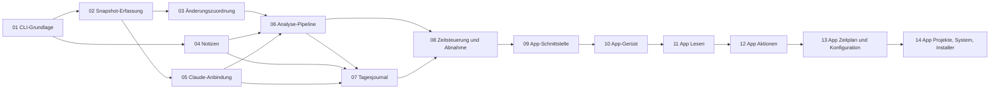

# Umsetzungsplanung IPA Assistant V1

Dieser Ordner enthält die verbindliche Umsetzungsplanung für Version 1 des IPA Assistant. Grundlage ist `IPA_ASSISTANT_KONZEPT.md` (Konzeptversion 1.1) im Repository-Root. Das Konzept bleibt als Referenz unverändert. Wo es von der Planung abweicht, gilt die Planung.

Ab Paket 10 enthält die Planung zusätzlich die Desktop-App (Electron mit TypeScript und React, im selben Repository unter `app/`). Ihre Spezifikation steht in [../app/spec.md](../app/spec.md); die Pakete 10 bis 14 sind nicht Teil der Abnahme von Version 1 des CLI. Paket 10 (App-Gerüst) und Paket 11 (App Lesen) sind technisch abgeschlossen, Aufbau und Befehle der App stehen in [../../app/README.md](../../app/README.md).

## Dateien

| Datei | Inhalt |
| --- | --- |
| [spec.md](spec.md) | Gemeinsame technische Spezifikation: Umfang, Architektur, CLI, Konfiguration, Datenmodelle, Schnittstellen, Lebenszyklen, Claude-Aufruf, Filter, Regeln, Tests, Klärungsprotokoll |
| [../app/spec.md](../app/spec.md) | Spezifikation der Desktop-App (Electron, React): Architektur, Vertrag mit dem CLI, Repository-Struktur, Seiten und Komponenten, Fehlerregeln, Tokens, Markdown, Sicherheit, Akzeptanzkriterien `AK-10-01` bis `AK-10-81`, offene Punkte. Grundlage der Pakete 10 bis 14. |
| [../app/design-brief.md](../app/design-brief.md) | Design-Brief der App (Hintergrund der App-Spezifikation) |
| [checklist.md](checklist.md) | Übergreifender Fortschritt, Paketstatus und Abnahmematrix zu Konzept §17 |
| `packages/NN-name/spec.md` | Paketspezifikation: Ziel, Umfang, Verhalten, Randfälle, Akzeptanzkriterien `AK-NN-xx`, Tests |
| `packages/NN-name/checklist.md` | Ausführbare Paketcheckliste |
| `packages/NN-name/prompt.md` | Vollständiger Umsetzungsprompt für eine neue Claude-Code-Sitzung |

Gemeinsame Verträge des CLI stehen nur in `spec.md`, die der App nur in `../app/spec.md`. Die Pakete verweisen darauf (`spec.md §…`, `app/spec.md §…`) und führen keine abweichenden Kopien. Die Pakete 10 bis 14 haben eine kurze `spec.md`, die nur auf Abschnitte der App-Spezifikation verweist; einen vollständigen Umsetzungsprompt gibt es bisher nur für Paket 10 (die Prompts der Pakete 11 bis 14 entstehen nach Abschluss des jeweils vorigen Pakets).

## Paketübersicht

| Nr. | Paket | Ziel | Hängt ab von | Wichtigster Prüfnachweis |
| --- | --- | --- | --- | --- |
| 01 | [CLI-Grundlage](packages/01-cli-grundlage/spec.md) | Baubares Projekt; `ipa init` und `ipa status`; eigener Arbeitsbereich pro Repository, standardmässig ausserhalb, wahlweise `--workspace`; Core-Bausteine und Git-Leseliste; Claude-Vorabprüfung mit künstlichen Daten | – | Getrennte Arbeitsbereiche mit unverändertem Repository (AK-01-03, AK-01-07, AK-01-15); Vorabprüfung live dokumentiert (AK-01-18) |
| 02 | [Snapshot-Erfassung](packages/02-snapshot-erfassung/spec.md) | Gefilterte, konsistente und atomare Snapshots von Commits, Index, Working Tree und neuen Dateien; Ausgangs-Snapshot bei `init`; `capture` ohne KI | 01 | Künstliches Secret, auch in einer entfernten Diff-Zeile, erscheint nirgends in der Datenwurzel (AK-02-05, AK-02-06) |
| 03 | [Änderungszuordnung](packages/03-aenderungszuordnung/spec.md) | `state_delta`, Statusänderungen statt Doppelerfassung, kein Snapshot ohne Änderung, Halt und `ipa baseline`, Testberichte | 01, 02 | Ein unverändert committeter Stand wird nur als Statusänderung geführt (AK-03-03) |
| 04 | [Notizen](packages/04-notizen/spec.md) | `ipa note` mit Typen, gemessenen oder geschätzten Zeiten und Verzögerungen, ohne Lock und ohne Snapshot-Voraussetzung | 01 | Zeit ohne Angabe von gemessen oder geschätzt wird abgelehnt, die Verzögerung wird separat gespeichert (AK-04-03, AK-04-04) |
| 05 | [Claude-Anbindung](packages/05-claude-anbindung/spec.md) | `ClaudeRunner` ohne Werkzeuge und ohne Shell, Fehlerklassen, `ai-usage.jsonl`, `ipa doctor [--live]` | 01, 02 | Exakte Argumentliste über Fake-CLI; live meldet Claude keine Werkzeuge und keine MCP-Server (AK-05-01, AK-05-09) |
| 06 | [Analyse-Pipeline](packages/06-analyse-pipeline/spec.md) | Eingabepaket, Validierung mit Belegregeln, Work-Logs, Warteschlange, Cursor, Wiederanlauf, `ipa skip`; Referenzprüfung und Secret-Warnung für `ipa note` | 02, 03, 04, 05 | Nach einem Abbruch nach der Abschlussmarkierung wird der Cursor ohne neuen Aufruf und ohne Doppel-Log nachgeführt (AK-06-06) |
| 07 | [Tagesjournal](packages/07-tagesjournal/spec.md) | `ipa journal [--day] [--no-ai]` mit belegten Entwürfen, deterministischer Zeitübersicht und offenen Punkten | 04, 05, 06 | Frühere Entwürfe und die persönliche Endfassung bleiben byte-gleich (AK-07-03) |
| 08 | [Zeitsteuerung und Abnahme](packages/08-zeitsteuerung-und-abnahme/spec.md) | `capture --scheduled`, Laufzeitgrenze, Vorlage für die Windows-Aufgabenplanung, V1-Abnahmeprotokoll mit echtem Claude | 06, 07 | Alle Fälle aus Konzept §17 sind live geprüft und protokolliert (AK-08-08) |
| 09 | [App-Schnittstelle](packages/09-app-schnittstelle/spec.md) | Vorarbeit für eine Desktop-App: `--json` der Aktionsbefehle, `ipa config`, Zeitplan-Verwaltung für die Windows-Aufgabenplanung (`ipa schedule install|status|pause|resume|remove|run`) | 08 | Kein Test berührt die echte Aufgabenplanung (AK-09-16); `claude.allowPaidUsage` nur mit `--confirm-paid-usage` (AK-09-10) |
| 10 | [App-Gerüst](packages/10-app-geruest/spec.md) | Electron-App in `app/` (eigenes Paket, keine Workspaces): sichere Fenster, Laufzeit des CLI mit mitgelieferter `node.exe`, CLI-Runner mit Sperren und Abbruch, Projektliste, Layout, Tokens in Hell und Dunkel, Basiskomponenten, Zustandsgalerie | 09 | CLI im Wurzelordner unberührt (AK-10-01); nichts startet Claude von selbst (AK-10-15) |
| 11 | [App Lesen](packages/11-app-lesen/spec.md) | Tagesansicht, Work-Logs, Notizenliste, Journal lesen, Projektübersicht mit Halt-Banner, Markdown mit Referenz-Chips und KI-Etiketten, Live-Aktualisierung | 10 | Analyse-Status der App gleich `ipa status --json` (AK-10-18); Markdown führt nichts aus (AK-10-28) |
| 12 | [App Aktionen](packages/12-app-aktionen/spec.md) | Laufanzeige, Jetzt erfassen, Journal erzeugen, Erneut versuchen, Überspringen, Ausgangspunkt, Prüfen, Notiz-Dialog, Sperren, Abbruch | 11 | Abbruch beendet den Prozessbaum, der nächste Lauf setzt ohne Doppel fort (AK-10-08, AK-10-51); Gründe mit Secret werden nie angezeigt (AK-10-44) |
| 13 | [App Zeitplan und Konfiguration](packages/13-app-zeitplan-konfiguration/spec.md) | Seite Zeitplan mit Vorschau und Verwaltung der Windows-Aufgabe, Seite Konfiguration mit allen Gruppen, Kostenschutz, Pfad testen | 12 | Vorschau aus `config set --dry-run`, nichts wird selbst gerechnet (AK-10-54); `allowPaidUsage` nur nach zweistufiger Bestätigung (AK-10-60) |
| 14 | [App Projekte, System, Installer](packages/14-app-projekte-system-installer/spec.md) | Assistent Projekt hinzufügen, Seite System mit Live-Test, NSIS-Installer mit CLI und `node.exe`, Ende-zu-Ende-Abnahme | 13 | `npm test` des CLI grün mit der mitgelieferten `node.exe` (AK-10-76); Installer auf sauberem Windows 11 (AK-10-80, manuell) |

## Abhängigkeiten

Der Graph ist zyklenfrei. Transitive Abhängigkeiten sind in der Tabelle nicht wiederholt. Paket 06 setzt zum Beispiel über Paket 02 auch Paket 01 voraus.

## Empfohlene Reihenfolge

1. **01 CLI-Grundlage**, einschliesslich der Claude-Vorabprüfung. Ihr Ergebnis zeigt früh, ob ein Claude-Update nötig ist.
2. **02 Snapshot-Erfassung**: Danach funktioniert der manuelle technische Prototyp aus Konzept Etappe 1.
3. **03 Änderungszuordnung**
4. **04 Notizen**: Setzt nur 01 voraus. Kann direkt nach 01 umgesetzt werden, damit Notizen früh nutzbar sind.
5. **05 Claude-Anbindung**: Kann auch vor 03 oder 04 umgesetzt werden. Sie überführt die Vorabprüfung aus 01 in `ipa doctor --live`. Die Live-Prüfung AK-05-09 sollte vor Paket 06 erfolgen.
6. **06 Analyse-Pipeline**: Danach funktioniert der vollständige manuelle Ablauf aus Konzept Etappe 2 und 3.
7. **07 Tagesjournal**: entspricht Konzept Etappe 4
8. **08 Zeitsteuerung und Abnahme**: entspricht Konzept Etappe 5, ohne die Messungen während der Probe-IPA
9. **09 App-Schnittstelle**: gehört nicht zur Abnahme von Version 1 (Konzept §17), sondern bereitet die Desktop-App vor.
10. **10 App-Gerüst**: Beginn der Desktop-App (Spezifikation: [../app/spec.md](../app/spec.md)). Die Pakete 10 bis 14 gehören ebenfalls nicht zur Abnahme von Version 1 des CLI.
11. **11 App Lesen**: Lesen vor Schreiben; jede Aktion braucht eine Ansicht, die ihr Ergebnis zeigt.
12. **12 App Aktionen**
13. **13 App Zeitplan und Konfiguration**: nach den Aktionen, weil Zeitplan und Konfiguration Laufanzeige, Sperren und Bestätigungsdialoge wiederverwenden. Die manuelle Prüfung der echten Aufgabenplanung (AK-09-17, AK-08-07) sollte vor der Abnahme dieses Pakets erfolgt sein.
14. **14 App Projekte, System, Installer**: bis dahin richtet man Projekte in der Konsole mit `ipa init` ein, die App liest sie aus der Registry. Der Installer steht zuletzt, damit er die fertige App ausliefert.

Nach jedem Paket liegt ein lauffähiger, getesteter Zwischenstand vor.

## Arbeit mit den Prompts

1. Eine neue Claude-Code-Sitzung im Repository-Root öffnen. (Für die Pakete 11 bis 14 gilt, bis ihre Prompts vorliegen: den Prompt von Paket 10 als Vorlage nehmen und `packages/NN-name/spec.md` und `checklist.md` des jeweiligen Pakets einsetzen.)
2. Den Inhalt von `packages/NN-name/prompt.md` als erste Nachricht einfügen.
3. Die Sitzung setzt nur dieses Paket um, aktualisiert Paketcheckliste und zentrale `checklist.md`, fasst zusammen und hält an.
4. Echte Claude-Aufrufe für Live-Prüfungen erfolgen nur nach ausdrücklicher Freigabe in der jeweiligen Sitzung.
5. Klärungen und Abweichungen stehen danach in `spec.md` §18.

Der erste Prompt ist [packages/01-cli-grundlage/prompt.md](packages/01-cli-grundlage/prompt.md).

## Offene Entscheidungen

Die offenen Entscheidungen O-01 bis O-08 stehen in `spec.md` §3.4. Keine davon blockiert den Start. Bis zur Klärung gelten die dort genannten Standardwerte.

Die offenen Punkte der App (Signierung des Installers, Installergrösse, Wartung der Versionen, App-Name und Icon, Prüfung von `electron-builder`, Claude-Prüfung ohne Projekt, Aufgabe nach Deinstallation, die ausstehende manuelle Prüfung der Aufgabenplanung AK-09-17 und weitere) stehen gesammelt in `../app/spec.md` §18 (AO-01 bis AO-18). Keiner blockiert den Start von Paket 10.
